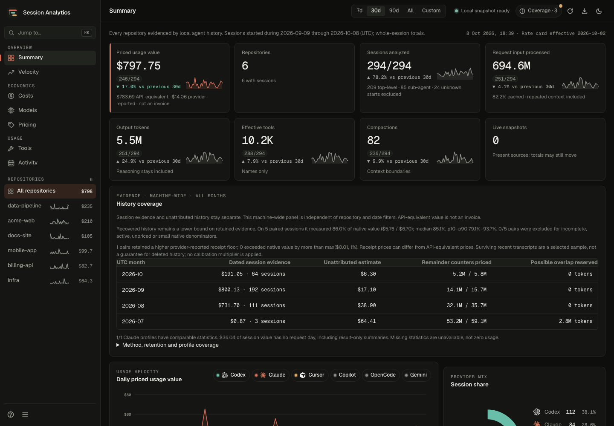
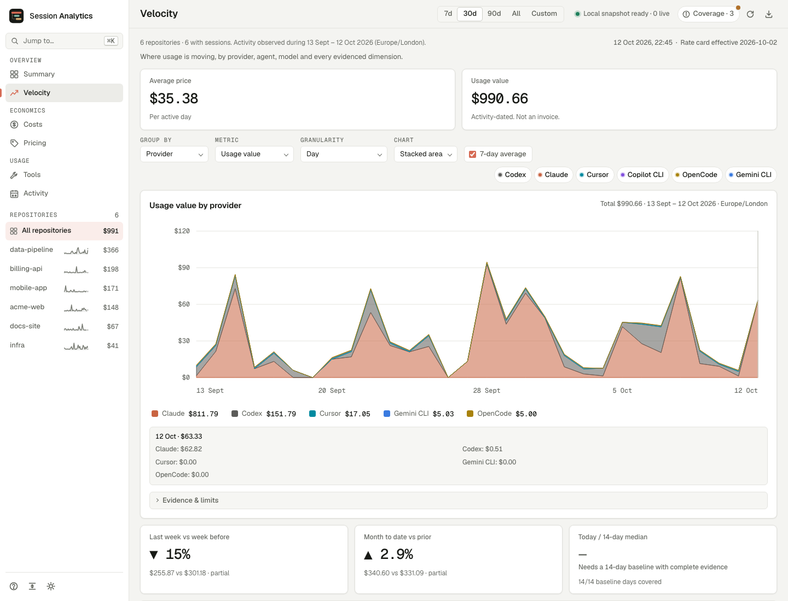
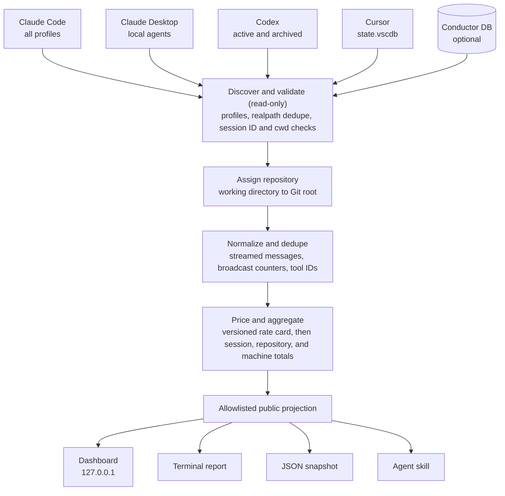

<div align="center">

<picture>
  <source media="(prefers-color-scheme: dark)" srcset="assets/logo-wordmark-dark.svg" />
  
</picture>

<h3>Content-free analytics for the coding-agent sessions already on your machine.</h3>

<p>Claude Code, Codex, and Cursor usage: tokens, API-equivalent cost, tools, and skills, grouped by Git repository.<br />
Local only. Read-only analytics. No prompts, messages, or file paths in analytics outputs.</p>

[](https://github.com/rokas-tarasevicius/session-analytics/actions/workflows/ci.yml)
[](LICENSE)
[](https://nodejs.org/)
[](package.json)
[](docs/privacy.md)
[](#roadmap)

</div>

<p align="center">
  
  <br />
  <sub>Every screenshot in this repository is rendered from the synthetic demo dataset (<code>npm run demo</code>), never from real history.</sub>
</p>

## Contents

- [Why](#why)
- [Features](#features)
- [Quick start](#quick-start)
- [Usage](#usage)
- [Supported agents and evidence](#supported-agents-and-evidence)
- [Privacy model](#privacy-model)
- [How it works](#how-it-works)
- [Accounting notes](#accounting-notes)
- [Use it from an agent](#use-it-from-an-agent)
- [Roadmap](#roadmap)
- [How it compares](#how-it-compares)
- [FAQ](#faq)
- [Contributing](#contributing) · [Security](#security) · [License](#license)

## Why

Claude Code, Codex, and Cursor already keep detailed session history on your disk. That history can tell you which repositories your agent work goes into, which models and tools it uses, and what it would cost at API list prices. It also contains every prompt, file path, command, and tool result you have produced, so most people do not want to hand it to an analytics tool.

`session-analytics` is built around three commitments:

1. **Content-free by contract.** The parser reads transcripts locally and returns only allowlisted counters, names, model IDs, timestamps, and hashed keys. The contract is written down in [docs/privacy.md](docs/privacy.md), every public field is listed there, and tests plant sentinel strings in fixtures and fail if any of them reaches an output.
2. **Accounting you can reproduce.** Costs come from immutable snapshots of public pricing feeds, with reviewed exceptions and the versioned repository rate card as an offline fallback. Every priced model carries its source, snapshot date, and payload hash. Streamed and broadcast token records are deduplicated, unknown models stay visibly unpriced, and each figure says whether it is exact, estimated, or unavailable for that provider.

1. **Content-free by contract.** The parser reads transcripts locally and returns only allowlisted counters, names, validated model IDs, timestamps, and hashed keys. Malformed model metadata becomes `<unknown>`. The contract is written down in [docs/privacy.md](docs/privacy.md), every public field is listed there, and tests plant sentinel strings in fixtures and fail if any of them reaches an output.
2. **Accounting you can reproduce.** Costs come from a versioned rate card in this repository with a source URL for every model. Streamed and broadcast token records are deduplicated, unknown models stay visibly unpriced, and each figure says whether it is exact, estimated, or unavailable for that provider.
3. **Repository first, across agents.** Every session is assigned to a Git repository from its recorded working directory, so Claude Code, Codex, and Cursor work on the same codebase lands in one row. Linked worktrees and clones with the same complete Git remote fold into one logical repository, and the [Conductor](https://conductor.build) app's workspace database is used as optional enrichment when present.

## Features

- **Cross-provider evidence.** Claude Code, Codex, Cursor, Copilot CLI, OpenCode and Gemini, with Conductor recovery when canonical history is missing. Summary and activity-only evidence carry explicit coverage and N/A values.
- **Seven dashboard views.** Overview: Summary, Velocity. Economics: Costs, Models, Pricing. Usage: Tools, Activity. Every view has a sidebar entry, command-palette action, `g` shortcut and `?view=` URL hook.
- **Control Room.** Shared cards and tables, repository focus, scoped provider chips, keyboard navigation, light/dark themes and compact/comfortable density. Summary provider chips affect its daily chart; Activity and Tools keep independent provider selections.
- **Measured usage.** API-equivalent value with dated price provenance, token-class coverage, velocity, quota freshness, cache/context evidence and optional plan comparisons. Value is not an invoice; unknown evidence is never presented as zero.
- **Reliability and workflow in reports and JSON.** Tool outcomes and latency, verification, permissions, active/wait timing, concurrency, steering, slash-command names and installed skills. Optional P2 content rules are off by default.
- **Outcomes and insights.** Recorded edits, commits and PR links with confidence and denominator guards; ten grouped rules available through the insights CLI. Git/GitHub enrichment is opt-in. P3 review requires `review --send-content` on each run.
- **Private index.** Complete derived session facts survive provider cleanup. Unchanged Claude/Codex sessions replay from a private index; `--no-index` reads present sources directly.
- **Every surface.** Localhost dashboard, terminal/JSON reports, versioned exports and aggregate-only sharing, seven metrics-only MCP tools, and an [agent skill](skills/session-analytics/SKILL.md).
- **Small trust surface.** Node 24 built-ins, zero runtime dependencies, no telemetry and read-only provider access. Analysis reads cached prices; the dashboard can refresh fixed public price feeds (`--offline` disables pricing requests). GitHub enrichment, OTLP delivery and P3 review each require their own explicit option.

<p align="center">
  
</p>

## Quick start

Requirements: **Node.js 24 or newer** and **macOS** (Claude Code and Codex history also works on Linux; see [platform support](#faq)).

```bash
git clone git@github.com:rokas-tarasevicius/session-analytics.git
cd session-analytics
npm install   # development tooling only; the runtime has no dependencies
npm link      # puts the session-analytics command on your PATH
session-analytics
```

The command scans local history, starts the dashboard on `http://127.0.0.1:4174`, and opens it in your browser. Running it again reuses a live dashboard already serving on that port; saved-file dashboards are kept separate.

To try it without touching your own history, run the demo. It generates about 60 days of synthetic sessions for six fictional repositories in a temporary directory, points every source option at that directory, and deletes it on exit:

```bash
npm run demo                      # dashboard on http://127.0.0.1:4175
npm run demo -- report            # terminal report of the same data
```

The npm package is not published yet. Without `npm link`, run `node bin/session-analytics.ts` from the checkout.

## Usage

### Dashboard

```bash
session-analytics                 # scan, serve on 127.0.0.1:4174, open the browser
session-analytics --no-open       # serve without opening a browser
session-analytics --port 4180     # use another loopback port
```

The server binds to `127.0.0.1` only and answers read-only `GET` requests. **Refresh snapshot** in the dashboard re-scans without restarting. Stop it with `Ctrl+C`. The dashboard starts with the last 30 days of observed history; `?window=7`, `?window=30`, `?window=90`, or `?window=all` overrides this for the visit. The window is not saved in browser storage.

Velocity follows **activity dates**, even when the session began before the selected window. Other totals select sessions by start date. The analysis timezone is shown in the view; set `TZ` before launching to choose a different one. Cursor value and other activity without timestamps stay undated. Projection bands are workload scenarios, not confidence intervals or invoices. See the [velocity definitions](docs/metrics.md#velocity-snapshot-version-1) for denominators and attribution rules.

Missing or timezone-free session starts are counted as undated and excluded from dated totals. Velocity comparisons show current/prior evidence beside each percentage; gaps in pricing or token detail make changes, burn and projections unavailable. Agent colors and patterns stay attached to the same identity as filters change.

### Terminal report

```bash
session-analytics report
```

Prints repository totals, priced usage value split into API-equivalent and provider-reported parts, token and cache totals, workflow and concurrency measures, the 15 highest-value sessions by hashed key, and coverage warnings.

The reliability section shows structured outcomes by default. To also classify shell commands and failed-result text locally and detect repeat/churn episodes, run `session-analytics report --reliability-content-rules` (the same option includes these counters in dashboard snapshots and exports). These P2 rules are off by default, send nothing to a model, and output only counters and class labels. Their matching key lives in `SESSION_ANALYTICS_DATA_DIR` (or `--data-dir`); path and argument hashes never appear in a snapshot. See the [reliability metric definitions](docs/metrics.md#reliability-m1) for coverage and thresholds. `npm run demo` enables these rules on synthetic data only.

### JSON snapshot

```bash
session-analytics report --json > snapshot.json
jq '.repositories[] | {name: .repository.name, usd: .summary.estimatedSpendUsd}' snapshot.json
```

The snapshot has the same shape as the dashboard's `/api/analytics` response and carries `schemaVersion: 1`, validated by the [published JSON Schema](schemas/snapshot.v1.schema.json). Every field is described in the [field manifest](docs/privacy.md#field-manifest).

### Exports and team sharing

```bash
session-analytics export --format csv --out ./exports
session-analytics export --format ndjson --out ./ndjson
session-analytics export --format otlp-json --out ./otlp
session-analytics report --share > shared.json  # exact local preview; sends nothing
session-analytics merge alice-shared.json bob-shared.json --out team.json
session-analytics --snapshot team.json --no-open
```

CSV exports sessions, daily value, models, and tools. **Export view** in the dashboard downloads the filtered JSON or CSV locally. `report --share` removes session details, uses keyed repository pseudonyms or explicit aliases, and suppresses repository buckets with fewer than five distinct sessions by default. This threshold counts sessions, not people, and does not guarantee anonymity. Merge rejects repeated contributing sources. A full or shared snapshot can be opened without scanning provider history. Imports enforce hashed identifiers, fixed warnings/status labels, and reconciled accounting. Filtered downloads preserve discovery caveats and use UTC session-start dates. Shared totals may include running and partially parsed sessions; pricing coverage does not establish evidence completeness.

See [schemas, exports, and sharing](docs/interop.md) for field definitions, aliases, threshold controls, the pinned OpenTelemetry mapping, and optional `--otlp-endpoint` delivery. Export files never overwrite existing files; network delivery happens only with that explicit flag.

### Pricing sources and history

```bash
session-analytics rates update               # fetch and archive public price lists
session-analytics rates show gpt-5.4 --json   # inspect rates and provenance
session-analytics rates diff                 # changes between the last two source snapshots
session-analytics rates status --offline     # age, sources, and local model coverage
session-analytics --offline                  # dashboard using only local cached/reviewed prices
```

Analysis never waits for the network. The dashboard uses the local cache immediately and refreshes stale sources in the background after its first scan; **Refresh snapshot** applies the new evidence. A report only prints an update hint on stderr (including with `--json`). The default stale threshold is seven days. `--offline` or `SESSION_ANALYTICS_OFFLINE=1` prevents public requests in every command.

Each request uses the latest available source snapshot at or before its timestamp. Requests older than the cache use the oldest available snapshot and carry an explicit label; this is an estimate, not reconstructed historical pricing. Every observation is retained, so a later price observation does not overwrite earlier evidence; unchanged rate tables share storage and indexed history keeps request lookup bounded. The dashboard's **Pricing** tab shows freshness, coverage, and the provenance used by selected sessions. [Pricing reference](docs/pricing.md) explains precedence, aliases, cache storage, and limitations.

### Insights and optional content review

```bash
session-analytics insights
session-analytics insights --json --from 2026-09-01 --through 2026-09-30
session-analytics insights --rule session-outlier --all-scopes
session-analytics insights --insights-config ./insights.json
session-analytics review --session <hashed-session-key> --via claude  # metadata-only dry-run
session-analytics review --session <hashed-session-key> --via codex --send-content
```

Insights cover peer outliers, cache reuse, model-price scenarios, compaction, delegation, large request contexts, installed skills/MCP servers without observed use, writes after idle gaps, and neutral start-time patterns. Missing evidence and insufficient activity are visible in rule coverage, never presented as 0%. [Thresholds and formulas](docs/insights.md) are documented and configurable with `--insights-config` or `SESSION_ANALYTICS_INSIGHTS_CONFIG`.

`insights` prints ranked rule groups and their leading scopes; `--all-scopes` includes every finding. `insights --json` uses schema version 2 (`groups` plus `items`). Pricing defaults to a configurable same-provider **next-tier-down** mapping; each model moves once, with unmapped usage unchanged. Known partial/active sessions are excluded; unknown liveness is disclosed, and completed-peer comparisons require observed inactivity. Context-premium price scenarios require complete request-size coverage. Date filters select UTC instants, including timestamps written with offsets.

**Content review is P3, opt-in and off by default.** The dry-run prints only rule IDs, sizes and redaction counts. `--send-content` permits bounded, redacted human/assistant excerpts to be sent through your own `claude -p` or `codex exec`; it has no environment-variable equivalent. Redaction is best effort, and remaining prose may still be sensitive. Your agent provider's retention and billing apply. Tools, reasoning and tool-result blocks are excluded; no content is sent from the dashboard. See [review behavior and limits](docs/insights.md#opt-in-review-p3).

Try synthetic insights with `npm run demo -- insights`.

### Local index

The first launch builds the index; later launches and dashboard refreshes fingerprint evidence and reuse unchanged session facts. Claude main and subagent files form one invalidation group. Codex ownership is recomputed from cached counter evidence so a changed rollout can invalidate another session without re-parsing unrelated files. Cursor's mutable databases and repository assignments are refreshed on every scan.

Each warm scan checks a rotating sample of up to four cached native sessions and one Codex ledger against fresh parsing. A consistency failure rolls back the ingest and runs a full scan with a visible warning; that fallback includes present sources only. Key/MAC corruption still fails closed. `--no-index` remains available on both dashboard and report commands.

```bash
session-analytics index status             # counts, schema, and last-ingest statistics
session-analytics index status --json
session-analytics index path               # local management path, never in analytics output
session-analytics index prune --before 2026-01-01
session-analytics index rebuild            # discard old facts, then rescan configured sources
session-analytics report --no-index        # bypass the index, including retained history
```

The default data directory is `~/Library/Application Support/session-analytics/` on macOS and `$XDG_DATA_HOME/session-analytics/` (or `~/.local/share/session-analytics/`) on Linux. Override it with `--data-dir PATH` or `SESSION_ANALYTICS_DATA_DIR`. The directory is mode `0700`; the database, SQLite sidecars, and per-machine key are `0600`. The index stores derived facts and keyed fingerprints, never transcript text or raw paths/IDs. See [on-disk privacy](docs/privacy.md#local-index).

Previously indexed sessions survive provider cleanup and carry `transcript.sourceDeleted: true`; their facts and prices remain those of their last successful ingest. Prune removes sessions whose last observed event is **strictly before UTC midnight** on the given date and keeps a retention floor for future indexed scans. It does not delete provider files. Rebuild resets that floor and discards retained history that no longer has source evidence. An unreadable index fails with a fixed error; rebuild recovers it, while `--no-index` bypasses it. A corrupt database is quarantined privately during recovery; quarantine files are not part of the active index.

Pruned sources keep only keyed exclusion checkpoints, so unchanged files skip session parsing; new activity can re-enter. Event extrema are compared as UTC instants. Legacy dates that cannot be verified are kept until their sources can be read again. Key mismatches fail an integrity check before selecting history, and rebuild also repairs damaged writer coordination. The dashboard shows filtered retention counts and frozen-pricing notes and excludes historical working observations from live snapshots. Direct machine and repository analyzer calls share the same visibility default.

Developers can run `node scripts/parity.ts --machine` to compare full, cold-index and warm-index accounting. It uses the 256 MB analysis worker, offline pricing, a fresh private index under `.lane/`, and the shared real-scan lock. Output contains month/provider totals and differences by hashed session key, never repository names or transcript content. Live source changes are reported separately and do not suppress the unfiltered diff or a failing exit status. Use `--demo-root PATH` with a retained synthetic demo for repeatable local checks.

Release verification uses `node scripts/verify-real.ts`: independent provider, repository, pricing and time oracles, with recorded source generations and explicit live-session exclusions. See the [verification guide](verify/README.md) for evidence files and saved-artifact rechecks.

### Options

| Option | Applies to | Description |
| --- | --- | --- |
| `--no-open` | dashboard | Start the server without opening a browser. |
| `--port PORT` | dashboard | Loopback port, 1024 to 65535. Default `4174`, or `CONDUCTOR_PORT + 4` inside a Conductor workspace. |
| `--json` | report | Print the versioned content-free snapshot as JSON. |
| `--share` | report | Preview aggregate-only JSON with pseudonymized repositories and a minimum of five sessions per bucket. |
| `--snapshot FILE` | dashboard, report, export | Read a validated snapshot file instead of scanning provider stores. |
| `--repo-name NAME` | both | Narrow to one uniquely named repository. |
| `--repo-root PATH` | both | Narrow to the repository whose canonical root is `PATH`. |
| `--repo-remote URL` | both | Narrow by Git remote. Remotes are known only for repositories registered in Conductor. |
| `--repo-id ID` | both | Narrow to one repository ID from a previous snapshot. |
| `--exclude-hidden` | both | Leave out repositories and sessions hidden in Conductor. Hidden records are included by default. |
| `--claude-root PATH` | both | Read only this Claude Code `projects` directory instead of discovering profiles. |
| `--codex-root PATH` | both | Read this Codex `sessions` directory instead of discovering profiles. |
| `--codex-archive-root PATH` | both | Read this Codex `archived_sessions` directory. Passing either Codex option replaces Codex discovery, so pass both to include archives. |
| `--cursor-database PATH` | both | Cursor `state.vscdb` to read. |
| `--cursor-sdk-root PATH` | both | Conductor's Cursor SDK store directory. |
| `--cursor-transcript-root PATH` | both | Cursor's `projects` directory containing `agent-transcripts`. |
| `--copilot-root PATH` | both | Copilot CLI's `session-state` directory. |
| `--opencode-database PATH` | both | OpenCode's `opencode.db`. |
| `--gemini-root PATH` | both | Gemini CLI's `tmp` directory containing project `chats` directories. |
| `--no-additional-providers` | both | Disable discovery of those five additional stores; explicit new-store paths still apply. Conductor result fallback follows `--database`. |
| `--database PATH` | both | Conductor database to use for optional enrichment. |
| `--rate-card PATH` | all | Pin an alternative reviewed rate card; bypass cached API prices and automatic pricing refresh. |
| `--offline` | all | Disable public pricing requests; retain access to cached prices. |
| `--data-dir PATH` | all analysis commands | Private index, pricing cache, settings and optional reliability key directory. |
| `--pricing-policy MODE` | all | `reviewed-first` (default), `api-first`, or `reviewed-only`. |
| `--pricing-sources LIST` | all | Ordered public sources; default `models.dev,litellm`. |
| `--pricing-max-age-days DAYS` | all | Stale threshold, default `7`; `0` checks on every dashboard startup. |
| `--rate-card PATH` | both | Alternative rate card with the same schema as `data/rate-cards.json`. |
| `--reliability-content-rules` | both | Opt into local P2 command/error rules and HMAC-based behavior detectors. Also `SESSION_ANALYTICS_RELIABILITY_CONTENT_RULES=1`. |
| `--no-reliability-content-rules` | both | Disable those rules even when enabled by the environment. |
| `--outcomes-git` | both | Opt in to bounded read-only local Git correlation on evidenced branches during session windows. No fetching. |
| `--outcomes-github` | both | Opt in to authenticated `gh` queries for state and time to merge of GitHub PRs already evidenced locally. Sends those PR coordinates to GitHub. |
| `--no-outcomes-git`, `--no-outcomes-github` | both | Disable the corresponding enrichment, including when enabled by environment. |
| `--workflow-content-rules` | both | Opt into the local P2 rule that counts exact Claude interruption markers. Only counts leave the parser. Default off; `SESSION_ANALYTICS_WORKFLOW_CONTENT_RULES=1` also enables it. |
| `--no-workflow-content-rules` | both | Disable the rule, including an environment opt-in. |
| `--insights-config PATH` | insights, review | Thresholds, disabled rules, next-tier mappings, explicit targets and optional extension inventory; see [configuration](docs/insights.md#configuration). |
| `--no-index` | both | Read present provider evidence without accessing the index; also `SESSION_ANALYTICS_NO_INDEX=1`. |
| `--version`, `--help` | all | Print the version or command help. |

Both commands also read `SESSION_ANALYTICS_*` environment variables for the same settings (for example `SESSION_ANALYTICS_PORT` or `SESSION_ANALYTICS_CLAUDE_ROOT`); a command-line option wins over the environment. Profile discovery honors `CLAUDE_CONFIG_DIR` and `CODEX_HOME`.

New-store variables are `SESSION_ANALYTICS_CURSOR_SDK_ROOT`, `SESSION_ANALYTICS_CURSOR_TRANSCRIPT_ROOT`, `SESSION_ANALYTICS_COPILOT_ROOT`, `SESSION_ANALYTICS_OPENCODE_DATABASE`, and `SESSION_ANALYTICS_GEMINI_ROOT`. Set `SESSION_ANALYTICS_ADDITIONAL_PROVIDERS=0` to disable their default discovery. OpenCode also honors `XDG_DATA_HOME`. Each source override replaces only that source's default; isolated scans should supply all desired paths and disable additional discovery. The demo does this automatically.

Outcome enrichment is off by default. Set `SESSION_ANALYTICS_OUTCOMES_GIT=1` or `SESSION_ANALYTICS_OUTCOMES_GITHUB=1` to opt in through configuration; other environment values do not enable it. Missing tools, authentication, branches, or deleted history are shown as unavailable. The [outcome metric definitions](docs/metrics.md#outcomes) explain confidence, coverage, deduplication, attribution, and scan limits. The snapshot always uses pseudonymous references, including when enrichment is enabled.

The report shows enrichment status counts, evidence limits, and complete/partial/unavailable line coverage. Ambiguous or reset line counters stay partial and are excluded from line-value ratios; incomplete PR associations withhold PR-value ratios.

Workflow estimates join work events at most five minutes apart; a terminal marker followed by a human supplies at most 30 minutes of estimated human waiting. Permission waiting is unavailable. Concurrency counts overlapping active session spans, with summed activity divided by its wall-clock union for effective parallelism. Claude child transcripts remain inside their parent for accounting but are excluded from the parent's interaction clock; Codex child threads have their own clocks. Cursor workflow timing is unavailable. See [workflow definitions and thresholds](docs/metrics.md#workflow-human-and-agent-interaction) before interpreting the comparisons or heuristics.

Incomplete primary transcripts are labeled partial and retain observed counters and independent provider durations; boundary estimates and abandonment claims are suppressed. Slash-command names require built-in or discovered command/skill registry evidence.

## Supported agents and evidence

| Source | Default location | Format |
| --- | --- | --- |
| Claude Code | `~/.claude/projects`, every `~/.claude-*/projects`, `$CLAUDE_CONFIG_DIR/projects`, `~/.config/claude/projects` | JSONL per session, plus `subagents/` transcripts |
| Claude Desktop local agents | `~/Library/Application Support/Claude/local-agent-mode-sessions` | Claude session files |
| Codex | `~/.codex/sessions` and `archived_sessions`, every `~/.codex-*` profile, `$CODEX_HOME` | JSONL rollouts |
| Cursor | `~/Library/Application Support/Cursor/User/globalStorage/state.vscdb` and its `workspaceStorage` | SQLite, opened read-only |
| Conductor (optional) | `~/Library/Application Support/com.conductor.app/conductor.db` | SQLite, opened read-only |
| Cursor SDK through Conductor | `~/Library/Application Support/com.conductor.app/cursor-sdk-store` | NDJSON agents, runs, and tool events |
| Cursor agent transcripts | `~/.cursor/projects/*/agent-transcripts` | JSONL; activity only, file-modification time |
| GitHub Copilot CLI | `~/.copilot/session-state/*/events.jsonl` | Persisted activity events; tokens unavailable |
| OpenCode | `$XDG_DATA_HOME/opencode/opencode.db`, or `~/.local/share/opencode/opencode.db` | SQLite session/message/part tables |
| Gemini CLI | `~/.gemini/tmp/*/chats/session-*.json{,l}` | Saved chats, with project registry/ownership-marker mapping |

What the original native stores support (additional sources have their own fidelity labels below):

| Measure | Claude Code | Codex | Cursor |
| --- | --- | --- | --- |
| Input and cache-read tokens | Exact | Exact, per request | Input only, per session |
| Cache-write tokens | Exact, split by 5-minute and 1-hour TTL when recorded | Not recorded; covered by an upper estimate | Not recorded |
| Output tokens | Exact (final streamed snapshot of each message) | Exact | Exact, per session |
| Reasoning tokens | Exact when `thinking_tokens` is recorded; otherwise inside output | Exact | Unavailable |
| Cost | API list-price equivalent | API list-price equivalent and upper estimate | Cursor's provider-reported local value, kept separate and not plotted by day |
| Tool calls by name | Exact | Exact; code-mode calls expanded to the inner tool | From tool-call records |
| Skill invocations | Explicit (`Skill` tool) | Inferred lower bound (`SKILL.md` reads) | Unavailable |
| Turns and messages | Human turns, assistant messages | User turns, agent messages | User and assistant bubbles |
| Compactions | Yes | Yes | Unavailable |
| Sub-agents | `subagents/` transcripts, cost split | Spawned threads, cost split | Sub-agent composers |
| Reasoning effort | Recorded `effort` | `turn_context` effort | Unavailable |

Per-source details, matching rules, and known gaps are in [docs/providers.md](docs/providers.md). Metric definitions are in [docs/metrics.md](docs/metrics.md).

Cursor SDK runs are priced only for exact model IDs in the reviewed rate card. Conductor result summaries retain reported USD separately and never supplement an existing canonical session. Copilot and Cursor activity-only transcripts have no token or cost evidence. OpenCode uses retained step counters, with assistant snapshots as a fallback. Gemini counters include thinking in output; unknown models remain unpriced. Aggregate run summaries have no daily cost allocation, and file dates do not establish session starts or durations.

## Privacy model

`session-analytics` reads transcripts on your machine and discards their content during parsing. Its outputs (dashboard, API, report, JSON, and skill) contain only:

- token counters, cost figures, durations, and timestamps;
- model IDs, tool names, and normalized skill identifiers;
- repository display names and pseudonymous keys (a truncated SHA-256 session key, and a repository ID);
- fixed-text parser warnings and the rate card's model list with source URLs.

Analytics outputs never contain prompts, assistant messages, reasoning text, tool arguments or results, commands, file paths, transcript paths, repository roots or remotes, raw session or provider IDs, branch names, session titles, credentials, or raw local error messages. The separate P3 review command sends redacted excerpts to your own agent only when `--send-content` is explicitly present; its console output remains a metadata preview and allowlisted assessment labels.

The dashboard binds to loopback, rejects requests whose `Host` or `Origin` is not local, serves a strict Content Security Policy, sends no CORS headers, has no telemetry, and serves all browser assets locally. The only requests are plain GETs of public price lists that carry no user data (no model lists or local values in URLs, headers, or bodies). `--offline` disables public pricing requests. Read [docs/privacy.md](docs/privacy.md) for the full contract, the privacy tiers, and the [field manifest](docs/privacy.md#field-manifest).

The dashboard binds to loopback, rejects requests whose `Host` or `Origin` is not local, serves a strict Content Security Policy, sends no CORS headers, loads only bundled resources, and has no telemetry. Analysis stays offline unless you explicitly enable GitHub outcome enrichment. Read [docs/privacy.md](docs/privacy.md) for the full contract, the privacy tiers, and the [field manifest](docs/privacy.md#field-manifest).

## How it works



Analysis runs in a child process with a capped heap, and Cursor's database is parsed in a further child process, so a machine-wide scan does not grow the server's memory and only serialized, allowlisted results cross the process boundary. [docs/architecture.md](docs/architecture.md) covers the modules, the process model, and the deduplication strategies.

## Accounting notes

- **API-equivalent is not an invoice.** Dollar figures price observed tokens at public API list prices. They do not model subscription plans, discounts, batch or priority tiers, regional pricing, taxes, or credits. Under a subscription, read them as the value of the usage, not as money spent.
- **Price evidence is versioned.** API snapshots record fetch time, public source URL and payload SHA-256; [`data/rate-cards.json`](data/rate-cards.json) keeps reviewed exceptions and fallback rates. Unknown or ambiguous models remain unpriced. Preserve the pricing directory and reviewed card to reproduce results, or use `--rate-card` to pin a reviewed card.
- **Coverage is shown, not hidden.** Pricing coverage is the share of observed tokens with explicit rates for their token classes. Substituted cache prices stay in estimated totals with visible assumptions, and their tokens are excluded from the coverage numerator. Invalid model labels become `<unknown>` without dropping tokens. Sessions without validated provider evidence are excluded rather than counted as zero.
- **Codex cache writes are not recorded.** Its upper estimate applies an additional write premium only where an explicit model tariff establishes one; legacy models without a write fee receive no invented surcharge.
- **Processed input repeats context.** Input totals count cached context every time a request processes it. They measure consumption, not unique text.
- **Long-context premiums apply per request**, using the input size of that request, never the session or repository total.
- **Cost basis follows the evidence source.** Cursor's composer database and Conductor results retain provider-reported values. Cursor SDK run counters use reviewed API rates, with aggregate-context uncertainty labeled. Summary values are not allocated to days; activity-only evidence has no usage value.
- **Sub-agent value is a lower bound.** It counts only usage with explicit sub-agent evidence.

The v0.6.1 correctness suite includes independent raw-data oracles under `verify/`. On the maintainer's machine, `npm run verify:real` compares a full scan with cold and warm disposable indexes, runs all ten oracle areas, and writes a monthly before/after table. It uses offline prices from a copied local pricing cache, reads provider history without modifying it, and emits content-free diagnostics. A shared lock serializes real scans. Exact source changes are identified separately; unexplained differences fail the command. The retained reference snapshot and platform-specific provider stores are required for this release audit.

## Use it from an agent

For direct metric queries, run `session-analytics mcp`. Its seven read-only tools cover usage summaries, budget status, repository profiles, tool statistics, recent sessions, extensions without observed use, and same-repository agent comparisons. It defaults to the launch repository and caches snapshots for 60 seconds. Every result includes source health and interpretation notes; budget periods carry their own pricing coverage, and typical-session baselines exclude active or unknown lifecycle evidence. No transcript content is exposed. See [MCP setup for Claude Code, Codex and Cursor](docs/mcp.md), or try `node scripts/demo.ts mcp` with an MCP client against synthetic data.

The repository ships an agent skill at [`skills/session-analytics`](skills/session-analytics/SKILL.md). Copy or symlink it into a skills directory your agent reads, either in a project or in your home directory:

```bash
# Claude Code
mkdir -p ~/.claude/skills
ln -s "$PWD/skills/session-analytics" ~/.claude/skills/session-analytics

# Codex and other agents that read .agents/skills
mkdir -p ~/.agents/skills
ln -s "$PWD/skills/session-analytics" ~/.agents/skills/session-analytics
```

Then ask, for example, "open my session analytics" or "compare agent usage across my repositories". The skill runs `session-analytics` (or `node <checkout>/bin/session-analytics.ts` when the command is not on `PATH`), reports the dashboard URL, session and repository counts, pricing coverage, and warnings, and keeps API-equivalent and provider-reported values separate. It uses `report` or `report --json` only when you ask for terminal or machine-readable output.

## Roadmap

v0.6.0 delivers the integrated index, provider adapters, pricing, velocity, reliability, limits/cache, outcomes, workflow, insights, MCP and interchange work. Remaining items include additional provider formats, profile dimensions, task-matched baselines, hooks, and packaging/user-research gates. See the checked delivery list in [docs/roadmap.md](docs/roadmap.md); the [product proposals](docs/proposals/) distinguish research from shipped behavior.

## How it compares

Several good tools work with the same local history. They make different trade-offs, and you may want more than one.

The table below is a short orientation. The [dated competitive research](docs/proposals/competitive-landscape.md) covers broader documented overlap, primary sources, and verification limits; competitors were not installed or benchmarked for that review.

| Project | Focus | Choose it when |
| --- | --- | --- |
| [ccusage](https://github.com/ryoppippi/ccusage) | Cost and token reports for Claude Code and Codex from local JSONL: daily, monthly, session, and 5-hour billing blocks | You want a fast, widely used CLI for spend over time. |
| [CodeBurn](https://github.com/getagentseal/codeburn) | Token use and cost across dozens of agents and tools, by model, project, and task | You use many different agents and want one cost view across all of them. |
| [AgentsView](https://github.com/kenn-io/agentsview) | Local session browser with full-text search, analytics, and insights | You want to read, search, and revisit session content. |
| [tokscale](https://github.com/junhoyeo/tokscale) | Terminal token tracking across many agents, with contribution graphs and an optional leaderboard | You want broad agent coverage and shareable usage graphs. |
| [CodexBar](https://github.com/steipete/CodexBar) | Menu bar app for provider usage limits and reset windows | You want to watch plan limits while you work. |
| Claude Code `/usage` and `/insights` | Built-in usage and session insight views | You use only Claude Code and want answers inside the tool. |

`session-analytics` is narrower. It never reads content into its outputs, so it has no transcript search or replay. It prices from cached public-feed snapshots with reviewed exceptions, discloses per-provider fidelity, groups everything by Git repository across agents and orchestrator workspaces, and provides tool reliability, outcome linkage, and a metrics-only MCP server.

## FAQ

<details>
<summary><strong>Does anything leave my machine?</strong></summary>

No session data is uploaded, and there is no telemetry. The only requests are plain GETs of public price lists that carry no user data (no model lists or local values in URLs, headers, or bodies). Use `--offline` or `SESSION_ANALYTICS_OFFLINE=1` to disable public pricing requests. Fonts and provider marks are bundled; `--no-open` disables opening the localhost dashboard in a browser.

There is no telemetry. Analysis reads cached prices; dashboard startup may refresh fixed public price feeds without sending local evidence. `--offline` disables those pricing requests. `--outcomes-github` allows authenticated PR-coordinate lookups, `export --otlp-endpoint` allows delivery of selected export data, and `review --send-content` allows bounded redacted prose through your own agent CLI for that run. Those explicit options are independent of the pricing offline setting. Fonts and provider marks are bundled; `--no-open` disables opening the loopback page.
</details>

<details>
<summary><strong>Why does the dollar figure differ from my bill?</strong></summary>

It is an API list-price equivalent, not an invoice. Subscriptions, discounts, credits, and pricing tiers are not modeled. See [Accounting notes](#accounting-notes).
</details>

<details>
<summary><strong>Does it modify my agent history?</strong></summary>

No. JSONL files are streamed read-only and provider SQLite databases are opened with `readOnly: true`. Nothing is written to provider directories. A separate private SQLite index stores only derived facts and keyed fingerprints; use `--no-index` to bypass it.
</details>

<details>
<summary><strong>Do I need Conductor?</strong></summary>

No. Provider stores define the scan. When Conductor's database is present it adds workspace-to-repository mappings, registered repositories that have no sessions yet, hidden flags, and live-session status.
</details>

<details>
<summary><strong>What are "(local directory)" and "Ephemeral automation sessions" in the repository list?</strong></summary>

Sessions whose working directory is not inside a Git repository are grouped by that directory, with a short hash suffix to keep same-named directories apart. Sessions that ran in macOS temporary directories are grouped together as ephemeral automation sessions.
</details>

<details>
<summary><strong>I use several Claude or Codex accounts. Are they all included?</strong></summary>

Yes. Sibling profile directories such as `~/.claude-work` or `~/.codex-personal`, plus `CLAUDE_CONFIG_DIR` and `CODEX_HOME`, are discovered automatically. Directories that resolve to the same place through symbolic links are read once.
</details>

<details>
<summary><strong>Which platforms are supported?</strong></summary>

macOS is the primary platform. Claude Code and Codex history paths are the same on Linux, so those sources work there; the default Cursor, Claude Desktop, and Conductor paths are macOS paths today, and Cursor can be pointed at another location with `--cursor-database`. Windows is not supported yet. CI runs on macOS and Linux.
</details>

<details>
<summary><strong>Can I see the prompt behind an expensive session?</strong></summary>

Not from this tool, by design. The session key is a truncated hash; use your agent's own history or resume feature to open the session.
</details>

<details>
<summary><strong>How do I add or correct a model price?</strong></summary>

Edit [`data/rate-cards.json`](data/rate-cards.json) with the rate and a primary source URL, update the effective date, and open a pull request. [CONTRIBUTING.md](CONTRIBUTING.md#rate-card-changes) has the checklist.
</details>

## Contributing

Contributions are welcome, especially provider adapters, rate-card reviews, and fixtures for new history formats. Start with [CONTRIBUTING.md](CONTRIBUTING.md): it covers setup, `npm run check`, the demo, the project layout, and the privacy rules every change must follow. This project follows the [Contributor Covenant](CODE_OF_CONDUCT.md).

## Security

Please report vulnerabilities privately through [GitHub private vulnerability reporting](https://github.com/rokas-tarasevicius/session-analytics/security/advisories/new), not in public issues. [SECURITY.md](SECURITY.md) describes supported versions and the threat model.

## License

[MIT](LICENSE). Bundled fonts (Geist and Geist Mono) are licensed under the [SIL Open Font License 1.1](src/public/fonts/OFL-1.1.txt). Provider names and marks shown in the dashboard identify the data source and remain trademarks of their owners; see [src/public/brands/NOTICE.md](src/public/brands/NOTICE.md).

Provider evidence has metric-specific coverage: unavailable observations display **N/A**, partial totals show eligible/selected session counts. Conductor recovery groups cumulative Claude SDK receipts and labels uncertain accounting partial; reported USD is not an invoice. OpenCode forks exclude inherited requests. See [provider fidelity and resource limits](docs/providers.md#review-hardening-and-resource-limits).

### History coverage

The Summary panel and terminal report show dated session evidence beside an **unattributed history estimate** for each UTC month. Missing Claude transcripts can be recovered from Conductor assistant usage, with message timestamps, tool names, subagent accounting and comparison to retained SDK receipts. Stripped response IDs use conservative input-counter groups and remain partial. Query receipts supply finalized output only with exact main-loop input agreement and one known model. A higher cumulative receipt value remains a provider-reported floor; native transcripts take precedence.

History coverage measures the recovery path against surviving native/SDK pairs on this machine, showing the aggregate value ratio, median, p10–p90 and eligible/excluded counts. Recovered history remains incomplete, especially for subagents. Receipt prices can differ from native API prices, and recent surviving transcripts are a selected sample. The measurement never scales or invents usage.

Claude profile statistics are reconciled per day and model using their streamed-block counting convention. These counters can repeat requests, so the remainder is not an exact measure of missing billable usage. Estimates reserve possible overlap for recovered Conductor sessions whose profile is unknown, use the lifetime model token mix, and remain outside session/repository totals. Provider retention may remove transcripts while aggregate statistics survive. Missing statistics and unknown prices stay explicit. The panel covers the entire machine independently of dashboard filters; filtered exports omit it. [Method and limits](docs/metrics.md#history-coverage-and-recovery).
