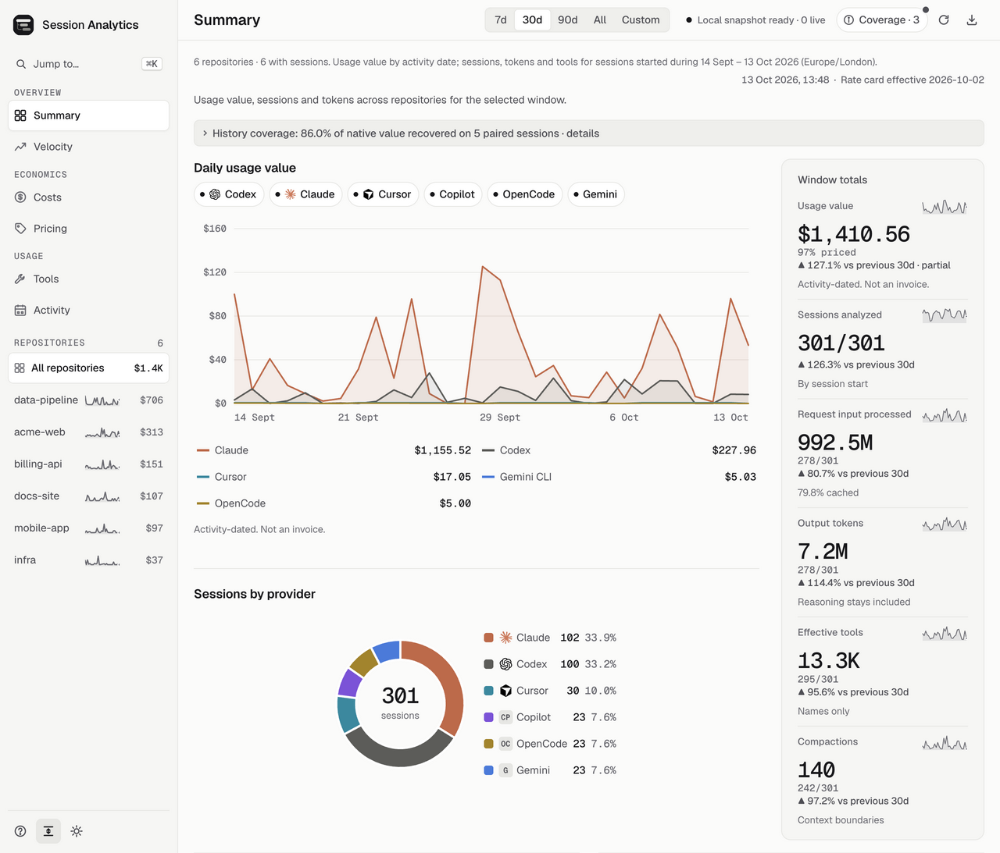
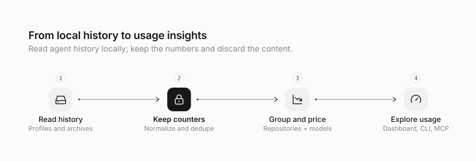

<div align="center">

<picture>
  <source media="(prefers-color-scheme: dark)" srcset="assets/logo-wordmark-dark.svg" />
  
</picture>

<h3>Content-free analytics for your coding-agent sessions.</h3>

<p>See usage value, models, tools and activity by repository across Claude Code, Codex, Cursor, Copilot CLI, OpenCode and Gemini CLI.<br />
Local and read-only. No prompts, messages or file paths in its outputs.</p>

<p><a href="LICENSE">MIT</a> · <a href="https://nodejs.org/">Node.js 24+</a> · <a href="package.json">Zero runtime dependencies</a> · <a href="docs/roadmap.md">Public preview</a> · <a href="https://github.com/rokas-tarasevicius/session-analytics/actions/workflows/ci.yml">CI</a></p>

</div>

<picture>
  <source media="(prefers-color-scheme: dark)" srcset="assets/screenshot-summary-dark.webp" />
  
</picture>

*Synthetic demo data. [Full dashboard tour →](docs/dashboard.md)*

<details>
<summary>Velocity: usage over time, grouped by model</summary>

<picture>
  <source media="(prefers-color-scheme: dark)" srcset="assets/screenshot-velocity-dark.webp" />
  
</picture>

Model is the default grouping. Provider colours keep the series easy to distinguish.

</details>

## Get started

Requires **Node.js 24+** on macOS or Linux. macOS is the primary platform; Claude Code and Codex sources also work on Linux.

Releases after 0.9.0 attach a compiled package to each [GitHub Release](https://github.com/rokas-tarasevicius/session-analytics/releases). npm installs the latest one straight from the release, without the npm registry:

```bash
npm install -g https://github.com/rokas-tarasevicius/session-analytics/releases/latest/download/session-analytics.tgz
session-analytics             # opens http://127.0.0.1:4174
session-analytics --offline   # disables public pricing refreshes
```

Until the first packaged release, or to explore synthetic data and contribute, use a source checkout. Node runs its TypeScript directly, so there is no install step:

```bash
git clone https://github.com/rokas-tarasevicius/session-analytics.git
cd session-analytics
npm run demo                    # synthetic history only; never reads your sessions
node bin/session-analytics.ts   # your own history at http://127.0.0.1:4174
```

A checkout runs unreleased `master`; check out a release tag to run released code, and `npm link` to get a `session-analytics` command. npm registry and Homebrew packages of the same tarball are planned but not published yet. See [installation](docs/cli.md#install) for verifying a download, pinning a version, upgrades, uninstalling and platform limits; `npm ci` is needed only for the checks in [CONTRIBUTING.md](CONTRIBUTING.md).

## What it does

- **Groups work by repository.** Combine agents, profiles, linked worktrees and clones of the same remote in one view. Conductor can enrich the mapping when installed.
- **Makes accounting inspectable.** Dated price snapshots, deduplicated token records and visible coverage explain each total. Unknown prices stay unpriced; missing evidence stays unavailable.
- **Shows seven views.** Summary for totals, Velocity for trends, Costs for the value breakdown, Pricing for rate provenance, Subscription for how much of your Claude and Codex limits you use, Tools for call patterns, and Activity for session starts. Views share a time window and support repository focus.
- **Includes your other machines.** `--remote server` adds a server or VM where agents run, read over your own SSH. Each machine analyzes its own history and returns only its content-free snapshot. [Combine machines](docs/interop.md#combine-machines).
- **Works beyond the browser.** Get terminal reports, JSON, CSV/NDJSON/OTLP exports, aggregate team snapshots, and six read-only [MCP tools](docs/mcp.md). A bundled [agent skill](skills/session-analytics/SKILL.md) exposes the same metrics.

**Usage value is an API list-price equivalent, not your bill.** Provider-reported figures stay separately identified. Subscriptions and discounts are not modeled. Money follows request activity dates; session, token and tool counts use session-start dates. [Metric definitions and limits](docs/metrics.md).

## Which agents it reads

| Source | Available evidence |
| --- | --- |
| Claude Code / Desktop local agents | Tokens and cache use, tools, compactions and sub-agents |
| Codex | Request tokens, tools, compactions and spawned threads; cache writes unavailable |
| Cursor | Tokens, tools and provider-reported value; SDK runs through Conductor; transcripts provide activity only |
| GitHub Copilot CLI | Tools and turns; tokens unavailable |
| OpenCode | Request tokens and tools |
| Gemini CLI | Message tokens and tools |

Profiles and archives are discovered automatically. Conductor is optional. [Source locations, fidelity and known gaps](docs/providers.md).

## Privacy

Provider stores are opened read-only. Outputs contain allowlisted counters, model IDs, tool names, timestamps, repository display names and pseudonymous keys. Prompts, replies, reasoning text, tool arguments/results, file paths and raw session IDs are discarded during parsing.

The dashboard binds to loopback, serves assets locally and has no telemetry. Optional public pricing GETs send no local evidence; `--offline` disables them. Sending an export to an OTLP endpoint requires an explicit option, independent of pricing offline mode. Reading another machine requires `--remote`, which runs your `ssh` and brings back only that machine's content-free snapshot. A separate private index retains derived facts; `--no-index` bypasses it. [Full privacy contract](docs/privacy.md).

## How it works

<picture>
  <source media="(prefers-color-scheme: dark)" srcset="docs/diagrams/overview.dark.svg" />
  
</picture>

Analysis runs in a child process with a capped heap. Only allowlisted results cross back to the dashboard or report, and a private index reuses unchanged sessions on later scans. [Architecture and process model](docs/architecture.md).

## Documentation

| Start here | Reference |
| --- | --- |
| [Dashboard tour](docs/dashboard.md) | [Metrics and accounting](docs/metrics.md) |
| [CLI and installation](docs/cli.md) | [Provider formats](docs/providers.md) |
| [FAQ](docs/faq.md) | [Privacy and public fields](docs/privacy.md) |
| [MCP and agent setup](docs/mcp.md) | [Pricing and offline use](docs/pricing.md) |
| [Exports and team sharing](docs/interop.md) | [Architecture](docs/architecture.md) |
| [Subscription limits and value](docs/subscription.md) | |

See the [changelog](CHANGELOG.md), [roadmap](docs/roadmap.md) and [release process](docs/release.md) for shipped and planned work. [Competitive research](docs/proposals/competitive-landscape.md) covers related tools.

## Contributing

Start with [CONTRIBUTING.md](CONTRIBUTING.md) for setup, checks, provider adapters and rate-card changes. Follow the [Code of Conduct](CODE_OF_CONDUCT.md); report vulnerabilities privately through [SECURITY.md](SECURITY.md).

## License

[MIT](LICENSE). Geist fonts use the [SIL Open Font License](src/public/fonts/OFL-1.1.txt). Provider marks belong to their owners; see the [brand notices](src/public/brands/NOTICE.md) and [diagram provenance](docs/diagrams/README.md).
