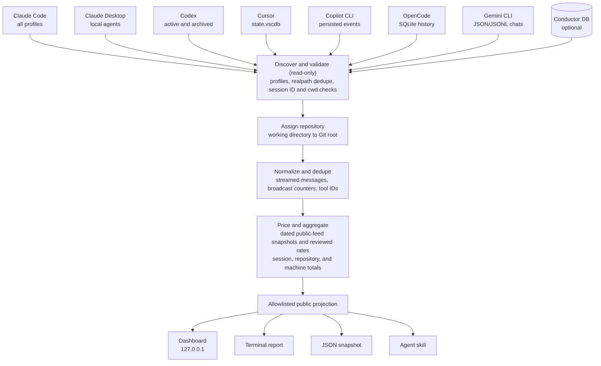

<div align="center">

<picture>
  <source media="(prefers-color-scheme: dark)" srcset="assets/logo-wordmark-dark.svg" />
  
</picture>

<h3>Content-free analytics for the coding-agent sessions already on your machine.</h3>

<p>One local dashboard for Claude Code, Codex, Cursor, Copilot CLI, OpenCode and Gemini CLI: what the work is worth at API prices, which repositories it goes into, which models and tools it uses, how that is changing, and when it happens.<br />
Read-only. Loopback only. No prompts, messages or file paths in anything it produces.</p>

[](https://github.com/rokas-tarasevicius/session-analytics/actions/workflows/ci.yml)
[](LICENSE)
[](https://nodejs.org/)
[](package.json)
[](docs/privacy.md)
[](#roadmap)

</div>

<p align="center">
  <picture>
    <source media="(prefers-color-scheme: dark)" srcset="assets/screenshot-summary-dark.webp" />
    
  </picture>
  <br />
  <sub>Every screenshot in this repository is rendered from the synthetic demo dataset (<code>npm run demo</code>), never from real history. The images follow your light or dark theme.</sub>
</p>

## Contents

- [What it does](#what-it-does)
- [The dashboard](#the-dashboard)
- [Which agents it reads](#which-agents-it-reads)
- [Privacy](#privacy)
- [How the numbers are made](#how-the-numbers-are-made)
- [Get started](#get-started)
- [Beyond the dashboard](#beyond-the-dashboard)
- [How it works](#how-it-works)
- [Roadmap](#roadmap)
- [How it compares](#how-it-compares)
- [FAQ](#faq)
- [Contributing](#contributing) · [Security](#security) · [License](#license)
- [Documentation](#documentation)

## What it does

Coding agents keep detailed session history on your disk. That history can tell you which repositories your agent work goes into, which models and tools it relies on, and what it would cost at API list prices. It also contains every prompt, file path, command and tool result you have ever produced, which is why most people do not want to hand it to an analytics tool.

`session-analytics` reads that history on your machine and keeps only the numbers. It is built around three commitments:

1. **Content-free by contract.** The parser returns allowlisted counters, model IDs, tool names, timestamps and hashed keys, and nothing else. Prompts, replies, reasoning, tool arguments, file paths and raw IDs are discarded during parsing. The contract is written down in [docs/privacy.md](docs/privacy.md), every public field is listed there, and tests plant sentinel strings in fixtures and fail if any of them reaches an output.
2. **Accounting you can reproduce.** Costs come from dated snapshots of public pricing feeds, with reviewed exceptions and a versioned rate card as the offline fallback. Every priced model carries its source, snapshot date and payload hash. Streamed and duplicated token records are deduplicated, unknown models stay visibly unpriced, and every figure says whether it is exact, estimated or unavailable for that source.
3. **Repository first, across agents.** Each session is assigned to a Git repository from its recorded working directory, so work from all six agents on the same codebase lands in one row. Linked worktrees and clones of the same remote fold into one repository, and the [Conductor](https://conductor.build) workspace database is used as optional enrichment when present.

## The dashboard

The dashboard runs on `127.0.0.1` and has six views in three groups: **Overview** (Summary, Velocity), **Economics** (Costs, Pricing) and **Usage** (Tools, Activity). A window selector at the top switches between the last 7, 30 or 90 days, all history, or a custom range. The sidebar lists every repository with a sparkline and its value, and clicking one focuses every view on that repository. A command palette (<kbd>⌘K</kbd>), `g`-prefixed shortcuts, light and dark themes, two densities and an address bar that follows the view, window and focus make it quick to move around and to share a link to exactly what you are looking at.

### Summary: the state of the machine

On narrow screens, repository and time-window selectors share the header, and KPI cards stack into one column below 400 pixels. Custom ranges keep the native date inputs.

<details>
<summary>Phone layout</summary>
<p align="center">
  <picture>
    <source media="(prefers-color-scheme: dark)" srcset="assets/screenshot-mobile-dark.webp" />
    
  </picture>
</p>
</details>

Summary answers "what happened in this window?" Six cards show usage value, sessions analyzed, request input processed, output tokens, effective tool calls and compactions. Each card shows how many of the selected sessions carry the evidence behind the number, the change against the previous window, and a sparkline. Below them, daily usage value by provider sits beside the session mix, then value and tokens by repository, value by model, top tools, sub-agent value and a sortable fleet table.

<p align="center">
  <picture>
    <source media="(prefers-color-scheme: dark)" srcset="assets/screenshot-summary-breakdowns-dark.webp" />
    
  </picture>
</p>

### Focus on one repository

Click a repository in the sidebar, or pick one from the command palette, and every view narrows to it. Summary adds a provider breakdown for value and request input, a sub-agent summary and a comparison row against the whole fleet. The focus is part of the URL, so a bookmark or a shared link opens the same repository.

<p align="center">
  <picture>
    <source media="(prefers-color-scheme: dark)" srcset="assets/screenshot-repository-dark.webp" />
    
  </picture>
</p>

### Velocity: where usage is moving

Velocity answers "is this going up, and what is driving it?" Group the chart by provider, agent, model, repository, execution kind or reasoning effort; plot usage value, any token class, model calls, tool calls or sessions started; by day, week or month, or as an hour-of-day profile; as a stacked area, lines or a cumulative curve, with an optional 7-day average. Below the chart, week-to-date, month-to-date and today-versus-median comparisons show the evidence on both sides of every percentage, and a **Top movers** table ranks the models, agents and other dimensions whose value changed most over the last seven completed days. When enough complete history exists, a projection band shows the month's likely range as a workload scenario, never as a forecast of your bill.

<p align="center">
  <picture>
    <source media="(prefers-color-scheme: dark)" srcset="assets/screenshot-velocity-dark.webp" />
    
  </picture>
</p>

<p align="center">
  <picture>
    <source media="(prefers-color-scheme: dark)" srcset="assets/screenshot-velocity-movers-dark.webp" />
    
  </picture>
</p>

Every panel has an **Evidence & limits** note that states what the number includes, what was excluded, and why a comparison is partial or unavailable. A missing comparison is shown as a dash with its reason, never as zero.

### Costs: one money ledger

Costs answers "where does the value go?" The usage value is the sum of an API-equivalent part, priced from observed tokens, and a provider-reported part for sources such as Cursor that record their own figure and have no rate card. Cost by provider shows each provider's bar segmented by model with its priced share; cost by model lists every model with its provider, sessions, calls, input and output tokens, value and share. Summary, Velocity and Costs read the same activity-dated ledger, so their totals agree for any window.

<p align="center">
  <picture>
    <source media="(prefers-color-scheme: dark)" srcset="assets/screenshot-costs-dark.webp" />
    
  </picture>
</p>

### Pricing: where the prices come from

Pricing answers "can I trust that dollar figure?" It shows pricing coverage (the share of eligible tokens with an explicit rate), the age of each public price source, whether updates are offline, and the effective date of the reviewed rate card. Each API-priced model used in the window gets a card with its input and output rates per million tokens, its value, tokens, calls and share, and a badge when part of its tokens could not be priced. A model with no matching rate is shown as unpriced rather than as free, and provider-reported value, such as Cursor's own figure, is kept in the totals line rather than given a rate card. A stale source raises a warning at the top; the demo seeds one deliberately stale source so that warning is visible.

<p align="center">
  <picture>
    <source media="(prefers-color-scheme: dark)" srcset="assets/screenshot-pricing-dark.webp" />
    
  </picture>
</p>

### Tools: what the agents reach for

Tools answers "how do the agents work?" using tool-call names only; arguments and results never reach any output. The table ranks tools by calls, share, sessions and repositories, with the change against the previous window, and provider chips narrow it to one or more agents. Selecting a tool opens its detail: calls by session-start day, the providers that made them, and the repositories they went into.

<p align="center">
  <picture>
    <source media="(prefers-color-scheme: dark)" srcset="assets/screenshot-tools-dark.webp" />
    
  </picture>
</p>

### Activity: when the work happens

Activity answers "when do sessions start?" A weekday-by-hour heatmap counts session starts in your local timezone for the selected providers, and a repository list shows where those sessions went. Sessions without a provider-recorded start time are excluded rather than guessed from file dates.

<p align="center">
  <picture>
    <source media="(prefers-color-scheme: dark)" srcset="assets/screenshot-activity-dark.webp" />
    
  </picture>
</p>

### Coverage, evidence and the command palette

Every number on the dashboard is a lower bound from local evidence. The **Coverage** button lists, for each source, how many selected sessions carry token evidence, tool evidence and timestamps, and explains how to read the figures on the current view. Unavailable is shown as a dash, never as zero activity, and counts never claim to measure quality or outcome.

<p align="center">
  <picture>
    <source media="(prefers-color-scheme: dark)" srcset="assets/screenshot-coverage-dark.webp" />
    
  </picture>
</p>

The command palette jumps to any view or repository, toggles provider chips and switches theme or density. The same actions have keyboard shortcuts: `g` then a letter for views, `[` and `]` for the previous and next view, `1` to `4` for the window presets, `e` for coverage and `t` for the theme.

<p align="center">
  <picture>
    <source media="(prefers-color-scheme: dark)" srcset="assets/screenshot-palette-dark.webp" />
    
  </picture>
</p>

## Which agents it reads

| Source | Where it looks | What it can tell you |
| --- | --- | --- |
| Claude Code | `~/.claude/projects`, every `~/.claude-*/projects`, `$CLAUDE_CONFIG_DIR/projects`, `~/.config/claude/projects` | Exact tokens including cache reads and writes, reasoning tokens when recorded, tool calls by name, compactions, sub-agents with their own cost split, and reasoning effort |
| Claude Desktop local agents | `~/Library/Application Support/Claude/local-agent-mode-sessions` | The same Claude session evidence |
| Codex | `~/.codex/sessions` and `archived_sessions`, every `~/.codex-*` profile, `$CODEX_HOME` | Exact tokens per request, reasoning tokens, tool calls (code-mode calls expanded to the inner tool), compactions and spawned threads; cache writes are not recorded, so an upper estimate is shown beside the value |
| Cursor | `~/Library/Application Support/Cursor/User/globalStorage/state.vscdb` and `workspaceStorage`, read-only | Per-session input and output tokens, tool calls, sub-agent composers, and Cursor's own reported value, which is kept separate from API-equivalent value |
| Cursor SDK through Conductor | `~/Library/Application Support/com.conductor.app/cursor-sdk-store` | Per-run token counters priced at the run's date, and tool events |
| Cursor agent transcripts | `~/.cursor/projects/*/agent-transcripts` | Activity only; no tokens or value |
| GitHub Copilot CLI | `~/.copilot/session-state/*/events.jsonl` | Tool calls and turns; tokens are not recorded |
| OpenCode | `$XDG_DATA_HOME/opencode/opencode.db` or `~/.local/share/opencode/opencode.db` | Per-request token counters and tool calls |
| Gemini CLI | `~/.gemini/tmp/*/chats/session-*.json{,l}` | Per-message token counters (thinking inside output) and tool calls |
| Conductor (optional) | `~/Library/Application Support/com.conductor.app/conductor.db`, read-only | Workspace-to-repository mapping, hidden flags, live-session status, and result receipts that can recover deleted Claude history |

Every source is opened read-only, and nothing is written to provider directories. Each source has its own fidelity label, so summary-only and activity-only evidence is shown with explicit coverage and **N/A** values rather than folded into exact figures. Per-source matching rules, measure-by-measure fidelity and known gaps are in [docs/providers.md](docs/providers.md); metric definitions are in [docs/metrics.md](docs/metrics.md).

## Privacy

`session-analytics` reads transcripts on your machine and discards their content during parsing. Its outputs (dashboard, API, reports, exports and the agent skill) contain only:

- token counters, cost figures, durations and timestamps;
- model IDs and tool names;
- repository display names and pseudonymous keys (a truncated SHA-256 session key and a repository ID);
- fixed-text warnings and the rate card's model list with source URLs.

They never contain prompts, assistant messages, reasoning text, tool arguments or results, commands, file paths, transcript paths, repository roots or remotes, raw session or provider IDs, branch names, session titles, credentials, or raw local error messages.

The dashboard binds to loopback, rejects requests whose `Host` is not local or whose `Origin` is present and not local, serves a strict Content Security Policy, sends no CORS headers, has no telemetry, and serves all browser assets locally. The only network activity is an optional refresh of fixed public price feeds with plain GETs that carry no local data; `--offline` disables it. Delivering an export to an OpenTelemetry endpoint requires its own explicit option. Read [docs/privacy.md](docs/privacy.md) for the full contract, the privacy tiers and the [field manifest](docs/privacy.md#field-manifest).

## How the numbers are made

- **API-equivalent is not an invoice.** Dollar figures price observed tokens at public API list prices. They do not model subscription plans, discounts, batch or priority tiers, regional pricing, taxes or credits. Under a subscription, read them as the value of the usage, not as money spent.
- **Money follows activity dates.** A session's value is placed on the days its requests happened, even when the session began before the window; sessions, tokens and tools are selected by start date. Sources that record no request times are session-dated on their last activity and say so. Summary, Velocity and Costs share this ledger, and the daily value export adds up to it.
- **Price evidence is versioned.** Each request is priced with the latest source snapshot at or before its time; a request older than the cached history uses the oldest snapshot and is labelled as an estimate. Snapshots record fetch time, source URL and payload hash, and [`data/rate-cards.json`](data/rate-cards.json) keeps reviewed exceptions and fallback rates. Unknown or ambiguous models remain unpriced.
- **Coverage is shown, not hidden.** Pricing coverage is the share of observed tokens with explicit rates for their token classes. Substituted cache prices stay in estimated totals with visible assumptions. Invalid model labels become `<unknown>` without dropping tokens. Sessions without validated evidence are excluded rather than counted as zero.
- **Processed input repeats context.** Input totals count cached context every time a request processes it; they measure consumption, not unique text. Long-context premiums apply per request, never to a session or repository total.
- **Sub-agent value is a lower bound.** It counts only usage with explicit sub-agent evidence.
- **History coverage is measured, not assumed.** When Claude transcripts have been deleted, Conductor's assistant usage can recover them. The Summary view shows how well that recovery path reproduces native value on the sessions where both survive, and an unattributed monthly estimate from provider statistics stays outside the session and repository totals. [Method and limits](docs/metrics.md#history-coverage-and-recovery).

Accounting details, denominators and attribution rules are in [docs/metrics.md](docs/metrics.md); provider-specific limits are in [docs/providers.md](docs/providers.md#review-hardening-and-resource-limits).

## Get started

Requirements: **Node.js 24 or newer** and **macOS** (Claude Code and Codex history also works on Linux; see [platform support](#faq)).

```bash
git clone https://github.com/rokas-tarasevicius/session-analytics.git
cd session-analytics
npm ci        # development tooling only; the runtime has no dependencies
npm link      # puts the session-analytics command on your PATH
session-analytics
```

The command scans local history, starts the dashboard on `http://127.0.0.1:4174` and opens it in your browser. To try it without touching your own history, run the demo: it generates about 60 days of synthetic sessions for six fictional repositories in a temporary directory and deletes them on exit.

```bash
npm run demo
```

The package is not on npm yet; the [command-line reference](docs/cli.md#install) explains why and what to do instead. The same page lists every option, including ports, offline mode, repository filters and explicit source paths.

The source is publicly available. If `npm link` needs permissions on your machine, run `node bin/session-analytics.ts` from the checkout instead. Start with `npm run demo` to explore the dashboard using synthetic data.

## Beyond the dashboard

Everything the dashboard shows is available without a browser, with the same privacy contract.

- **Terminal report and JSON snapshot.** `session-analytics report` prints repository totals, value by basis, token and cache totals, the highest-value sessions by hashed key and coverage warnings; `report --json` writes the same versioned snapshot the dashboard uses, validated by a [published JSON Schema](schemas/snapshot.v1.schema.json).
- **Exports and team sharing.** Export sessions, daily value, models and tools as CSV, NDJSON or OTLP JSON, or download the current view from the dashboard. `report --share` produces an aggregate-only snapshot with pseudonymous repositories and a minimum of five sessions per bucket, and `merge` combines shared snapshots from several machines into one dashboard. See [schemas, exports and sharing](docs/interop.md).
- **Metrics for your agent.** `session-analytics mcp` serves six read-only MCP tools (usage summaries, budget status, repository profiles, tool statistics, recent sessions and same-repository agent comparisons), and the bundled [agent skill](skills/session-analytics/SKILL.md) lets Claude Code, Codex or Cursor open the dashboard or answer "compare agent usage across my repositories". See [docs/mcp.md](docs/mcp.md).
- **Price lists and the local index.** `rates` fetches, inspects and diffs public price snapshots; `index` reports, prunes or rebuilds the private index that lets indexed sessions survive provider cleanup.

The [command-line reference](docs/cli.md) documents every command, option and environment variable.

## How it works



Analysis runs in a child process with a capped heap, and Cursor's database is parsed in a further child process, so a machine-wide scan does not grow the server's memory and only serialized, allowlisted results cross the process boundary. The first launch builds a private index of derived facts; later launches fingerprint the evidence and reuse unchanged sessions, and a rotating sample is re-parsed on every warm scan to confirm the cache still agrees with the files. [docs/architecture.md](docs/architecture.md) covers the modules, the process model and the deduplication strategies.

## Roadmap

This checkout is version 0.8.1 (see the [changelog](CHANGELOG.md)). The integrated index, six providers, pricing, velocity, MCP and interchange are shipped. Remaining items include additional provider formats, profile dimensions, task-matched baselines, hooks, and packaging/user-research gates. See the checked delivery list in [docs/roadmap.md](docs/roadmap.md); the [product proposals](docs/proposals/) distinguish research from shipped behavior.

## How it compares

Several good tools work with the same local history. They make different trade-offs, and you may want more than one.

The table below is a short orientation. The [dated competitive research](docs/proposals/competitive-landscape.md) covers broader documented overlap, primary sources, and verification limits; competitors were not installed or benchmarked for that review.

| Project | Focus | Choose it when |
| --- | --- | --- |
| [ccusage](https://github.com/ryoppippi/ccusage) | Cost and token reports for Claude Code and Codex from local JSONL: daily, monthly, session, and 5-hour billing blocks | You want a fast, widely used CLI for spend over time. |
| [CodeBurn](https://github.com/getagentseal/codeburn) | Token use and cost across dozens of agents and tools, by model, project, and task | You use many different agents and want one cost view across all of them. |
| [AgentsView](https://github.com/kenn-io/agentsview) | Local session browser with full-text search, analytics, and insights | You want to read, search, and revisit session content. |
| [tokscale](https://github.com/junhoyeo/tokscale) | Terminal token tracking across many agents, with contribution graphs and an optional leaderboard | You want broad agent coverage and shareable usage graphs. |
| [CodexBar](https://github.com/steipete/CodexBar) | Menu bar app for provider usage limits and reset windows | You want to watch plan limits while you work. |
| Claude Code `/usage` and `/insights` | Built-in usage and session insight views | You use only Claude Code and want answers inside the tool. |

`session-analytics` is narrower. It never reads content into its outputs, so it has no transcript search or replay. It prices from cached public-feed snapshots with reviewed exceptions, discloses per-provider fidelity, groups everything by Git repository across agents and orchestrator workspaces, and provides a metrics-only MCP server.

## FAQ

<details>
<summary><strong>Can I install from npm, GitHub, or a tarball?</strong></summary>

The package is not on npm. Install from a checkout with `npm link` as shown above. `npm install github:rokas-tarasevicius/session-analytics` or a tarball install fails on Node 24 with `ERR_UNSUPPORTED_NODE_MODULES_TYPE_STRIPPING` because the executable is a `.ts` file under `node_modules`. Without `npm link`, run `node bin/session-analytics.ts` from the checkout.
</details>

<details>
<summary><strong>Does anything leave my machine?</strong></summary>

There is no telemetry. Analysis reads cached prices; dashboard startup may refresh fixed public price feeds without sending local evidence. `--offline` or `SESSION_ANALYTICS_OFFLINE=1` disables those pricing requests. `export --otlp-endpoint` allows delivery of selected content-free export data; that explicit option is independent of the pricing offline setting. Fonts and provider marks are bundled; `--no-open` disables opening the loopback page.
</details>

<details>
<summary><strong>Why does the dollar figure differ from my bill?</strong></summary>

It is an API list-price equivalent, not an invoice. Subscriptions, discounts, credits, and pricing tiers are not modeled. See [How the numbers are made](#how-the-numbers-are-made).
</details>

<details>
<summary><strong>Does it modify my agent history?</strong></summary>

No. JSONL files are streamed read-only and provider SQLite databases are opened with `readOnly: true`. Nothing is written to provider directories. A separate private SQLite index stores only derived facts and keyed fingerprints; use `--no-index` to bypass it.
</details>

<details>
<summary><strong>Do I need Conductor?</strong></summary>

No. Provider stores define the scan. When Conductor's database is present it adds workspace-to-repository mappings, registered repositories that have no sessions yet, hidden flags, and live-session status.
</details>

<details>
<summary><strong>What are "No repository detected" and "Ephemeral automation sessions" in the repository list?</strong></summary>

A folder is only listed as a repository when there is evidence for one: a Git root, a Git remote recorded by the provider, or a Conductor repository or workspace. Sessions started anywhere else (your home directory, a download or scratch folder, a deleted checkout whose remote was never recorded) are grouped together under "No repository detected" instead of one entry per folder. Sessions that ran in temporary directories are grouped together as ephemeral automation sessions.
</details>

<details>
<summary><strong>I use several Claude or Codex accounts. Are they all included?</strong></summary>

Yes. Sibling profile directories such as `~/.claude-work` or `~/.codex-personal`, plus `CLAUDE_CONFIG_DIR` and `CODEX_HOME`, are discovered automatically. Directories that resolve to the same place through symbolic links are read once.
</details>

<details>
<summary><strong>Which platforms are supported?</strong></summary>

macOS is the primary platform. Claude Code and Codex history paths are the same on Linux, so those sources work there; the default Cursor, Claude Desktop, and Conductor paths are macOS paths today, and Cursor can be pointed at another location with `--cursor-database`. Windows is not supported yet. Pull requests, pushes to `master` and manual CI runs require GitHub-hosted Ubuntu and macOS checks plus a required Ubuntu Chrome check, in both private and public repositories. See [release validation](docs/release.md).
</details>

<details>
<summary><strong>Can I see the prompt behind an expensive session?</strong></summary>

Not from this tool, by design. The session key is a truncated hash; use your agent's own history or resume feature to open the session.
</details>

<details>
<summary><strong>How do I add or correct a model price?</strong></summary>

Edit [`data/rate-cards.json`](data/rate-cards.json) with the rate and a primary source URL, update the effective date, and open a pull request. [CONTRIBUTING.md](CONTRIBUTING.md#rate-card-changes) has the checklist.
</details>

## Contributing

Contributions are welcome, especially provider adapters, rate-card reviews, and fixtures for new history formats. Start with [CONTRIBUTING.md](CONTRIBUTING.md): it covers setup, `npm run check`, the demo, the project layout, and the privacy rules every change must follow. This project follows the [Contributor Covenant](CODE_OF_CONDUCT.md).

## Security

Please report vulnerabilities privately. [SECURITY.md](SECURITY.md) describes reporting availability, supported versions and the threat model.

## Documentation

- [CLI commands and source installation](docs/cli.md)
- [Provider formats and fidelity](docs/providers.md)
- [Metric definitions and evidence limits](docs/metrics.md)
- [Privacy contract and public field manifest](docs/privacy.md)
- [Pricing sources and offline operation](docs/pricing.md)
- [Exports, sharing and schemas](docs/interop.md)
- [Metrics-only MCP setup](docs/mcp.md)
- [Architecture](docs/architecture.md) and [branding](docs/branding.md)
- [Release validation and public launch gates](docs/release.md)
- [Current open-source readiness plan](docs/proposals/open-source-readiness-2026-10-13.md) and [deferred work](TODOS.md)

## License

[MIT](LICENSE). Bundled fonts (Geist and Geist Mono) are licensed under the [SIL Open Font License 1.1](src/public/fonts/OFL-1.1.txt). Provider names and marks shown in the dashboard identify the data source and remain trademarks of their owners; see [src/public/brands/NOTICE.md](src/public/brands/NOTICE.md).
