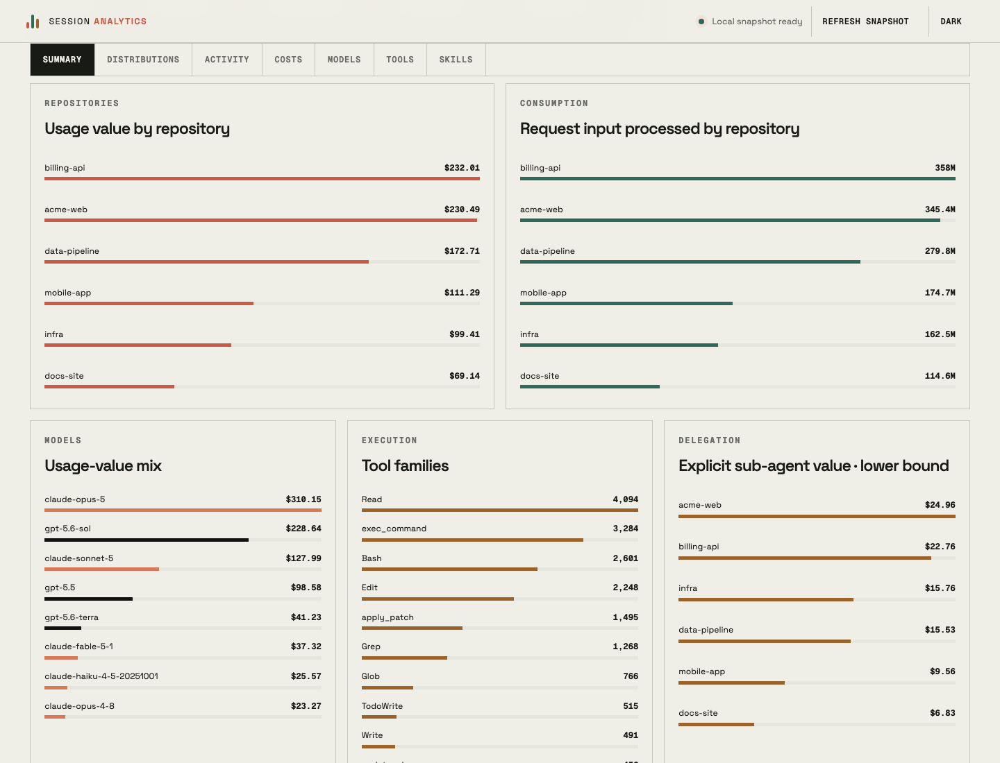
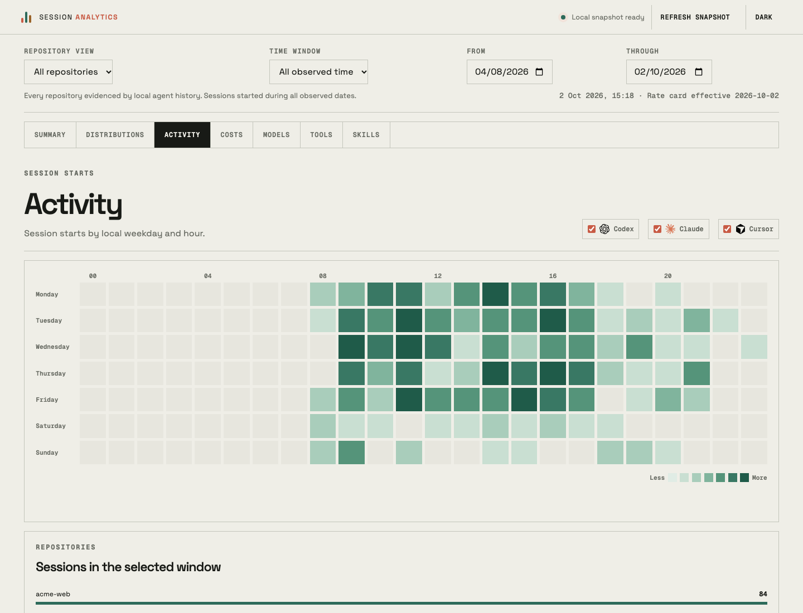
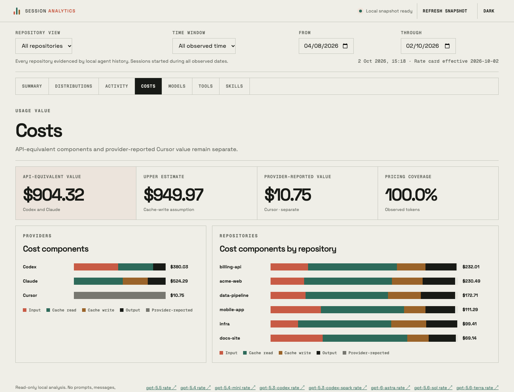
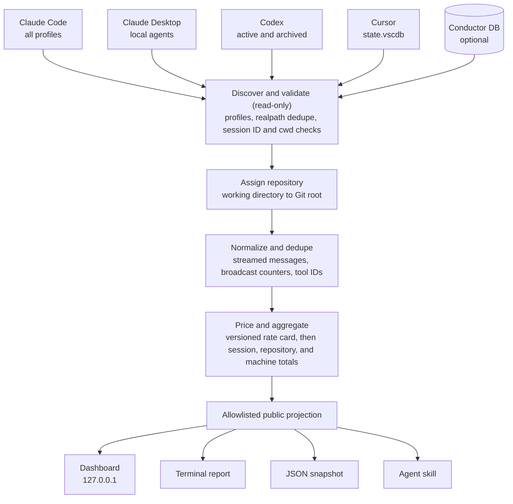

<div align="center">

<picture>
  <source media="(prefers-color-scheme: dark)" srcset="assets/logo-wordmark-dark.svg" />
  
</picture>

<h3>Content-free analytics for the coding-agent sessions already on your machine.</h3>

<p>Claude Code, Codex, and Cursor usage: tokens, API-equivalent cost, tools, and skills, grouped by Git repository.<br />
Local only. Read-only. No prompts, messages, or file paths ever leave the parser.</p>

[](https://github.com/rokas-tarasevicius/session-analytics/actions/workflows/ci.yml)
[](LICENSE)
[](https://nodejs.org/)
[](package.json)
[](docs/privacy.md)
[](#roadmap)

</div>

<p align="center">
  
  <br />
  <sub>Every screenshot in this repository is rendered from the synthetic demo dataset (<code>npm run demo</code>), never from real history.</sub>
</p>

## Contents

- [Why](#why)
- [Features](#features)
- [Quick start](#quick-start)
- [Usage](#usage)
- [Supported agents and evidence](#supported-agents-and-evidence)
- [Privacy model](#privacy-model)
- [How it works](#how-it-works)
- [Accounting notes](#accounting-notes)
- [Use it from an agent](#use-it-from-an-agent)
- [Roadmap](#roadmap)
- [How it compares](#how-it-compares)
- [FAQ](#faq)
- [Contributing](#contributing) · [Security](#security) · [License](#license)

## Why

Claude Code, Codex, and Cursor already keep detailed session history on your disk. That history can tell you which repositories your agent work goes into, which models and tools it uses, and what it would cost at API list prices. It also contains every prompt, file path, command, and tool result you have produced, so most people do not want to hand it to an analytics tool.

`session-analytics` is built around three commitments:

1. **Content-free by contract.** The parser reads transcripts locally and returns only allowlisted counters, names, model IDs, timestamps, and hashed keys. The contract is written down in [docs/privacy.md](docs/privacy.md), every public field is listed there, and tests plant sentinel strings in fixtures and fail if any of them reaches an output.
2. **Accounting you can reproduce.** Costs come from a versioned rate card in this repository with a source URL for every model. Streamed and broadcast token records are deduplicated, unknown models stay visibly unpriced, and each figure says whether it is exact, estimated, or unavailable for that provider.
3. **Repository first, across agents.** Every session is assigned to a Git repository from its recorded working directory, so Claude Code, Codex, and Cursor work on the same codebase lands in one row. Linked worktrees fold into their main repository, and the [Conductor](https://conductor.build) app's workspace database is used as optional enrichment when present.

## Features

- **One command, whole machine.** Discovers every Claude Code profile (`~/.claude`, `~/.claude-*`, `CLAUDE_CONFIG_DIR`), active and archived Codex rollouts (`~/.codex`, `~/.codex-*`, `CODEX_HOME`), Cursor's local composer history, and Claude Desktop local-agent sessions. Profiles that point at the same directory are read once.
- **Tokens by class.** Input, uncached input, cache reads, cache writes split by 5-minute and 1-hour TTL, output, and reasoning output where the provider records it.
- **Cost with provenance.** API list-price equivalents from [`data/rate-cards.json`](data/rate-cards.json), an upper estimate where cache writes are not observable, Cursor's own provider-reported value kept on a separate basis, and pricing coverage beside every total.
- **Execution shape.** Tool calls by name, skill invocations (explicit for Claude, an inferred lower bound for Codex), compactions, user turns, model calls, durations, reasoning effort, and the split between top-level and sub-agent cost.
- **Dashboard views.** Summary (daily usage velocity, provider mix, repository comparison), Distributions (up to six repositories side by side), Activity (weekday-by-hour heatmap), Costs (components by provider and repository), Models, Tools, and Skills. Filter by time window and drill into any repository. Light and dark themes.
- **Five surfaces.** A localhost dashboard, a terminal report, a JSON snapshot, a [metrics-only MCP server](docs/mcp.md), and an [agent skill](skills/session-analytics/SKILL.md) so Claude Code or Codex can open the dashboard for you.
- **Small trust surface.** Node 24 built-ins only (native TypeScript and `node:sqlite`), zero runtime dependencies, no network access, no telemetry, and read-only access to every store.

<table>
  <tr>
    <td width="33%"></td>
    <td width="33%"></td>
    <td width="33%"></td>
  </tr>
  <tr>
    <td align="center"><sub>Repositories, models, tools</sub></td>
    <td align="center"><sub>Activity heatmap</sub></td>
    <td align="center"><sub>Cost components and coverage</sub></td>
  </tr>
</table>

## Quick start

Requirements: **Node.js 24 or newer** and **macOS** (Claude Code and Codex history also works on Linux; see [platform support](#faq)).

```bash
git clone git@github.com:rokas-tarasevicius/session-analytics.git
cd session-analytics
npm install   # development tooling only; the runtime has no dependencies
npm link      # puts the session-analytics command on your PATH
session-analytics
```

The command scans local history, starts the dashboard on `http://127.0.0.1:4174`, and opens it in your browser. Running it again reuses a dashboard that is already serving on that port.

To try it without touching your own history, run the demo. It generates about 60 days of synthetic sessions for six fictional repositories in a temporary directory, points every source option at that directory, and deletes it on exit:

```bash
npm run demo                      # dashboard on http://127.0.0.1:4175
npm run demo -- report            # terminal report of the same data
```

The npm package is not published yet. Without `npm link`, run `node bin/session-analytics.ts` from the checkout.

## Usage

### Dashboard

```bash
session-analytics                 # scan, serve on 127.0.0.1:4174, open the browser
session-analytics --no-open       # serve without opening a browser
session-analytics --port 4180     # use another loopback port
```

The server binds to `127.0.0.1` only and answers read-only `GET` requests. **Refresh snapshot** in the dashboard re-scans without restarting. Stop it with `Ctrl+C`.

### Terminal report

```bash
session-analytics report
```

Prints repository totals, priced usage value split into API-equivalent and provider-reported parts, token and cache totals, the 15 highest-value sessions by hashed key, and coverage warnings.

### JSON snapshot

```bash
session-analytics report --json > snapshot.json
jq '.repositories[] | {name: .repository.name, usd: .summary.estimatedSpendUsd}' snapshot.json
```

The snapshot has the same shape as the dashboard's `/api/analytics` response. Every field is described in the [field manifest](docs/privacy.md#field-manifest).

### Options

| Option | Applies to | Description |
| --- | --- | --- |
| `--no-open` | dashboard | Start the server without opening a browser. |
| `--port PORT` | dashboard | Loopback port, 1024 to 65535. Default `4174`, or `CONDUCTOR_PORT + 4` inside a Conductor workspace. |
| `--json` | report | Print the content-free snapshot as JSON. |
| `--repo-name NAME` | both | Narrow to one uniquely named repository. |
| `--repo-root PATH` | both | Narrow to the repository whose canonical root is `PATH`. |
| `--repo-remote URL` | both | Narrow by Git remote. Remotes are known only for repositories registered in Conductor. |
| `--repo-id ID` | both | Narrow to one repository ID from a previous snapshot. |
| `--exclude-hidden` | both | Leave out repositories and sessions hidden in Conductor. Hidden records are included by default. |
| `--claude-root PATH` | both | Read only this Claude Code `projects` directory instead of discovering profiles. |
| `--codex-root PATH` | both | Read this Codex `sessions` directory instead of discovering profiles. |
| `--codex-archive-root PATH` | both | Read this Codex `archived_sessions` directory. Passing either Codex option replaces Codex discovery, so pass both to include archives. |
| `--cursor-database PATH` | both | Cursor `state.vscdb` to read. |
| `--database PATH` | both | Conductor database to use for optional enrichment. |
| `--rate-card PATH` | both | Alternative rate card with the same schema as `data/rate-cards.json`. |
| `--version`, `--help` | all | Print the version or command help. |

Both commands also read `SESSION_ANALYTICS_*` environment variables for the same settings (for example `SESSION_ANALYTICS_PORT` or `SESSION_ANALYTICS_CLAUDE_ROOT`); a command-line option wins over the environment. Profile discovery honors `CLAUDE_CONFIG_DIR` and `CODEX_HOME`.

## Supported agents and evidence

| Source | Default location | Format |
| --- | --- | --- |
| Claude Code | `~/.claude/projects`, every `~/.claude-*/projects`, `$CLAUDE_CONFIG_DIR/projects`, `~/.config/claude/projects` | JSONL per session, plus `subagents/` transcripts |
| Claude Desktop local agents | `~/Library/Application Support/Claude/local-agent-mode-sessions` | Claude session files |
| Codex | `~/.codex/sessions` and `archived_sessions`, every `~/.codex-*` profile, `$CODEX_HOME` | JSONL rollouts |
| Cursor | `~/Library/Application Support/Cursor/User/globalStorage/state.vscdb` and its `workspaceStorage` | SQLite, opened read-only |
| Conductor (optional) | `~/Library/Application Support/com.conductor.app/conductor.db` | SQLite, opened read-only |

What each provider's local history supports:

| Measure | Claude Code | Codex | Cursor |
| --- | --- | --- | --- |
| Input and cache-read tokens | Exact | Exact, per request | Input only, per session |
| Cache-write tokens | Exact, split by 5-minute and 1-hour TTL when recorded | Not recorded; covered by an upper estimate | Not recorded |
| Output tokens | Exact (final streamed snapshot of each message) | Exact | Exact, per session |
| Reasoning tokens | Exact when `thinking_tokens` is recorded; otherwise inside output | Exact | Unavailable |
| Cost | API list-price equivalent | API list-price equivalent and upper estimate | Cursor's provider-reported local value, kept separate and not plotted by day |
| Tool calls by name | Exact | Exact; code-mode calls expanded to the inner tool | From tool-call records |
| Skill invocations | Explicit (`Skill` tool) | Inferred lower bound (`SKILL.md` reads) | Unavailable |
| Turns and messages | Human turns, assistant messages | User turns, agent messages | User and assistant bubbles |
| Compactions | Yes | Yes | Unavailable |
| Sub-agents | `subagents/` transcripts, cost split | Spawned threads, cost split | Sub-agent composers |
| Reasoning effort | Recorded `effort` | `turn_context` effort | Unavailable |

Per-source details, matching rules, and known gaps are in [docs/providers.md](docs/providers.md). Metric definitions are in [docs/metrics.md](docs/metrics.md).

## Privacy model

`session-analytics` reads transcripts on your machine and discards their content during parsing. Its outputs (dashboard, API, report, JSON, and skill) contain only:

- token counters, cost figures, durations, and timestamps;
- model IDs, tool names, and normalized skill identifiers;
- repository display names and pseudonymous keys (a truncated SHA-256 session key, and a repository ID);
- fixed-text parser warnings and the rate card's model list with source URLs.

They never contain prompts, assistant messages, reasoning text, tool arguments or results, commands, file paths, transcript paths, repository roots or remotes, raw session or provider IDs, branch names, session titles, credentials, or raw local error messages.

The dashboard binds to loopback, rejects requests whose `Host` or `Origin` is not local, serves a strict Content Security Policy, sends no CORS headers, makes no network requests, and has no telemetry. Read [docs/privacy.md](docs/privacy.md) for the full contract, the privacy tiers, and the [field manifest](docs/privacy.md#field-manifest).

## How it works



Analysis runs in a child process with a capped heap, and Cursor's database is parsed in a further child process, so a machine-wide scan does not grow the server's memory and only serialized, allowlisted results cross the process boundary. [docs/architecture.md](docs/architecture.md) covers the modules, the process model, and the deduplication strategies.

## Accounting notes

- **API-equivalent is not an invoice.** Dollar figures price observed tokens at public API list prices. They do not model subscription plans, discounts, batch or priority tiers, regional pricing, taxes, or credits. Under a subscription, read them as the value of the usage, not as money spent.
- **The rate card is versioned.** [`data/rate-cards.json`](data/rate-cards.json) has an effective date and a primary source URL for every model, and the dashboard footer links each one. A model without an entry stays unpriced and lowers the pricing coverage figure instead of being guessed. Use `--rate-card` to price against your own reviewed card.
- **Coverage is shown, not hidden.** Pricing coverage is the share of observed tokens that have a known rate. Sessions without validated provider evidence are excluded rather than counted as zero.
- **Codex cache writes are not recorded**, so Codex has an ordinary estimate and an upper estimate that charges the cache-write premium on all uncached input.
- **Processed input repeats context.** Input totals count cached context every time a request processes it. They measure consumption, not unique text.
- **Long-context premiums apply per request**, using the input size of that request, never the session or repository total.
- **Cursor is reported, not repriced.** Cursor's value comes from its own local cost records. It is kept separate from API-equivalent figures and is not plotted by day because the local store has no per-call cost timestamps.
- **Sub-agent value is a lower bound.** It counts only usage with explicit sub-agent evidence.

## Use it from an agent

For direct metric queries, run `session-analytics mcp`. Its seven read-only tools cover usage summaries, budget status, repository profiles, tool statistics, recent sessions, extensions without observed use, and same-repository agent comparisons. It defaults to the launch repository and caches snapshots for 60 seconds. Every result includes source health and interpretation notes; budget periods carry their own pricing coverage, and typical-session baselines exclude active or unknown lifecycle evidence. No transcript content is exposed. See [MCP setup for Claude Code, Codex and Cursor](docs/mcp.md), or try `node scripts/demo.ts mcp` with an MCP client against synthetic data.

The repository ships an agent skill at [`skills/session-analytics`](skills/session-analytics/SKILL.md). Copy or symlink it into a skills directory your agent reads, either in a project or in your home directory:

```bash
# Claude Code
mkdir -p ~/.claude/skills
ln -s "$PWD/skills/session-analytics" ~/.claude/skills/session-analytics

# Codex and other agents that read .agents/skills
mkdir -p ~/.agents/skills
ln -s "$PWD/skills/session-analytics" ~/.agents/skills/session-analytics
```

Then ask, for example, "open my session analytics" or "compare agent usage across my repositories". The skill runs `session-analytics` (or `node <checkout>/bin/session-analytics.ts` when the command is not on `PATH`), reports the dashboard URL, session and repository counts, pricing coverage, and warnings, and keeps API-equivalent and provider-reported values separate. It uses `report` or `report --json` only when you ask for terminal or machine-readable output.

## Roadmap

`0.5.0` is the first standalone release. The next milestones, in order:

- **M0, correctness (in progress):** multi-profile discovery, streamed-usage dedupe, thinking tokens, and current Codex and Cursor formats shipped in 0.5.0. Still to come: remaining Codex and Cursor formats, Conductor result records as fallback evidence, reconciliation against provider-reported totals, and a persistent content-free index with incremental ingest.
- **M1, reliability and economics:** tool error rates and latency, loop and churn flags, MCP server health, permission friction, rate-limit headroom, cache-break causes, and context fill.
- **M2, outcomes and interaction:** evidence-ranked links from sessions to commits and pull requests, cost per merged change, autonomy and interruption measures, and concurrency.
- **M3, agent-facing (in progress):** the metrics-only MCP server ships with seven repository-aware tools. Hotspots, deeper reliability signals, hooks and opt-in review features remain planned.
- **M4, breadth and export:** more agents and OpenTelemetry GenAI export.

Features that need content (local rules over commands, or an LLM review of selected sessions) will always be opt-in, off by default, and labeled. See [docs/roadmap.md](docs/roadmap.md) for the checklists.

## How it compares

Several good tools work with the same local history. They make different trade-offs, and you may want more than one.

| Project | Focus | Choose it when |
| --- | --- | --- |
| [ccusage](https://github.com/ryoppippi/ccusage) | Cost and token reports for Claude Code and Codex from local JSONL: daily, monthly, session, and 5-hour billing blocks | You want a fast, widely used CLI for spend over time. |
| [CodeBurn](https://github.com/getagentseal/codeburn) | Token use and cost across dozens of agents and tools, by model, project, and task | You use many different agents and want one cost view across all of them. |
| [AgentsView](https://github.com/kenn-io/agentsview) | Local session browser with full-text search, analytics, and insights | You want to read, search, and revisit session content. |
| [tokscale](https://github.com/junhoyeo/tokscale) | Terminal token tracking across many agents, with contribution graphs and an optional leaderboard | You want broad agent coverage and shareable usage graphs. |
| [CodexBar](https://github.com/steipete/CodexBar) | Menu bar app for provider usage limits and reset windows | You want to watch plan limits while you work. |
| Claude Code `/usage` and `/insights` | Built-in usage and session insight views | You use only Claude Code and want answers inside the tool. |

`session-analytics` is narrower. It never reads content into its outputs, so it has no transcript search or replay. It prices from a reviewed, versioned rate card rather than a live price feed, discloses per-provider fidelity, groups everything by Git repository across agents and orchestrator workspaces, and is heading toward tool reliability, outcome linkage, and a metrics-only MCP server.

## FAQ

<details>
<summary><strong>Does anything leave my machine?</strong></summary>

No. The tool makes no network requests and has no telemetry. Its only outward action is asking your operating system to open the loopback dashboard URL in a browser, which `--no-open` disables. Fonts and provider marks are bundled.
</details>

<details>
<summary><strong>Why does the dollar figure differ from my bill?</strong></summary>

It is an API list-price equivalent, not an invoice. Subscriptions, discounts, credits, and pricing tiers are not modeled. See [Accounting notes](#accounting-notes).
</details>

<details>
<summary><strong>Does it modify my agent history?</strong></summary>

No. JSONL files are streamed read-only and SQLite databases are opened with `readOnly: true`. Nothing is written to provider directories.
</details>

<details>
<summary><strong>Do I need Conductor?</strong></summary>

No. Provider stores define the scan. When Conductor's database is present it adds workspace-to-repository mappings, registered repositories that have no sessions yet, hidden flags, and live-session status.
</details>

<details>
<summary><strong>What are "(local directory)" and "Ephemeral automation sessions" in the repository list?</strong></summary>

Sessions whose working directory is not inside a Git repository are grouped by that directory, with a short hash suffix to keep same-named directories apart. Sessions that ran in macOS temporary directories are grouped together as ephemeral automation sessions.
</details>

<details>
<summary><strong>I use several Claude or Codex accounts. Are they all included?</strong></summary>

Yes. Sibling profile directories such as `~/.claude-work` or `~/.codex-personal`, plus `CLAUDE_CONFIG_DIR` and `CODEX_HOME`, are discovered automatically. Directories that resolve to the same place through symbolic links are read once.
</details>

<details>
<summary><strong>Which platforms are supported?</strong></summary>

macOS is the primary platform. Claude Code and Codex history paths are the same on Linux, so those sources work there; the default Cursor, Claude Desktop, and Conductor paths are macOS paths today, and Cursor can be pointed at another location with `--cursor-database`. Windows is not supported yet. CI runs on macOS and Linux.
</details>

<details>
<summary><strong>Can I see the prompt behind an expensive session?</strong></summary>

Not from this tool, by design. The session key is a truncated hash; use your agent's own history or resume feature to open the session.
</details>

<details>
<summary><strong>How do I add or correct a model price?</strong></summary>

Edit [`data/rate-cards.json`](data/rate-cards.json) with the rate and a primary source URL, update the effective date, and open a pull request. [CONTRIBUTING.md](CONTRIBUTING.md#rate-card-changes) has the checklist.
</details>

## Contributing

Contributions are welcome, especially provider adapters, rate-card reviews, and fixtures for new history formats. Start with [CONTRIBUTING.md](CONTRIBUTING.md): it covers setup, `npm run check`, the demo, the project layout, and the privacy rules every change must follow. This project follows the [Contributor Covenant](CODE_OF_CONDUCT.md).

## Security

Please report vulnerabilities privately through [GitHub private vulnerability reporting](https://github.com/rokas-tarasevicius/session-analytics/security/advisories/new), not in public issues. [SECURITY.md](SECURITY.md) describes supported versions and the threat model.

## License

[MIT](LICENSE). Bundled fonts (Space Grotesk and Geist Mono) are licensed under the [SIL Open Font License 1.1](src/public/fonts/OFL-1.1.txt). Provider names and marks shown in the dashboard identify the data source and remain trademarks of their owners; see [src/public/brands/NOTICE.md](src/public/brands/NOTICE.md).
