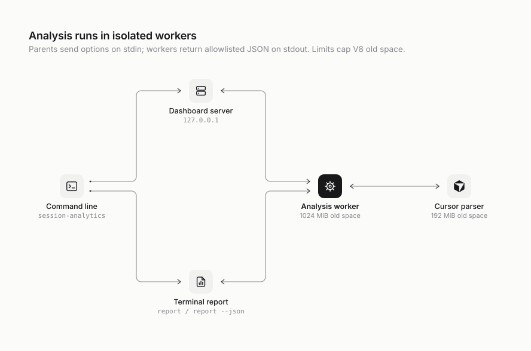

# Architecture

`session-analytics` is a single Node.js 24 package with zero runtime dependencies. Native TypeScript, `node:sqlite` and `node:http` provide parsing, read-only provider access, a private derived index and a loopback dashboard. Unchanged Claude/Codex facts are replayed; `--no-index` reads present sources. MCP additionally caches snapshots for a bounded TTL.

## Modules

| Path | Role |
| --- | --- |
| `bin/session-analytics.ts` | Dispatcher for dashboard, report, rates, export, merge, index, MCP, limits and machines; common help/version handling. |
| `src/server.ts` | Dashboard server: argument and environment parsing, loopback HTTP server, static files, `/api/health`, `/api/analytics`, browser opener. |
| `src/cli.ts` | Terminal report and `--json` snapshot. |
| `src/mcp/` | Stdio protocol, strict tool schemas, bounded snapshot worker, TTL cache, query metrics and structured evidence collector. See [MCP](mcp.md). |
| `src/analysis-process.ts` | Runs one analysis in a child process and returns the parsed result. |
| `src/analysis-worker.ts` | Child-process entry point: reads options on stdin, writes the snapshot JSON on stdout. |
| `src/remote.ts` | Reads other machines: runs `ssh … report --json` on each next to the local scan, maps every exit code and stderr line to a fixed reason and fix, bounds and validates the reply, keeps each machine's status and snapshot as its read settles (falling back to its last good snapshot), refuses the same machine twice, and combines the snapshots. |
| `src/remote/bootstrap.ts`, `src/remote/runtime.ts` | The bundled runtime: a fixed plain-JS bootstrap, kept as a string so compiled installs carry it, sent on stdin to the remote `node -`, and this install's files and digest, sent once per version into that account's cache. |
| `src/machines/` | `machines.json` (strict, private, atomic), the `machines` command, the `check` doctor, each saved machine's last good snapshot, and the machine and account hash. |
| `src/processes.ts` | Registry of child processes (ssh, analysis workers), so a signal or deadline stops them all before exit. |
| `src/analysis-output.ts` | Streams the same snapshot JSON with pipe backpressure, avoiding a second snapshot-sized string in the worker heap. |
| `src/cursor-worker.ts` | Child-process entry point for the Cursor database pass. |
| `src/analyzer.ts` | Discovery, identity validation, repository assignment, provider parsers, pricing, deduplication, and aggregation. |
| `src/providers/adapter.ts` | Private adapter contract: discover roots, identify sessions, analyze into the public allowlist. |
| `src/providers/claude.ts` | Existing Claude parser behind the adapter; shared state and pricing are injected by the analyzer. |
| `src/providers/` | Additional-source registry, bounded readers and projection, Cursor SDK/transcripts, Copilot, OpenCode, Gemini, and Conductor result fallback. |
| `src/public/providers.js` | Provider labels, daily series, and source-specific evidence coverage. |
| `src/pricing/` | Fixed public-feed fetchers, normalization, validation, content-addressed rate tables with immutable observations, indexed request-time history, token-class pricing/coverage, provenance and rates CLI. |
| `src/limits/` | Limit-meter harvesters (Codex `rate_limits`, Claude Agent SDK `rate_limit_event` logs, status line), incremental byte cursors, the private `limits.json` ledger and the `limits` command. Served by `/api/limits`, outside the analysis worker. |
| `src/public/subscription-data.js`, `subscription.js`, `subscription-plans.js` | Subscription view: meter cycles, pace and projection, value-per-percent calibration against the activity ledger, reset history, recommendations, and the reviewed plan price list. |
| `src/public/pricing.js` | Isolated Pricing tab renderer: source freshness, coverage, model cards and the model details dialog. |
| `src/public/pricing-data.js` | Pricing model cards per provider and model from the rate card and the activity ledger for the selected dates (usage-value ordering, unused models, rate rows). |
| `src/public/model-id.js` | Shared bounded model projection for provider parsing, catalogs and Pricing rendering. |
| `src/metrics/velocity.ts` | Fixed agent enums and a streaming hourly counter accumulator attached at existing deduplicated parser counting points. |
| `src/public/velocity-data.js` | Pure calendar rollups, coverage, comparisons, projection scenarios and movers; exercised directly by tests. |
| `src/public/velocity.js`, `velocity.css` | Shared Summary/Velocity charts and isolated view styling. Served through the static allowlist with the existing CSP. |
| `src/interop/` | Validated snapshot IO, sharing/merge, combining full snapshots from several machines, private file export, and explicit opt-in OTLP delivery. No additional provider parsing. |
| `schemas/`, `scripts/snapshot-schema.ts` | Published v1 schemas and exhaustive TypeScript-checked field maps. |
| `src/public/export-data.js`, `evidence.js`, `timestamps.js` | Typechecked pure aggregation/selection, warning vocabulary, UTC normalization, and CSV helpers shared by ingestion, validation, and browser exports. |
| `src/public/export-menu.js`, `shared-view.js` | Bound download previews and aggregate-only snapshot view. |
| `src/store/index.ts` | Scoped incremental ingest, session reuse, dependency invalidation, source-deleted retention, and atomic persistence. |
| `src/store/database.ts` | Private data-directory resolution, permissions, SQLite writer lease, WAL, migrations, status, prune, and rebuild. |
| `src/store/writer-gate.ts` | Private filesystem ticket mutex protecting writers and coordination recovery independently of SQLite. |
| `src/store/fingerprint.ts` | Device/inode, size, nanosecond times, keyed edge fingerprints, and full-prefix verification. |
| `src/store/codex-ledger.ts` | Content-free per-file counter observations and verified append-only continuation. |
| `src/store/projection.ts` | Explicit disk allowlist for session facts, used when writing and reading cached sessions. |
| `src/store/parity.ts` | Typed consistency failures, exact comparison and rotating sample selection. |
| `src/store/cli.ts` | `index status|path|rebuild|prune` management commands. |
| `src/store/errors.ts` | Fixed index failure codes/messages allowed across the worker boundary. |
| `src/types.ts` | Public snapshot types, rate-card types, and internal-only correlation types. |
| `src/public-model.ts`, `src/public/model-id.js` | Shared bounded model-identifier projection for providers, pricing and metric dimensions. |
| `src/metrics/context-windows.ts` | Reviewed Claude context-window table used for `maxContextWindow` and `contextUtilizationPeak`. |
| `src/metrics/compactions.ts` | Compaction boundary reconciliation across the shapes one provider event can be recorded in. |
| `src/brand.ts`, `src/version.ts` | Display name, command name, neutral service ID, and version. |
| `src/public/` | Dashboard: `index.html`, `app.js` (a dependency-free ES module), `styles.css`, bundled fonts, provider marks, favicon. |
| `data/rate-cards.json` | Versioned model rates with an effective date and a source URL per model. |
| `skills/session-analytics/` | Agent skill that launches the dashboard or report. |
| `scripts/demo.ts` | Synthetic dataset generator that runs the tool against that data only. |
| `scripts/benchmark-index.ts` | Numeric-only cold/warm timing, plus full-scan parity for a retained demo dataset. |
| `test/` | Node test runner suites and the shared fixture builder. |

## Process model

<picture>
  <source media="(prefers-color-scheme: dark)" srcset="diagrams/process-model.dark.svg" />
  
</picture>

The server and report never parse transcripts themselves. Each snapshot runs in a fresh worker with `--max-old-space-size=1024`; Cursor uses a separate 192 MiB worker. These are V8 old-space caps, not total resident-memory limits. Only serialized, allowlisted results cross the process boundary. Child stderr is discarded; index failures cross as bounded error codes and other failures use fixed messages.

The Cursor pass runs and serializes before the Claude and Codex pass starts, so the two largest object graphs never coexist in one heap.

With saved machines or `--remote`, the dashboard, report or export process also starts one `ssh` per machine while the local worker scans. Each remote machine runs its own worker and returns its snapshot on stdout (at most 256 MiB, within 300 seconds or `--remote-timeout`); the parent validates it like an imported file and combines it with the local result. With the bundled runtime, the remote bootstrap refuses a cache directory another account could change, verifies the cached runtime against its digest, relays the report's stdout and writes an empty heartbeat line about once a second, so a closed connection fails a write and the bootstrap stops the report's process group. Every ssh and worker is registered in `src/processes.ts`; the deadline, `SIGINT`, `SIGTERM` and `SIGHUP` stop them before the process exits. Remote stderr is reduced to its most telling line and shown only in the terminal with a fixed reason and fix. The combined snapshot lists every machine in `machines` with its state, reason, fix, counts and read time, and tags each session and Claude profile with its machine. A saved machine's validated snapshot is kept after each good read and reused, marked stale, when a later read fails. `report` and `export` wait for every machine; the dashboard serves a snapshot once the local scan is done, using last good snapshots for machines still reading, rebuilds it as each machine settles, and the page polls `/api/machines` until none is reading (`/api/machines?read=1` reads them again without a local scan). A dashboard that reads the saved machines checks `machines.json` on each API request and, when it changed, reads the new set and rebuilds from its last local scan, so a plain launch keeps matching it.

The MCP command serves discovery and handshakes before scanning. Its first tool call starts `src/mcp/worker.ts` with the same 1024 MiB V8 old-space limit, then caches the allowlisted snapshot for a completion-based TTL. Concurrent calls share the worker. Stdio EOF/signals abort and reap it; scans have a 300-second deadline. Output drains for at most 250 ms, then the CLI exits to release unread standard-pipe writes; the 4 MiB output overflow path skips the drain. The worker resolves the trusted launch CWD through the analyzer's existing repository assignment and returns only a repository key. Lifecycle observations are collected during the normal transcript pass in `src/mcp/evidence.ts` and `activity.ts`. The existing pricing pass supplies dated eligible/priced token operands, including unknown prices; provider source-health counts are retained before repository selection; no second transcript scan is required. MCP queries project a smaller response and never forward the full snapshot, warnings, paths or raw exceptions.

## Pipeline

1. **Load local price evidence.** Validate `data/rate-cards.json` plus cached API snapshots; `--rate-card` and `reviewed-only` pin the current reviewed card. Loaders never fetch or write. Request-time resolution binary-searches per-source observation indexes under the configured source order and reviewed exception policy; unchanged tables and their alias indexes are shared. Token-class substitutions retain estimated costs but reduce priced-token coverage and carry explicit assumptions. Only the public rate-card projection crosses the worker boundary; raw payloads, cache paths and internal history do not. See [pricing](pricing.md).
2. **Open optional metadata.** If the Conductor database exists, it is opened read-only and its repositories, workspaces, and sessions are loaded. A missing database is normal. External Conductor, Cursor and OpenCode readers share `src/source-database.ts`: if SQLite cannot open a WAL-mode source after its sidecars disappear in a read-only directory, an immutable URI fallback is permitted only while WAL and rollback-journal files are absent and the main file's device, inode, size, nanosecond mtime and ctime remain unchanged. Guards run before and after reads, including iterator completion and connection close; any source change rejects that read. Active WAL stores retain normal SQLite visibility.
3. **Cursor pass.** In the Cursor child, every `composerData:*` record is read with its `bubbleId:*` records, composer headers map composers to workspaces, and each composer becomes a session assigned to a repository.
4. **Discover provider roots.** Claude Code and Codex roots are collected across profiles (see [providers.md](providers.md)), then deduplicated by resolved real path. An explicit root option replaces discovery for that provider.
5. **Index transcripts.** Each root is walked for transcript files, keyed by the session UUID in the file name. Claude sub-agent files and audit logs are excluded from the index; they are read later as part of their parent session.
6. **Validate identity.** For each indexed session, the first records are read to find the provider's own session ID and working directory. A file is a candidate only when the recorded ID matches the file name and a working directory is present.
7. **Build the Codex counter ledger.** Merge per-file counter observations from the index, reading changed candidates, to decide which file owns each cumulative snapshot (see [Deduplication](#deduplication)). Without the index, every candidate is pre-scanned.
8. **Match orchestrator records.** Conductor sessions are matched to candidates by provider session ID and validated working directory. Legacy rows without a provider ID are recovered only when exactly one candidate shares the provider and working directory and started within 15 minutes. Rows without validated evidence are dropped rather than counted as empty sessions.
9. **Assign repositories.** Every remaining candidate is assigned to a repository from its working directory (see [Repository assignment](#repository-assignment)).
10. **Parse, price, or reuse.** A session can be reused only when its evidence group, metadata, parser revision, rate card, and ownership dependencies match. Otherwise provider parsers stream its files and price requests individually, preserving long-context modifiers.
11. **Retain and aggregate.** Previously indexed sessions with deleted sources join present sessions with an explicit source-deleted mark. The retention floor applies before aggregation; repository filters apply to the full evidenced union.
12. **Project.** `finalizeSession` and the aggregators build the public objects field by field. The result is written as JSON to the parent process.

## Repository assignment

A working directory is assigned to the first match in this order:

1. a Conductor workspace whose path equals the directory;
2. the registered Conductor repository whose root contains the directory (longest root wins);
3. a registered repository named like a Conductor workspace path segment (`.../conductor/workspaces/<name>/...`);
4. the nearest Git root above the directory, where a linked worktree's `.git` file resolves to its main repository; if that root is registered, the registered repository is used;
5. otherwise, a discovered repository for that Git root, named after its basename;
6. a recorded Git remote (for example Codex session metadata) identifies a deleted checkout;
7. temporary directories without a Git root or remote are grouped as `Ephemeral automation sessions`. These are the OS temporary directory, `/tmp` and macOS per-user `/var/folders/*/*/T` directories, under either their `/private` or their short spelling, whether or not they still exist;
8. every other directory without a Git root, remote or Conductor ownership (the home directory, scratch and download folders, deleted checkouts that recorded no remote) is not a repository. All of them share one group, `No repository detected`, with no root directory.

Discovered repository IDs are derived from a hash of the grouping root, so they are stable across runs on the same machine and do not contain the path itself. When the grouping root is a Git remote, every machine derives the same ID. Conductor-registered repositories carry pseudonymous Conductor IDs; `--portable-ids` replaces remote-backed IDs with the remote-derived ID and qualifies discovered local Git roots by hostname. Shared unassigned groups and Conductor repositories without a remote keep their IDs. Portable repository IDs also work with `--repo-id`. Claude and Codex registrations with a known provider session ID receive the same hashed session key as discovered copies; output deduplication keeps the more complete copy if keys collide. These changes apply only to the output projection after the index commit, so cached facts and their signatures keep local IDs and warm scans reuse sessions.

## Deduplication

Provider logs repeat information in several ways. Each is handled explicitly:

| Source of duplication | Strategy |
| --- | --- |
| The same directory reachable through several profile paths or symbolic links | Roots are resolved with `realpath` and read once. |
| The same session file under more than one root | The transcript index merges candidate paths per session ID. |
| Claude Code writes one record per streamed content block, repeating input and cache counters while output grows | Usage is kept per `message.id`, and the snapshot with the most output (the final one) is priced once. |
| Claude tool-use blocks repeated across streamed records | Tool calls are counted once per tool-use ID. |
| Claude human messages repeated in a file | Counted once per record UUID; tool results are not human turns. |
| Codex broadcasts the same process-wide cumulative counter into several session files | Each `(total, last)` usage state is fingerprinted; the file whose nearest preceding local activity is closest owns it, ties broken by timestamp and path; other files skip it. Only `last_token_usage` is summed. |
| A Codex file opens on a process-wide counter that includes requests it never issued | Without per-request usage, only deltas between two snapshots the same file observed are counted; the opening snapshot and any post-reset snapshot are baselines. |
| Codex records the same lifecycle event in several shapes (`event_msg`, `item_completed`, top-level `compacted`) | Turns/messages use the largest shape count. Compactions reconcile shared identities or equal UTC timestamps across shapes and retain distinct boundaries; incomplete/ambiguous evidence is flagged. |
| Codex tool calls | Counted once per `call_id`. |
| Codex execution kind changes mid-file | Each request is attributed to the execution segment (top-level or sub-agent) active when it was observed. |
| Cursor conversation bubbles stored both inline and as separate records | Merged by bubble ID. |
| Cursor tool calls | Counted once per `toolCallId`. |
| Conductor rows pointing at the same provider session | Only the first row per provider session is analyzed. |

## Dashboard server

- Binds to `127.0.0.1` only. The port comes from `--port`, `SESSION_ANALYTICS_PORT`, `CONDUCTOR_PORT + 4`, or `4174`.
- Rejects requests whose `Host` is not `127.0.0.1` or `localhost` before parsing the target; malformed targets get a fixed `400` response. For `/api/*`, a present `Sec-Fetch-Site` must be `same-origin` or `none` and a present `Origin` must match the request's Host including port, otherwise `403`. Static files retain the loopback Origin check. An unhandled rejection logs one fixed line and leaves the server running.
- Accepts `GET` only; anything else gets `405`.
- Serves static files from a fixed map of URL paths, so request paths never reach the file system.
- After the first successful scan, refreshes stale public pricing feeds once in the background unless offline or pinned to a reviewed card. This does not mutate the in-memory analytics snapshot; the next explicit refresh loads new cache evidence. There is no price-update HTTP endpoint.
- Caches one snapshot promise. `/api/analytics?refresh=1` starts a new scan; concurrent requests share the scan in progress.
- Sends a strict Content Security Policy (`default-src 'self'`, no inline script or style, `frame-ancestors 'none'`), `X-Frame-Options: DENY`, `X-Content-Type-Options: nosniff`, `Referrer-Policy: no-referrer`, and same-origin opener and resource policies. No CORS headers are sent.
- If the port is taken, it reuses a live dashboard only when `/api/health` has its service ID, the same normalized analysis-options SHA-256 hash, and a launch token matching `dashboard-PORT.token` in the caller's private data directory. The token is random per launch, written atomically with mode `0600` only after binding the port, inside a mode `0700` directory. A different configuration or an unverifiable service exits with an error directing you to stop it or choose `--port`. Saved-file dashboards and the demo refuse port reuse.

## Persistent index

The default data directory is the macOS Application Support directory or the Linux XDG data directory described in the [command-line reference](cli.md#local-index). `index.sqlite`, its WAL/SHM sidecars, `writer.sqlite` (a small coordination database), and `index.key` are mode `0600` inside a mode `0700` directory. Links, hard-linked files, and foreign-owned files are rejected. No source store is modified. `--no-index` returns before opening any index file.

The schema uses `PRAGMA user_version` and ordered transactional migrations. Version 1 creates metadata, evidence, and session facts; version 2 adds deletion state, retention indexing, scan statistics, and keyed counter reservations; version 3 adds verified retention dates and keyed exclusion checkpoints; version 4 adds per-file Claude ownership observations and per-session Conductor record projections. Future versions are refused rather than downgraded. WAL uses `synchronous=FULL`, a 5-second busy timeout, foreign keys, disabled trusted schema, and secure deletion. A domain-separated key-verification MAC is checked before selecting a scope. Legacy stores bootstrap it only after authenticating their existing payloads; unverifiable keyed-only stores fail closed.

A filesystem bakery mutex protects the SQLite writer transaction and its recovery. Each process publishes a private choosing ticket, then an ordered numeric ticket using atomic rename, and waits for preceding live tickets. Tickets contain only a process ID, random nonce, and ordering number; abandoned tickets from dead processes are removed by their unique names. The 5-second wait limit gives a fixed busy error. This requires a local filesystem with coherent atomic rename and directory reads. SQLite still coordinates older writers and releases its locks on process exit. Rebuild can quarantine corrupt `writer.sqlite` files while holding the filesystem mutex; contention is never treated as corruption. Status checks both databases and the key, and can read the last committed generation during ingest.

### Reuse and invalidation

- Evidence is keyed by HMAC-SHA-256 of its absolute local path with the machine key. Fingerprints contain device/inode, byte length, nanosecond mtime **and ctime**, plus keyed hashes of the first and last 4 KiB. Content and raw paths never enter SQLite. Ctime catches middle-of-file rewrites even when size and mtime are restored. This detects ordinary filesystem changes, not an adversary controlling the filesystem and its metadata.
- Source scope includes explicit provider roots (or the machine/profile discovery policy), the Cursor/Conductor configuration, and hidden-record policy. Machine and repository API entrypoints both include hidden records by default; an explicit exclusion still selects an isolated scope. Repository filters are projections over this scope. Switching an explicit source root never imports retained facts from a different scope.
- Session signatures include the complete evidence group, relevant metadata, reviewed rate card, analyzer/ledger/store/projection revision, the analysis time zone (hourly activity cells are local, so a session cached under another zone is parsed again), and Codex ownership dependencies for every continuation page. Proven inherited-call dependencies also invalidate otherwise unchanged descendants. Headers are still validated and repository assignment is still computed from current local evidence. A Git/worktree mapping or Conductor metadata change therefore changes the signature. Pruned groups keep only keyed signature/source checkpoints, allowing unchanged excluded groups to skip session parsing. Evidence, metadata, ownership, or parser-policy changes re-evaluate them; new activity can re-enter above the floor.
- Validated same-identity Claude main copies and their current `subagents/` trees form one group. Each distinct child directory is enumerated once, even when discovery already supplies every child; path storage grows with physical evidence rather than the square of the child count. Adding, changing, replacing, truncating, or removing a member invalidates the composite. Stable response IDs deduplicate copied usage across distinct sessions; those ownership cases bypass session-local reuse. A surviving child-only projection cannot replace a fuller indexed parent. A present genuine main stream retains primary timing precedence over children.
- Codex stores each file's selected and earliest observation of each numeric counter fingerprint, generated-activity gap, model set, explicit response receipts, hashed ancestry/call identities, and append continuation state. Explicit response identities establish request multiplicity. Proven pre-birth ancestor states and exact request-chain coverage suppress replay before proximity ranking. Unresolved numeric coincidences retain a conservative total and partial evidence. Inherited-call replay sets contain only call IDs also exposed by the child, avoiding ancestor-call copies for unrelated child evidence. Interval proofs consume eligible counter fingerprints lazily. Every changed ownership decision invalidates its consumers even if their files are unchanged. Timestamp-free counters disable Codex session reuse for that scan because order-sensitive claim ownership cannot be proved.
- Append continuation is limited to the Codex **ledger pass**: the same device/inode, increased length, a newline-terminated old file, and a matching keyed hash of the **entire old prefix** are required. A size increase and matching edge samples alone are insufficient. Partial lines, rewrites, replacements, and truncation trigger a full ledger read. Changed session aggregates are recomputed because later records can revise deduplication, streaming maxima, and attribution.
- The Claude ownership pre-pass stores each transcript file's assistant usage observations under its fingerprint, with message IDs replaced by keyed hashes. An unchanged file replays them; a changed, replaced or growing file is read again, and a file that could not be read completely is never stored, so it stays possibly shared exactly as in a full scan. Entries for files no longer visited are dropped.
- Conductor result receipts and assistant messages are stored per Conductor session as the same allowlisted projection the fallback builds in memory, with every identifier replaced by a keyed hash. The entry is reused while a per-session change signature is unchanged: row count, rowid sum and maximum, earliest/latest `created_at`, and the count, byte sum and rowid-weighted byte sum of `id`, `content`, `full_message`, `created_at` and `sdk_message_id`. These come from the session index and SQLite record headers without parsing message JSON. They catch inserted and deleted rows and the in-place fills Conductor performs (`full_message`, `sdk_message_id`); `sent_at` and `cancelled_at` are not projected. An in-place rewrite that preserves every byte length is not detected; the rotating audit compares a cached entry against a fresh extraction. Raw provider-session and receipt identities, needed only to order groups and break equal-time receipt ties exactly, are taken from the current scan; a group whose identity is not otherwise known is re-read from Conductor.
- Cursor is refreshed through the existing isolated reader on every scan; mutable SQLite tables, WALs, workspace metadata, and repository assignment make a single database-file fingerprint insufficient. Its projected session facts are stored for retention, but a new Cursor incremental adapter remains a follow-up.

### Atomicity and retention

Index-only fingerprint, projection, persistence and audit failures propagate past the provider parsing catch sites as typed consistency failures. The analyzer closes and rolls back the writer before retrying with `noIndex`; all parser collectors and Codex claims are rebuilt. A fixed discovery warning explains that the result covers present sources and omits retained history. Integrity/MAC/key failures retain their existing fail-closed behavior.

Each warm scan rotates through at most four previously indexed native sessions, one unchanged Codex ledger, one Claude ownership file and one Conductor session. Session audits run before replaying their ownership claims; unstable audit claims are discarded and normal component deferral handles source changes. Successful sample cursors and P0 audit counts commit with the scan. Cached ledgers are hydrated one at a time from SQLite when computing dependency signatures; duplicate broadcast observations are not retained across all files in the worker heap.

Previous session rows are streamed from SQLite and their rollback payloads compressed in memory with Node's built-in zlib. They are inflated one at a time for replay or restoration. The on-disk JSON/MAC format and transaction semantics are unchanged; this avoids retaining all old JSON strings alongside the hydrated output graph on warm scans.

Conductor recovery likewise compresses each row's allowlisted message projections in memory while joining provider identities. It expands one provider group at a time and releases completed groups, preserving cross-row deduplication without retaining all expanded histories beside the native snapshot. Prose is removed by the SQL projection before this boundary; only the keyed, allowlisted per-session projection described above is written to disk.

The schema projection builds wide objects with `Object.fromEntries`, avoiding a separate V8 property hash table per session while preserving the recursive allowlist and validation. The worker serializes arrays in the snapshot and its aggregate namespaces one item at a time and awaits pipe backpressure. The receiving process still gets exactly one ordinary JSON snapshot; the worker no longer allocates a second complete snapshot-sized string before writing it. Serialization tests compare the exact JSON bytes.

Facts, fingerprints, deletion marks, exclusions, reservations, and scan statistics commit in one main-database transaction. An exception rolls it back. Files are checked again before commit. Deferral follows the complete connected component of prior owners, current owners, and consumers, including undated fingerprints and counters an old owner no longer observes. Every pending session and exclusion in an unstable component is restored to its prior generation, its ledgers are invalidated, and new reservations are discarded. Unrelated stable components can commit. The current response remains a best-effort live snapshot and carries a fixed warning. The next scan re-evaluates deferred files and their ownership dependents.

When a previously validated main source disappears, its last public session projection is retained with `transcript.sourceDeleted: true`. A moved rollout with the same provider identity updates its source keys rather than creating a duplicate. Present-but-invalid identity evidence is excluded; an unreadable source tree keeps prior facts with an availability warning instead of declaring deletion. Retained-only repositories keep keyed root/remote matches for CLI filtering without storing paths. Cursor composers absent from a successful database read are retained similarly.

Deleted Codex owners reserve their attributed counter states, so a surviving broadcast receiver cannot charge them again. Every request claim checks retired membership independently of timestamps or ledger ownership. Prune removes sessions last active strictly before its UTC date and persists a retention floor; keyed membership of retired counters remains solely to prevent rebilling after pruning. Event extrema compare parsed instants and are stored in normalized UTC. Pre-version-3 retention dates are unverified and cannot justify pruning until a source is reparsed; source-deleted legacy facts remain conservatively retained. Raw provider files are untouched. Rebuild clears facts, exclusions, counters, and the retention floor; deleted history cannot be reconstructed. Corrupt databases are moved to private `.rebuild-*` quarantine files; healthy rebuilds clear and vacuum the existing database. Quarantines are never opened by analysis or included in status/prune and may be removed manually after recovery.

Retained facts use the parser and price card from their last successful ingest. They are not silently repriced using current model aggregates, which would lose per-request long-context behavior. A fixed warning states this. The index does not archive raw files or separately freeze removed subagent contributions when a main file remains; a changed partial Claude group is recomputed from present evidence.

### Verification

`test/index-parity.test.ts` includes streamed Claude composites, Codex counter loss after projection failures, signed stale session/ledger detection, liveness aging and content-free source-generation diagnostics. Four memory regressions complete under a 64 MB test heap: 600,000 broadcast observations, loading 400 dense cached sessions, projecting 5,000 sessions, and serializing a snapshot larger than 128 MiB. The production worker stays capped at 1024 MB. `node scripts/parity.ts --machine` compares full, cold and warm analyses against current local evidence under `/tmp/session-analytics-realscan.lock`, using a fresh `.lane/` data directory and offline rates. It emits only aggregates, schema field names and hashed keys. Source-generation diagnostics never read message tables or copy transcript content; unfiltered mismatches still fail the audit even when a separate stable-evidence comparison matches. Other provider stores are explicitly marked unverified by this native-file inventory. The temporary index is removed on normal completion or a caught failure.

`test/index-store.test.ts` checks cold/warm/full parity, cross-file ownership changes, streamed/composite invalidation, prefix verification, rotation/truncation, deletion, pruning, migrations, corruption, concurrency, rollback, permissions, and sentinel absence in SQLite and output. To measure the demo: run `node scripts/demo.ts report --keep`, then `node scripts/benchmark-index.ts --demo-root <printed-synthetic-directory>`. `--machine` instead performs one cold ingest and one incremental launch against local defaults, emits only counts/timings, and removes its temporary index on exit.

## Dashboard client

Navigation groups are Overview (Summary, Velocity), Economics (Costs, Pricing), and Usage (Tools, Activity). Activity is last in navigation, view stepping and the command palette. The shared window defaults to 30 days; an explicit `?window=` preset overrides it without browser persistence. The URL follows the view, window (`?window=`, custom `?start=`/`?end=`) and repository focus (`?repo=` with the opaque repository ID): view, preset and repository changes add a history entry, date edits replace the current one, and Back/Forward restores them (`src/public/url-state.js`). `?open=`, `?theme=` and `?density=` are one-shot: applied once, then removed, and never saved as preferences. `src/public/theme-boot.js` is a same-origin classic script in `<head>` that sets the theme and density before the first paint, because the CSP forbids inline scripts.

`src/public/app.js` is a plain ES module with no framework or build step. It fetches one snapshot and derives every view from the flattened `sessions` list, so time-window, repository, and provider filters are applied in the browser without another scan. Every money figure for a window (Summary, fleet table, Costs, Pricing, Velocity and the daily CSV export) sums the activity ledger's event-date cells through `buildVelocity` (`ledgerMoney` in `view-model.js` splits it by cost basis, provider and model), independently of session-start filtering, so a long-running session can contribute value after its start falls outside the window and every view shows the same total. Session counts, tokens and tools select sessions by start date. The snapshot declares the analysis timezone; both calendars use it. Legacy UTC spend fields remain available to other consumers. Only the active view is rendered. Charts are built as inline SVG and DOM nodes; no inline scripts or styles are used, which keeps the CSP strict.

Retention counts and pricing caveats follow the filtered sessions; scan-wide warnings remain visible on every tab. Historical working observations from deleted or unavailable sources are excluded from the live snapshot count. Retained prices are qualified beside summary totals and in the shared view context.

## Design constraints

- **No runtime dependencies.** A tool that reads every transcript on a machine should have a small, auditable supply chain. Development dependencies are TypeScript and Node type definitions only.
- **Erasable TypeScript.** The code runs directly under Node's type stripping, so it avoids enums, namespaces, and parameter properties (`erasableSyntaxOnly` in `tsconfig.json`).
- **Streaming parsers.** Transcripts are read line by line. Identity checks stop at the first records that carry an ID and working directory, and concurrency is kept low because a single Codex `session_meta` record can be several megabytes.
- **Fail closed on content.** When a record is malformed it is counted as a warning, not echoed.

## Planned changes

The remaining native parsers can move behind the adapter boundary introduced below. The complete projection now has a persistent index. Remaining work includes a normalized event model and incremental mutable-database adapters. See [roadmap.md](roadmap.md).

## Provider adapter boundary

`ProviderAdapter<Session, Context>` owns `discoverRoots`, `identify`, and `analyze`. Session identity, working directory, source path, and opaque project grouping keys are private worker data. Only `SessionAnalytics` crosses the public boundary. The host supplies repository assignment and the existing pricing function; adapters do not fetch rates, run provider CLIs, or write provider stores. Claude retains its mature mutable-state/finalizer implementation through injected callbacks; a saved five-session fixture checks the complete legacy projection after migration.

Additional adapters run sequentially after the original stores. For the same Cursor ID, composer evidence wins over SDK runs, and SDK runs win over activity-only transcripts. Identity matching is exact; tools or tokens from copies are never added together. Conductor results run last and cannot supplement any canonical provider identity or uniquely recovered legacy session. Distinct SDK result UUIDs are counted once, including duplicate database envelopes; rows without provider IDs can use the result's own identity to suppress copies.

New JSONL readers release streams on early identity exit and retain only projected data. Recursive discovery does not follow child symlinks and is limited to eight directory levels. Legacy monolithic Gemini JSON is limited to 32 MiB, with JSONL available for larger histories. Source failures produce fixed warnings, retain successfully read sessions, and do not echo exceptions. All SQLite connections use `readOnly: true` and close in `finally` blocks. A missing new store is normal; a present unsupported store emits a fixed warning.

Gemini maps a provider project hash through known repository/workspace paths, `projects.json`, or `.project_root`; Cursor's encoded project directory is matched only to an unambiguous known path. Unresolved projects receive a pseudonymous unassigned group. The code never guesses a filesystem path by reversing an encoded folder name.

The roadmap moves the analyzer toward per-source adapters, a normalized event model, and a persistent content-free SQLite index with incremental ingest, so launches no longer rescan unchanged files. See [roadmap.md](roadmap.md).

## Interchange boundary

Full and shared snapshots have separate closed schemas. `--snapshot` bypasses analysis and validates file input before display. Merging full snapshots from several machines (`src/interop/combine.ts`) unions sessions and repositories, recomputes every rollup with the shared aggregation helpers, and validates the result like an imported file. Shared files retain only thresholded repository counters; no synthetic sessions are created to reuse session charts. Aggregation/selection helpers run in both Node and the browser and are checked as JavaScript against the public types. File imports reconcile every rollup and applicable session invariant. Browser export previews bind one selection, are invalidated on data/scope changes including keyboard provider toggles, and recheck the selection description before downloading. Health checks distinguish live scans from saved files. Exports write new private files; OTLP posts only after local output succeeds and only with an explicit endpoint flag. See [interop.md](interop.md) for the formats and privacy limits.
The roadmap moves parsing toward per-source adapters, a normalized event model, and more granular continuation checkpoints on top of the persistent index. See [roadmap.md](roadmap.md).

## v0.6.0 integration boundaries

All native metrics attach to the existing Claude/Codex parse streams. The Codex counter ledger establishes ownership before accounting; metrics use the same deduplicated, priced usage. Additional adapters label their fidelity and unavailable metrics. The analysis worker remains capped at 1024 MiB.

The published schema supplies the recursive disk allowlist. Cached session facts include velocity, compaction and context-window counters, history profile evidence, MCP evidence and model price provenance. Provider source changes, parser/schema code, pricing policy/history and source options invalidate reuse.

Mutable additional-provider stores are reread, while their complete derived sessions can be retained after deletion. Repository/day filters project the same population; they do not create separate index datasets. Snapshot dashboards validate input and derive all views without scanning local history or refreshing prices.

The shared browser aggregation/selection modules also serve filtered exports. MCP exposes bounded summaries of each metric namespace, with coverage. No raw parser object crosses the worker, index, API, MCP or export boundaries.

## History recovery and coverage

`src/providers/conductor-records.ts` projects only fixed JSON paths inside read-only SQLite, so SDK prose and tool arguments/results never enter the JavaScript row projection. `conductor-messages.ts` rebuilds missing Claude sessions using `claude-usage.ts`, shared with the native parser. It preserves dated message accounting and compares, rather than adds, the result-receipt baseline. Canonical provider identities retain precedence.

`src/metrics/history-coverage.ts` reads bounded, optional profile statistics, including profiles whose projects directory has been deleted. `history-statistics.ts` collects the provider’s streamed-block counting basis during existing native parses, separately from the deduplicated per-day request tokens that native Claude sessions publish as `historyProfile`. Recovered record counters provide an unknown-profile overlap reserve. The aggregate-only namespace is collected after the evidence union and omitted for repository-filtered analysis. It is refreshed each scan, independent of the derived index. Public schema projection persists recovered session facts; full-snapshot JSON keeps machine coverage, while filtered exports omit it. `src/report/history.ts` and `src/public/history-coverage.js` supply the report and additive Summary panel.
