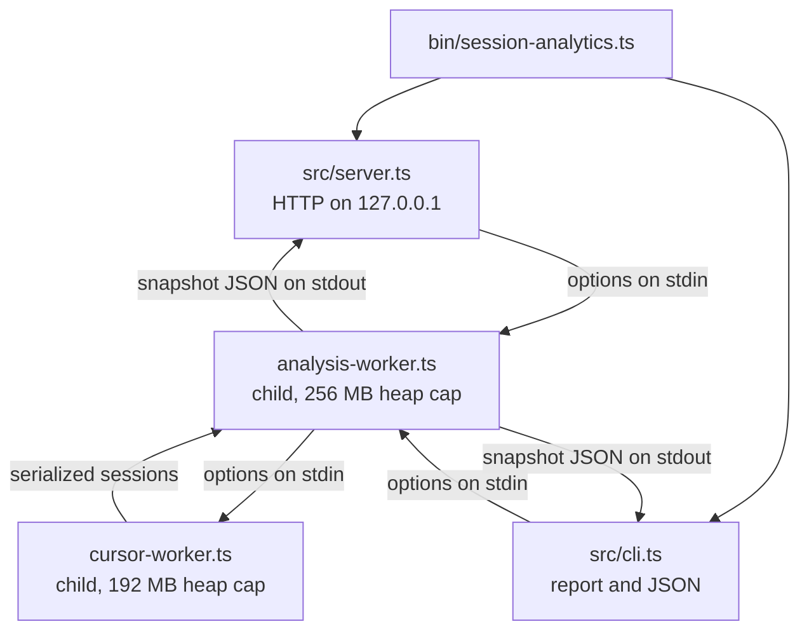

# Architecture

`session-analytics` is a single Node.js 24 package with no runtime dependencies. It uses Node's native TypeScript type stripping, `node:sqlite` for read-only database access, and `node:http` for the dashboard. Every launch performs a fresh scan; there is no persistent index yet (planned in [M0](roadmap.md#m0-correctness)).

## Modules

| Path | Role |
| --- | --- |
| `bin/session-analytics.ts` | Command dispatcher: `dashboard` (default), `report`, `rates`, `--help`, `--version`. Adds `--open` to the dashboard unless `--no-open` is given. |
| `src/server.ts` | Dashboard server: argument and environment parsing, loopback HTTP server, static files, `/api/health`, `/api/analytics`, browser opener. |
| `src/cli.ts` | Terminal report and `--json` snapshot. |
| `src/analysis-process.ts` | Runs one analysis in a child process and returns the parsed result. |
| `src/analysis-worker.ts` | Child-process entry point: reads options on stdin, writes the snapshot JSON on stdout. |
| `src/cursor-worker.ts` | Child-process entry point for the Cursor database pass. |
| `src/analyzer.ts` | Discovery, identity validation, repository assignment, provider parsers, pricing, deduplication, and aggregation. |
| `src/pricing/` | Fixed public-feed fetchers, normalization, validation, immutable cache, request-time history and provenance, rates CLI. |
| `src/public/pricing.js` | Isolated Pricing tab renderer using selected sessions. |
| `src/types.ts` | Public snapshot types, rate-card types, and internal-only correlation types. |
| `src/brand.ts`, `src/version.ts` | Display name, command name, neutral service ID, and version. |
| `src/public/` | Dashboard: `index.html`, `app.js` (a dependency-free ES module), `styles.css`, bundled fonts, provider marks, favicon. |
| `data/rate-cards.json` | Versioned model rates with an effective date and a source URL per model. |
| `skills/session-analytics/` | Agent skill that launches the dashboard or report. |
| `scripts/demo.ts` | Synthetic dataset generator that runs the tool against that data only. |
| `test/` | Node test runner suites and the shared fixture builder. |

## Process model

The server and the report never parse transcripts themselves. Each snapshot is computed in a fresh child process started with `--max-old-space-size=256`, and Cursor's composer database is parsed in its own child with a 192 MB cap. This keeps a machine-wide scan from growing the long-running server's memory, releases everything when the child exits, and means only serialized, already-allowlisted results cross the process boundary. A child's standard error is discarded; a failure surfaces as a fixed message.

The Cursor pass runs and serializes before the Claude and Codex pass starts, so the two largest object graphs never coexist in one heap.

## Pipeline

1. **Load local price evidence.** Validate `data/rate-cards.json` plus cached API snapshots; `--rate-card` and `reviewed-only` pin the current reviewed card. Loaders never fetch or write. Request-time resolution selects archived evidence under the configured source order and reviewed exception policy. Only the public rate-card projection crosses the worker boundary; raw payloads, cache paths and internal history do not. See [pricing](pricing.md).
2. **Open optional metadata.** If the Conductor database exists, it is opened read-only and its repositories, workspaces, and sessions are loaded. A missing database is normal.
3. **Cursor pass.** In the Cursor child, every `composerData:*` record is read with its `bubbleId:*` records, composer headers map composers to workspaces, and each composer becomes a session assigned to a repository.
4. **Discover provider roots.** Claude Code and Codex roots are collected across profiles (see [providers.md](providers.md)), then deduplicated by resolved real path. An explicit root option replaces discovery for that provider.
5. **Index transcripts.** Each root is walked for transcript files, keyed by the session UUID in the file name. Claude sub-agent files and audit logs are excluded from the index; they are read later as part of their parent session.
6. **Validate identity.** For each indexed session, the first records are read to find the provider's own session ID and working directory. A file is a candidate only when the recorded ID matches the file name and a working directory is present.
7. **Build the Codex counter ledger.** Every Codex candidate is pre-scanned to decide which file owns each cumulative token snapshot (see [Deduplication](#deduplication)).
8. **Match orchestrator records.** Conductor sessions are matched to candidates by provider session ID and validated working directory. Legacy rows without a provider ID are recovered only when exactly one candidate shares the provider and working directory and started within 15 minutes. Rows without validated evidence are dropped rather than counted as empty sessions.
9. **Assign repositories.** Every remaining candidate is assigned to a repository from its working directory (see [Repository assignment](#repository-assignment)).
10. **Parse and price.** Provider parsers stream each file line by line and accumulate counters. Each request is priced as it is added, so long-context modifiers use that request's input size.
11. **Aggregate.** Sessions roll up into repository summaries, then into the machine snapshot. Any repository filter is applied here.
12. **Project.** `finalizeSession` and the aggregators build the public objects field by field. The result is written as JSON to the parent process.

## Repository assignment

A working directory is assigned to the first match in this order:

1. a Conductor workspace whose path equals the directory;
2. the registered Conductor repository whose root contains the directory (longest root wins);
3. a registered repository named like a Conductor workspace path segment (`.../conductor/workspaces/<name>/...`);
4. the nearest Git root above the directory, where a linked worktree's `.git` file resolves to its main repository; if that root is registered, the registered repository is used;
5. otherwise, a discovered repository for that Git root, named after its basename;
6. a non-Git directory becomes its own group, named `<basename> · <hash> (local directory)`;
7. macOS temporary directories without a Git root are grouped as `Ephemeral automation sessions`.

Discovered repository IDs are derived from a hash of the grouping root, so they are stable across runs on the same machine and do not contain the path itself.

## Deduplication

Provider logs repeat information in several ways. Each is handled explicitly:

| Source of duplication | Strategy |
| --- | --- |
| The same directory reachable through several profile paths or symbolic links | Roots are resolved with `realpath` and read once. |
| The same session file under more than one root | The transcript index merges candidate paths per session ID. |
| Claude Code writes one record per streamed content block, repeating input and cache counters while output grows | Usage is kept per `message.id`, and the snapshot with the most output (the final one) is priced once. |
| Claude tool-use blocks repeated across streamed records | Tool calls are counted once per tool-use ID. |
| Claude human messages repeated in a file | Counted once per record UUID; tool results are not human turns. |
| Codex broadcasts the same process-wide cumulative counter into several session files | Each `(total, last)` usage state is fingerprinted; the file whose nearest preceding local activity is closest owns it, ties broken by timestamp and path; other files skip it. Only `last_token_usage` is summed. |
| A Codex file opens on a process-wide counter that includes requests it never issued | Without per-request usage, only deltas between two snapshots the same file observed are counted; the opening snapshot and any post-reset snapshot are baselines. |
| Codex records the same lifecycle event in several shapes (`event_msg`, `item_completed`, top-level `compacted`) | Turns, messages, and compactions take the largest count among shapes rather than the sum. |
| Codex tool calls | Counted once per `call_id`. |
| Codex execution kind changes mid-file | Each request is attributed to the execution segment (top-level or sub-agent) active when it was observed. |
| Cursor conversation bubbles stored both inline and as separate records | Merged by bubble ID. |
| Cursor tool calls | Counted once per `toolCallId`. |
| Conductor rows pointing at the same provider session | Only the first row per provider session is analyzed. |

## Dashboard server

- Binds to `127.0.0.1` only. The port comes from `--port`, `SESSION_ANALYTICS_PORT`, `CONDUCTOR_PORT + 4`, or `4174`.
- Rejects requests whose `Host` is not `127.0.0.1` or `localhost`, or whose `Origin` (when present) is not a loopback origin, with `403`.
- Accepts `GET` only; anything else gets `405`.
- Serves static files from a fixed map of URL paths, so request paths never reach the file system.
- After the first successful scan, refreshes stale public pricing feeds once in the background unless offline or pinned to a reviewed card. This does not mutate the in-memory analytics snapshot; the next explicit refresh loads new cache evidence. There is no price-update HTTP endpoint.
- Caches one snapshot promise. `/api/analytics?refresh=1` starts a new scan; concurrent requests share the scan in progress.
- Sends a strict Content Security Policy (`default-src 'self'`, no inline script or style, `frame-ancestors 'none'`), `X-Frame-Options: DENY`, `X-Content-Type-Options: nosniff`, `Referrer-Policy: no-referrer`, and same-origin opener and resource policies. No CORS headers are sent.
- If the port is taken, it checks `/api/health` for its own service ID and reuses that dashboard; otherwise it exits with an error.

## Dashboard client

`src/public/app.js` is a plain ES module with no framework or build step. It fetches one snapshot and derives every view from the flattened `sessions` list, so time-window, repository, and provider filters are applied in the browser without another scan. Only the active view is rendered. Charts are built as inline SVG and DOM nodes; no inline scripts or styles are used, which keeps the CSP strict.

## Design constraints

- **No runtime dependencies.** A tool that reads every transcript on a machine should have a small, auditable supply chain. Development dependencies are TypeScript and Node type definitions only.
- **Erasable TypeScript.** The code runs directly under Node's type stripping, so it avoids enums, namespaces, and parameter properties (`erasableSyntaxOnly` in `tsconfig.json`).
- **Streaming parsers.** Transcripts are read line by line. Identity checks stop at the first records that carry an ID and working directory, and concurrency is kept low because a single Codex `session_meta` record can be several megabytes.
- **Fail closed on content.** When a record is malformed it is counted as a warning, not echoed.

## Planned changes

The roadmap moves the analyzer toward per-source adapters, a normalized event model, and a persistent content-free SQLite index with incremental ingest, so launches no longer rescan unchanged files. See [roadmap.md](roadmap.md).
