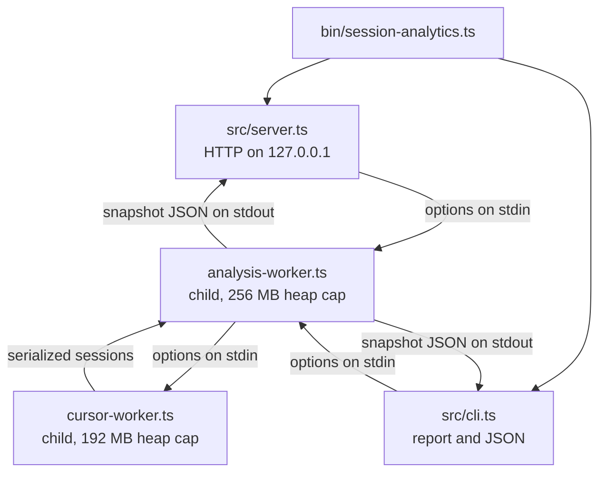

# Architecture

`session-analytics` is a single Node.js 24 package with no runtime dependencies. It uses native TypeScript type stripping, `node:sqlite` for read-only provider access and a private derived index, and `node:http` for the dashboard. Launches and refreshes reuse unchanged Claude/Codex session facts. `--no-index` keeps the original full-scan behavior.

## Modules

| Path | Role |
| --- | --- |
| `bin/session-analytics.ts` | Command dispatcher: `dashboard` (default), `report`, `--help`, `--version`. Adds `--open` to the dashboard unless `--no-open` is given. |
| `src/server.ts` | Dashboard server: argument and environment parsing, loopback HTTP server, static files, `/api/health`, `/api/analytics`, browser opener. |
| `src/cli.ts` | Terminal report and `--json` snapshot. |
| `src/analysis-process.ts` | Runs one analysis in a child process and returns the parsed result. |
| `src/analysis-worker.ts` | Child-process entry point: reads options on stdin, writes the snapshot JSON on stdout. |
| `src/cursor-worker.ts` | Child-process entry point for the Cursor database pass. |
| `src/analyzer.ts` | Discovery, identity validation, repository assignment, provider parsers, pricing, deduplication, and aggregation. |
| `src/store/index.ts` | Scoped incremental ingest, session reuse, dependency invalidation, source-deleted retention, and atomic persistence. |
| `src/store/database.ts` | Private data-directory resolution, permissions, SQLite writer lease, WAL, migrations, status, prune, and rebuild. |
| `src/store/writer-gate.ts` | Private filesystem ticket mutex protecting writers and coordination recovery independently of SQLite. |
| `src/store/fingerprint.ts` | Device/inode, size, nanosecond times, keyed edge fingerprints, and full-prefix verification. |
| `src/store/codex-ledger.ts` | Content-free per-file counter observations and verified append-only continuation. |
| `src/store/projection.ts` | Explicit disk allowlist for session facts, used when writing and reading cached sessions. |
| `src/store/cli.ts` | `index status|path|rebuild|prune` management commands. |
| `src/store/errors.ts` | Fixed index failure codes/messages allowed across the worker boundary. |
| `src/types.ts` | Public snapshot types, rate-card types, and internal-only correlation types. |
| `src/brand.ts`, `src/version.ts` | Display name, command name, neutral service ID, and version. |
| `src/public/` | Dashboard: `index.html`, `app.js` (a dependency-free ES module), `styles.css`, bundled fonts, provider marks, favicon. |
| `data/rate-cards.json` | Versioned model rates with an effective date and a source URL per model. |
| `skills/session-analytics/` | Agent skill that launches the dashboard or report. |
| `scripts/demo.ts` | Synthetic dataset generator that runs the tool against that data only. |
| `scripts/benchmark-index.ts` | Numeric-only cold/warm timing, plus full-scan parity for a retained demo dataset. |
| `test/` | Node test runner suites and the shared fixture builder. |

## Process model

The server and the report never parse transcripts themselves. Each snapshot is computed in a fresh child process started with `--max-old-space-size=256`, and Cursor's composer database is parsed in its own child with a 192 MB cap. This keeps a machine-wide scan from growing the long-running server's memory, releases everything when the child exits, and means only serialized, already-allowlisted results cross the process boundary. A child's standard error is discarded; a failure surfaces as a fixed message. Index failures use a bounded error-code envelope so callers can distinguish busy, unavailable, incompatible, and integrity failures without forwarding error text or stacks.

The Cursor pass runs and serializes before the Claude and Codex pass starts, so the two largest object graphs never coexist in one heap.

## Pipeline

1. **Load the rate card.** `data/rate-cards.json`, or `--rate-card`, is validated: USD currency, an ISO effective date, non-negative rates, a provider of `claude` or `codex`, and a source for every model.
2. **Open optional metadata.** If the Conductor database exists, it is opened read-only and its repositories, workspaces, and sessions are loaded. A missing database is normal.
3. **Cursor pass.** In the Cursor child, every `composerData:*` record is read with its `bubbleId:*` records, composer headers map composers to workspaces, and each composer becomes a session assigned to a repository.
4. **Discover provider roots.** Claude Code and Codex roots are collected across profiles (see [providers.md](providers.md)), then deduplicated by resolved real path. An explicit root option replaces discovery for that provider.
5. **Index transcripts.** Each root is walked for transcript files, keyed by the session UUID in the file name. Claude sub-agent files and audit logs are excluded from the index; they are read later as part of their parent session.
6. **Validate identity.** For each indexed session, the first records are read to find the provider's own session ID and working directory. A file is a candidate only when the recorded ID matches the file name and a working directory is present.
7. **Build the Codex counter ledger.** Merge per-file counter observations from the index, reading changed candidates, to decide which file owns each cumulative snapshot (see [Deduplication](#deduplication)). Without the index, every candidate is pre-scanned.
8. **Match orchestrator records.** Conductor sessions are matched to candidates by provider session ID and validated working directory. Legacy rows without a provider ID are recovered only when exactly one candidate shares the provider and working directory and started within 15 minutes. Rows without validated evidence are dropped rather than counted as empty sessions.
9. **Assign repositories.** Every remaining candidate is assigned to a repository from its working directory (see [Repository assignment](#repository-assignment)).
10. **Parse, price, or reuse.** A session can be reused only when its evidence group, metadata, parser revision, rate card, and ownership dependencies match. Otherwise provider parsers stream its files and price requests individually, preserving long-context modifiers.
11. **Retain and aggregate.** Previously indexed sessions with deleted sources join present sessions with an explicit source-deleted mark. The retention floor applies before aggregation; repository filters apply to the full evidenced union.
12. **Project.** `finalizeSession` and the aggregators build the public objects field by field. The result is written as JSON to the parent process.

## Repository assignment

A working directory is assigned to the first match in this order:

1. a Conductor workspace whose path equals the directory;
2. the registered Conductor repository whose root contains the directory (longest root wins);
3. a registered repository named like a Conductor workspace path segment (`.../conductor/workspaces/<name>/...`);
4. the nearest Git root above the directory, where a linked worktree's `.git` file resolves to its main repository; if that root is registered, the registered repository is used;
5. otherwise, a discovered repository for that Git root, named after its basename;
6. a non-Git directory becomes its own group, named `<basename> · <hash> (local directory)`;
7. macOS temporary directories without a Git root are grouped as `Ephemeral automation sessions`.

Discovered repository IDs are derived from a hash of the grouping root, so they are stable across runs on the same machine and do not contain the path itself.

## Deduplication

Provider logs repeat information in several ways. Each is handled explicitly:

| Source of duplication | Strategy |
| --- | --- |
| The same directory reachable through several profile paths or symbolic links | Roots are resolved with `realpath` and read once. |
| The same session file under more than one root | The transcript index merges candidate paths per session ID. |
| Claude Code writes one record per streamed content block, repeating input and cache counters while output grows | Usage is kept per `message.id`, and the snapshot with the most output (the final one) is priced once. |
| Claude tool-use blocks repeated across streamed records | Tool calls are counted once per tool-use ID. |
| Claude human messages repeated in a file | Counted once per record UUID; tool results are not human turns. |
| Codex broadcasts the same process-wide cumulative counter into several session files | Each `(total, last)` usage state is fingerprinted; the file whose nearest preceding local activity is closest owns it, ties broken by timestamp and path; other files skip it. Only `last_token_usage` is summed. |
| A Codex file opens on a process-wide counter that includes requests it never issued | Without per-request usage, only deltas between two snapshots the same file observed are counted; the opening snapshot and any post-reset snapshot are baselines. |
| Codex records the same lifecycle event in several shapes (`event_msg`, `item_completed`, top-level `compacted`) | Turns, messages, and compactions take the largest count among shapes rather than the sum. |
| Codex tool calls | Counted once per `call_id`. |
| Codex execution kind changes mid-file | Each request is attributed to the execution segment (top-level or sub-agent) active when it was observed. |
| Cursor conversation bubbles stored both inline and as separate records | Merged by bubble ID. |
| Cursor tool calls | Counted once per `toolCallId`. |
| Conductor rows pointing at the same provider session | Only the first row per provider session is analyzed. |

## Dashboard server

- Binds to `127.0.0.1` only. The port comes from `--port`, `SESSION_ANALYTICS_PORT`, `CONDUCTOR_PORT + 4`, or `4174`.
- Rejects requests whose `Host` is not `127.0.0.1` or `localhost`, or whose `Origin` (when present) is not a loopback origin, with `403`.
- Accepts `GET` only; anything else gets `405`.
- Serves static files from a fixed map of URL paths, so request paths never reach the file system.
- Caches one snapshot promise. `/api/analytics?refresh=1` starts a new scan; concurrent requests share the scan in progress.
- Sends a strict Content Security Policy (`default-src 'self'`, no inline script or style, `frame-ancestors 'none'`), `X-Frame-Options: DENY`, `X-Content-Type-Options: nosniff`, `Referrer-Policy: no-referrer`, and same-origin opener and resource policies. No CORS headers are sent.
- If the port is taken, it checks `/api/health` for its own service ID and reuses that dashboard; otherwise it exits with an error.

## Persistent index

The default data directory is the macOS Application Support directory or the Linux XDG data directory described in [README](../README.md#local-index). `index.sqlite`, its WAL/SHM sidecars, `writer.sqlite` (a small coordination database), and `index.key` are mode `0600` inside a mode `0700` directory. Links, hard-linked files, and foreign-owned files are rejected. No source store is modified. `--no-index` returns before opening any index file.

The schema uses `PRAGMA user_version` and ordered transactional migrations. Version 1 creates metadata, evidence, and session facts; version 2 adds deletion state, retention indexing, scan statistics, and keyed counter reservations; version 3 adds verified retention dates and keyed exclusion checkpoints. Future versions are refused rather than downgraded. WAL uses `synchronous=FULL`, a 5-second busy timeout, foreign keys, disabled trusted schema, and secure deletion. A domain-separated key-verification MAC is checked before selecting a scope. Legacy stores bootstrap it only after authenticating their existing payloads; unverifiable keyed-only stores fail closed.

A filesystem bakery mutex protects the SQLite writer transaction and its recovery. Each process publishes a private choosing ticket, then an ordered numeric ticket using atomic rename, and waits for preceding live tickets. Tickets contain only a process ID, random nonce, and ordering number; abandoned tickets from dead processes are removed by their unique names. The 5-second wait limit gives a fixed busy error. This requires a local filesystem with coherent atomic rename and directory reads. SQLite still coordinates older writers and releases its locks on process exit. Rebuild can quarantine corrupt `writer.sqlite` files while holding the filesystem mutex; contention is never treated as corruption. Status checks both databases and the key, and can read the last committed generation during ingest.

### Reuse and invalidation

- Evidence is keyed by HMAC-SHA-256 of its absolute local path with the machine key. Fingerprints contain device/inode, byte length, nanosecond mtime **and ctime**, plus keyed hashes of the first and last 4 KiB. Content and raw paths never enter SQLite. Ctime catches middle-of-file rewrites even when size and mtime are restored. This detects ordinary filesystem changes, not an adversary controlling the filesystem and its metadata.
- Source scope includes explicit provider roots (or the machine/profile discovery policy), the Cursor/Conductor configuration, and hidden-record policy. Machine and repository API entrypoints both include hidden records by default; an explicit exclusion still selects an isolated scope. Repository filters are projections over this scope. Switching an explicit source root never imports retained facts from a different scope.
- Session signatures include the complete evidence group, relevant metadata, reviewed rate card, analyzer/ledger/store/projection revision, and Codex ownership decisions for that file. Headers are still validated and repository assignment is still computed from current local evidence. A Git/worktree mapping or Conductor metadata change therefore changes the signature. Pruned groups keep only keyed signature/source checkpoints, allowing unchanged excluded groups to skip session parsing. Evidence, metadata, ownership, or parser-policy changes re-evaluate them; new activity can re-enter above the floor.
- Each Claude main transcript and its entire current `subagents/` tree form one group. Adding, changing, replacing, truncating, or removing a member invalidates the composite. The parser then deduplicates message IDs and keeps the final streamed usage exactly as in a full scan.
- Codex stores each file's best observation of each numeric counter fingerprint, activity gap, timestamp, model set, and append continuation state. Rebuilding the machine ledger from these facts preserves the existing activity/timestamp/path ownership rule. A new owner invalidates the old owner's session, even if its file is unchanged. Timestamp-free counters disable Codex session reuse for that scan because order-sensitive claim ownership cannot be proved.
- Append continuation is limited to the Codex **ledger pass**: the same device/inode, increased length, a newline-terminated old file, and a matching keyed hash of the **entire old prefix** are required. A size increase and matching edge samples alone are insufficient. Partial lines, rewrites, replacements, and truncation trigger a full ledger read. Changed session aggregates are recomputed because later records can revise deduplication, streaming maxima, and attribution.
- Cursor is refreshed through the existing isolated reader on every scan; mutable SQLite tables, WALs, workspace metadata, and repository assignment make a single database-file fingerprint insufficient. Its projected session facts are stored for retention, but a new Cursor incremental adapter remains a follow-up.

### Atomicity and retention

Facts, fingerprints, deletion marks, exclusions, reservations, and scan statistics commit in one main-database transaction. An exception rolls it back. Files are checked again before commit. Deferral follows the complete connected component of prior owners, current owners, and consumers, including undated fingerprints and counters an old owner no longer observes. Every pending session and exclusion in an unstable component is restored to its prior generation, its ledgers are invalidated, and new reservations are discarded. Unrelated stable components can commit. The current response remains a best-effort live snapshot and carries a fixed warning. The next scan re-evaluates deferred files and their ownership dependents.

When a previously validated main source disappears, its last public session projection is retained with `transcript.sourceDeleted: true`. A moved rollout with the same provider identity updates its source keys rather than creating a duplicate. Present-but-invalid identity evidence is excluded; an unreadable source tree keeps prior facts with an availability warning instead of declaring deletion. Retained-only repositories keep keyed root/remote matches for CLI filtering without storing paths. Cursor composers absent from a successful database read are retained similarly.

Deleted Codex owners reserve their attributed counter states, so a surviving broadcast receiver cannot charge them again. Every request claim checks retired membership independently of timestamps or ledger ownership. Prune removes sessions last active strictly before its UTC date and persists a retention floor; keyed membership of retired counters remains solely to prevent rebilling after pruning. Event extrema compare parsed instants and are stored in normalized UTC. Pre-version-3 retention dates are unverified and cannot justify pruning until a source is reparsed; source-deleted legacy facts remain conservatively retained. Raw provider files are untouched. Rebuild clears facts, exclusions, counters, and the retention floor; deleted history cannot be reconstructed. Corrupt databases are moved to private `.rebuild-*` quarantine files; healthy rebuilds clear and vacuum the existing database. Quarantines are never opened by analysis or included in status/prune and may be removed manually after recovery.

Retained facts use the parser and price card from their last successful ingest. They are not silently repriced using current model aggregates, which would lose per-request long-context behavior. A fixed warning states this. The index does not archive raw files or separately freeze removed subagent contributions when a main file remains; a changed partial Claude group is recomputed from present evidence.

### Verification

`test/index-store.test.ts` checks cold/warm/full parity, cross-file ownership changes, streamed/composite invalidation, prefix verification, rotation/truncation, deletion, pruning, migrations, corruption, concurrency, rollback, permissions, and sentinel absence in SQLite and output. To measure the demo: run `node scripts/demo.ts report --keep`, then `node scripts/benchmark-index.ts --demo-root <printed-synthetic-directory>`. `--machine` instead performs one cold ingest and one incremental launch against local defaults, emits only counts/timings, and removes its temporary index on exit.

## Dashboard client

`src/public/app.js` is a plain ES module with no framework or build step. It fetches one snapshot and derives every view from the flattened `sessions` list, so time-window, repository, and provider filters are applied in the browser without another scan. Only the active view is rendered. Charts are built as inline SVG and DOM nodes; no inline scripts or styles are used, which keeps the CSP strict.

Retention counts and pricing caveats follow the filtered sessions; scan-wide warnings remain visible on every tab. Historical working observations from deleted or unavailable sources are excluded from the live snapshot count. Retained prices are qualified beside summary totals and in the shared view context.

## Design constraints

- **No runtime dependencies.** A tool that reads every transcript on a machine should have a small, auditable supply chain. Development dependencies are TypeScript and Node type definitions only.
- **Erasable TypeScript.** The code runs directly under Node's type stripping, so it avoids enums, namespaces, and parameter properties (`erasableSyntaxOnly` in `tsconfig.json`).
- **Streaming parsers.** Transcripts are read line by line. Identity checks stop at the first records that carry an ID and working directory, and concurrency is kept low because a single Codex `session_meta` record can be several megabytes.
- **Fail closed on content.** When a record is malformed it is counted as a warning, not echoed.

## Planned changes

The roadmap moves parsing toward per-source adapters, a normalized event model, and more granular continuation checkpoints on top of the persistent index. See [roadmap.md](roadmap.md).
