# Dashboard tour

[Back to the README](../README.md) · [Run the demo](cli.md#demo-and-developer-scripts)

All screenshots use synthetic demo data from all seven providers, including Antigravity, and follow your light or dark theme. [Capture provenance and regeneration](../assets/SCREENSHOTS.md).

The dashboard runs on `127.0.0.1` and has seven views in three groups: **Overview** (Summary, Velocity), **Economics** (Costs, Pricing, Subscription) and **Usage** (Tools, Activity). A window selector at the top switches between the last 7, 30 or 90 days, all history, or a custom range. The sidebar lists every repository with a sparkline and its value, and clicking one focuses every view on that repository except Subscription, whose limits are account-wide. A command palette (<kbd>⌘K</kbd>), `g`-prefixed shortcuts, light and dark themes, two densities and an address bar that follows the view, window and focus make it quick to move around and to share a link to exactly what you are looking at.

Each view’s screen-reader region is named “Summary overview”, “Velocity overview”, and so on, distinct from its page heading. Export downloads return keyboard focus to the Export view control before their menu closes; a scope change that invalidates a focused download does the same.

### While a scan runs

A first scan, an index re-parse after a code or price-list update, and **Refresh snapshot** show scan progress:
the current phase, completed work out of the known total, and elapsed time. A thin progress bar stays out of the
layout; unknown totals use an indeterminate bar. On phones the compact header says, for example, “Reading 27%”.
A full re-parse is labeled “Parsing all history”. Counts describe session work (including indexed results), with
the Cursor database counted as one unit; totals can grow as more provider sessions are discovered.

The dashboard polls `/api/analytics?wait=10`. A scan still running after ten seconds answers HTTP 202:

```json
{"pending":true,"progress":{"phase":"parse","done":1240,"total":4567,"startedAt":"2026-10-20T10:00:00.000Z","fullParse":true}}
```

`phase` is `discover`, `parse`, or `combine`; `total` is null before enumeration. `startedAt` and `fullParse` reset
for each scan. Progress is null when no scan is running. A ready scan answers HTTP 200 with the normal snapshot.
Only the first request of a manual refresh uses `?refresh=1&wait=10`; subsequent polls join that scan. The client
updates elapsed time locally every second and visual progress text at most once per two seconds.
Screen readers receive a polite announcement when a scan starts, completes or fails, without repeated elapsed-time
announcements. An empty date window is announced once when selected, with its scope and dates. Keyboard focus returns
to Refresh snapshot after completion if disabling the button displaced it and focus is still on the page body.

### Summary: the state of the machine

On narrow screens, repository and time-window selectors share the header, and metrics stack into one column below 400 pixels. Custom ranges keep the native date inputs. At widths up to 800 pixels, the repository fleet table shows each row as a card with labeled figures and wrapping repository names. The column buttons above the cards still sort all eight columns; activating a repository focuses it, and Clear focus restores the fleet. The same table and native buttons preserve keyboard and screen-reader navigation. Wider screens keep the table layout.

<details>
<summary>Phone layout</summary>
<p align="center">
  <picture>
    <source media="(prefers-color-scheme: dark)" srcset="../assets/screenshot-mobile-dark.webp" />
    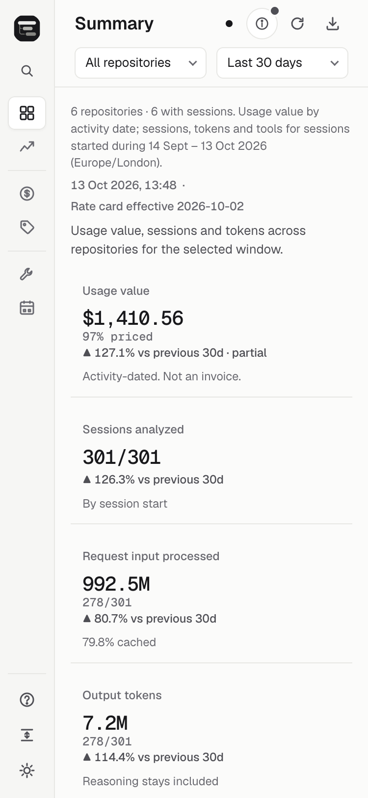
  </picture>
</p>
</details>

Summary answers "what happened in this window?" Six metrics show usage value, sessions analyzed, request input processed, output tokens, effective tool calls and compactions. Each metric shows how many of the selected sessions carry the evidence behind the number, the change against the previous window, and a sparkline. On wide desktops, the metrics form a totals rail beside the daily usage chart and session mix; narrower layouts put totals first. Repository and model breakdowns, top tools, sub-agent value and a sortable fleet table follow below.

Changes share arrow marks and one decimal place for percentages; ratios above 10× use a multiple of the prior value, such as `▲ 156×`. Adjacent equal-length windows say “vs previous Nd”; calendar week/month comparisons retain their named weekday/month periods.

<p align="center">
  <picture>
    <source media="(prefers-color-scheme: dark)" srcset="../assets/screenshot-summary-breakdowns-dark.webp" />
    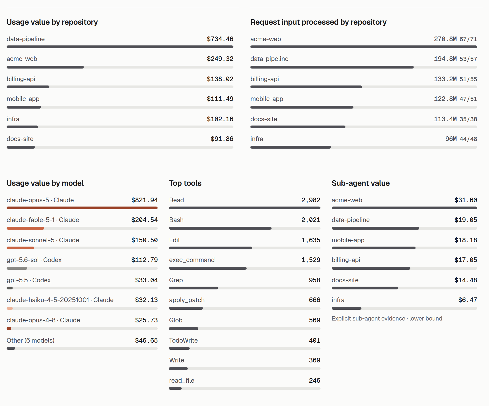
  </picture>
</p>

### Focus on one repository

Click a repository in the sidebar, or pick one from the command palette, and every view narrows to it. Summary adds a provider breakdown for value and request input, a sub-agent summary and a comparison row against the whole fleet. The focus is part of the URL, so a bookmark or a shared link opens the same repository.

<p align="center">
  <picture>
    <source media="(prefers-color-scheme: dark)" srcset="../assets/screenshot-repository-dark.webp" />
    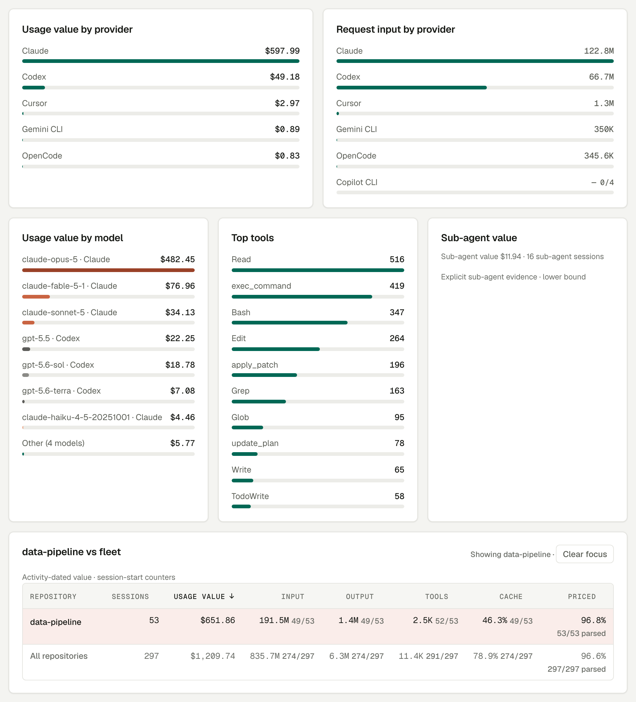
  </picture>
</p>

### Machines: more than one computer

With [other machines](interop.md#combine-machines) saved, a **Machines** strip above the scope line lists each machine with its session count over all time, such as `laptop 6,398 · agentbox 722 · snapshot 11:44`. Each chip switches that machine's sessions in or out of every view, total and export, as the provider chips do for a chart. Subscription is the exception: it reads every machine's limits and counts the sessions of every machine whose limits and sessions were read, whatever the strip shows, names the machines it leaves out, and the strip says which machines it counts on that view (`Subscription counts this machine + agentbox`). A machine that could not be read is marked with its reason: a stale one (`agentbox 722 unreachable · showing 2 h ago`) still counts its last good snapshot, and a failed one is a button that opens **Machine details**. That dialog, also in the command palette, lists every machine's state, sessions, repositories, read time, duration and version, and the command that fixes a failure; after running it, **Read them again** reads the other machines without scanning this one again. The sync label says how many machines are ready and names the others, such as `1 of 2 machines ready · agentbox stale` (or `not read` when nothing of it is shown), Summary adds **Usage value by machine**, and Coverage notes name the machine they came from. History coverage spans every machine whichever are switched on, and labels each Claude profile with its machine.

Snapshot status omits a zero in-progress count and names nonzero counts as “1 session in progress” or “N sessions in progress”, for local and multi-machine snapshots.

The dashboard shows this machine's sessions as soon as its own scan is done, rather than waiting for the slowest machine: a machine still reading appears from its last good snapshot (or without its sessions), with a pulsing dot, and its sessions join the views when it answers. **Refresh snapshot** reads each machine again unless it is still reading; if this machine's scan fails, the other machines' reads carry on. Machines added, changed or removed with `session-analytics machines` reach the open dashboard on its next request, without a restart. The first machine added to a dashboard that had none also scans this machine again, which takes as long as a refresh.

### Velocity: where usage is moving

Velocity answers "is this going up, and what is driving it?" It opens grouped by model, with shades of each provider's colour. You can also group by provider, agent, repository, execution kind or reasoning effort; plot usage value, any token class, model calls, tool calls or sessions started; by day, week or month, or as an hour-of-day profile; as a stacked area, lines or a cumulative curve, with an optional 7-day average. Below the chart, week-to-date, month-to-date and today-versus-median comparisons show the evidence on both sides of every change, and a **Top increases** table ranks positive absolute increases by repository, model and agent over the last seven completed days versus the preceding seven. Evidence cells use compact counts, such as `13.8M priced (100%) → 9.3M priced (100%)`; exact known/eligible counts stay in the tooltip and accessible name. When enough complete history exists, a projection band shows the month's likely range as a workload scenario, never as a forecast of your bill.

Daily chart ticks use equal calendar steps, labelling every day in windows up to 14 days when the labels fit. Hour profiles use 00:00, 06:00, 12:00 and 18:00, with fewer equally spaced ticks on narrow charts.

Focus the Velocity chart and use Left/Right arrows or Home/End to inspect and announce a bucket. Pointer hover updates
the visible readout quietly; repeated movement within a bucket and resize redraws do not repeat announcements. Escape
dismisses the readout before the dashboard's separate shortcut to clear repository focus.

Velocity’s “Average per active day” is usage value divided by days with positive usage value in the selected window, independent of the plotted metric.

<p align="center">
  <picture>
    <source media="(prefers-color-scheme: dark)" srcset="../assets/screenshot-velocity-dark.webp" />
    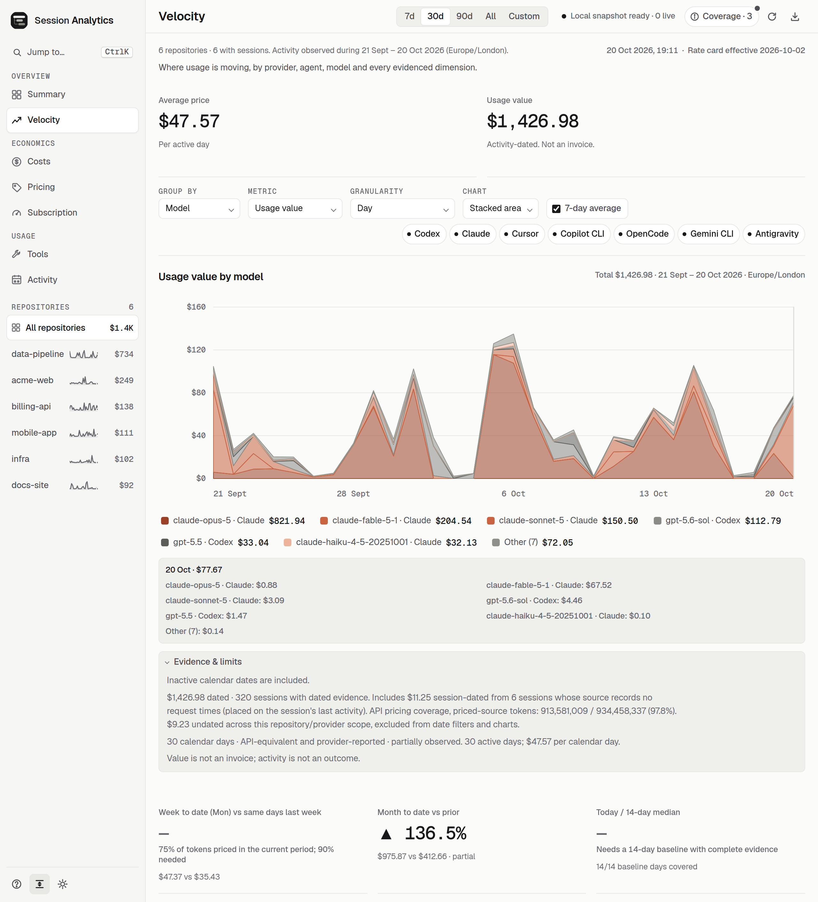
  </picture>
</p>

<p align="center">
  <picture>
    <source media="(prefers-color-scheme: dark)" srcset="../assets/screenshot-velocity-movers-dark.webp" />
    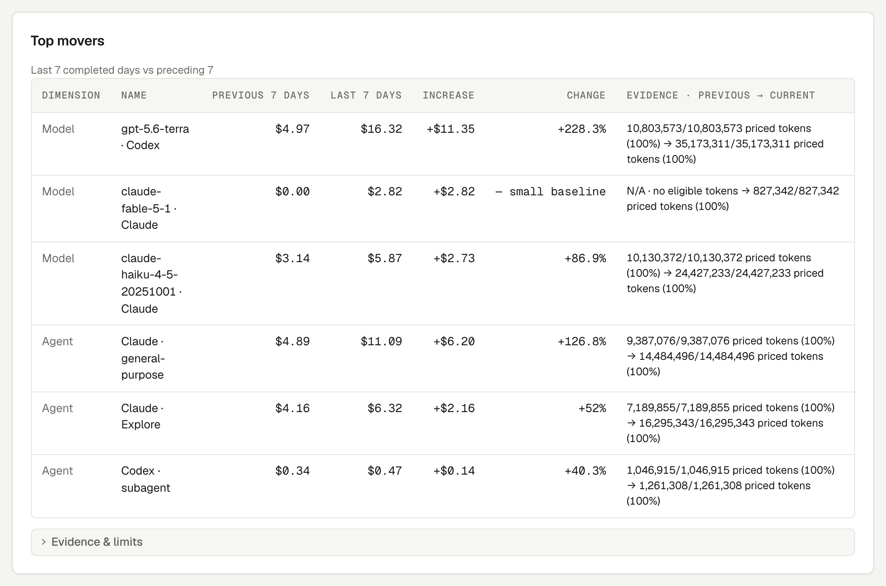
  </picture>
</p>

Every panel has an **Evidence & limits** note that states what the number includes, what was excluded, and why a comparison is partial or unavailable. A missing comparison is shown as a dash with its reason, never as zero.

When a Velocity burn ratio or projection is unavailable, its visible explanation names the failed calendar, activity, evidence or baseline guard with the observed and required figures.

### Costs: one money ledger

Costs answers "where does the value go?" The usage value is the sum of an API-equivalent part, priced from observed tokens, and a provider-reported part for sources such as Cursor that record their own figure and have no rate card. Cost by provider shows each provider's bar segmented by model with its priced share; cost by model lists every model with its provider, sessions, calls, input and output tokens, value and share. Summary, Velocity and Costs read the same activity-dated ledger, so their totals agree for any window.

Costs shows **—** for wholly unpriced model, provider and total values and model shares; a reviewed zero-rate model can still show $0.00. Pricing coverage and unpriced metadata stay visible.

<p align="center">
  <picture>
    <source media="(prefers-color-scheme: dark)" srcset="../assets/screenshot-costs-dark.webp" />
    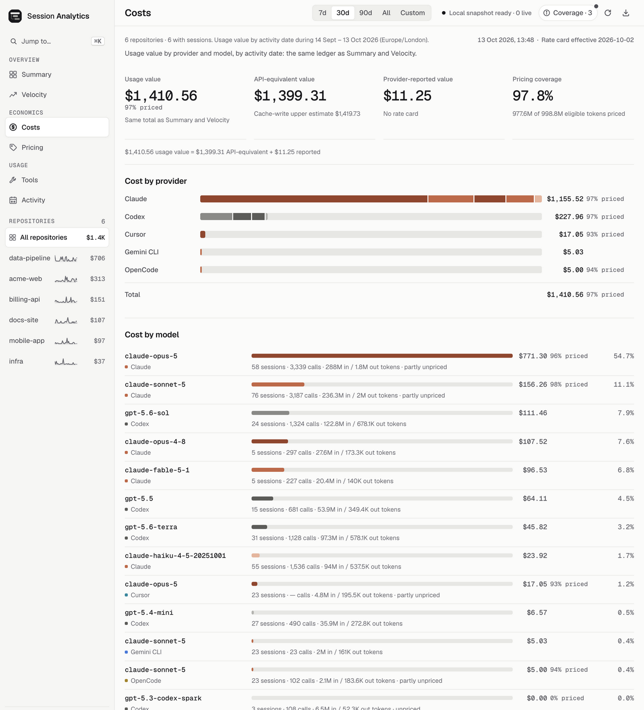
  </picture>
</p>

### Pricing: where the prices come from

Pricing answers "can I trust that dollar figure?" It shows pricing coverage (the share of eligible tokens with an explicit rate), the age of each public price source, whether updates are offline, and the effective date of the reviewed rate card. Each API-priced model used in the window gets a card with its input and output rates per million tokens, its value, tokens, calls and share, and a badge when part of its tokens could not be priced. A model with no matching rate is shown as unpriced rather than as free, and provider-reported value, such as Cursor's own figure, is kept in the totals line rather than given a rate card. A stale source raises a warning at the top; the demo seeds one deliberately stale source so that warning is visible. While a live dashboard runs, pricing is checked at startup, every six hours and on Refresh snapshot when the newest fetch is older than 24 hours, with an extra daily check for newly observed unpriced models when a source is over 24 hours old. New cached rates raise the same **Pricing evidence needs a refresh** notice, even if the displayed sources were fresh, with the fetch time and a **Refresh snapshot** action. The browser checks this content-free hint every minute while visible; it never rescans or changes displayed totals on its own. Refresh snapshot first checks stale enabled sources, then scans with the cache; failed updates retain usable cached/reviewed rates. Offline and pinned dashboards make no public requests.

Rate-card effective dates in the header and pricing details use the same calendar-date format as window dates (for example, “2 Oct 2026”).

<p align="center">
  <picture>
    <source media="(prefers-color-scheme: dark)" srcset="../assets/screenshot-pricing-dark.webp" />
    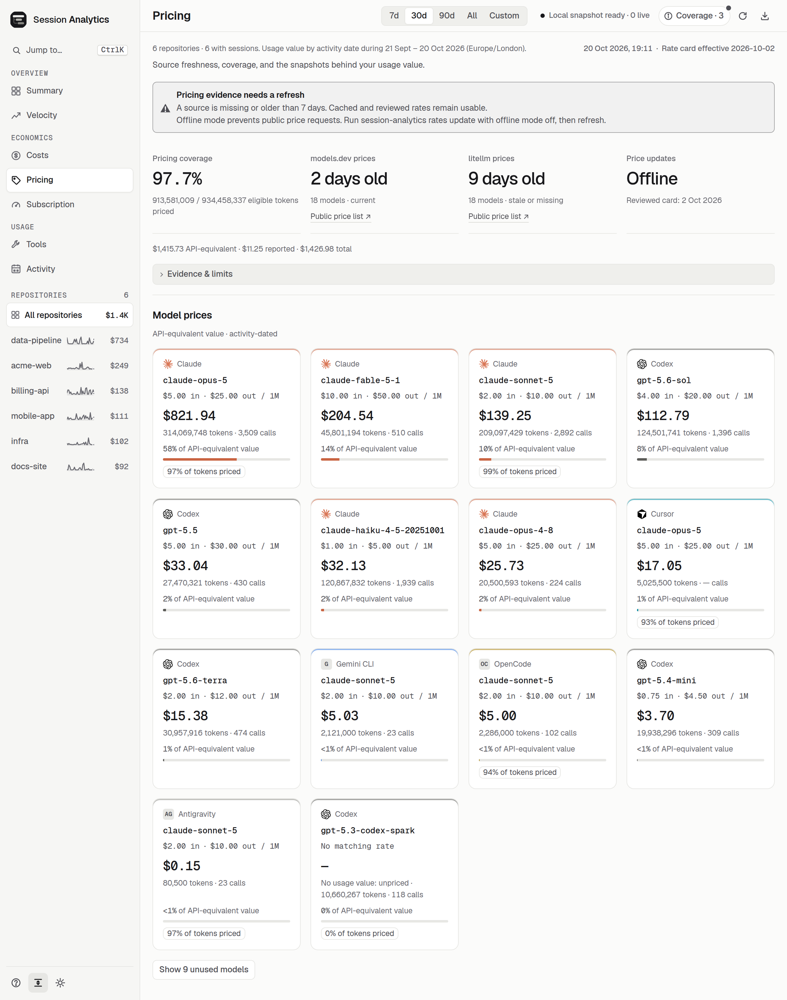
  </picture>
</p>

### Subscription: can I keep working, and is it worth it?

Subscription answers "which of my accounts can I still use, and until when?" first, and "what is each allowance worth?" second. Every account is shown on its own, so a personal Max plan and an employer's Team seat used on one machine are never mixed. Limits are account-wide, so the repository focus does not apply. The view reads from top to bottom:

1. **Limits now**: one row per account, the most urgent first. Each row has the weekly bar, a thin 5-hour bar, the weekly share left in large type, when it resets (absolute and relative, in your browser's time zone) and one status: on track, runs out early, used up fast (too early to project, but "66% used in 12h · runs out 18:26 at this pace", or "5-hour limit runs out 14:05 at this pace"), capped until the reset, using extra usage, last seen a while ago, or no reading this week. While the weekly allowance is capped, the 5-hour line says the account is blocked until the weekly reset. These rows appear as soon as this machine's meters are read, before the session scan finishes; with [other machines](subscription.md#machines), each row names the machines that report its account (`(stale)` when only their last good limits are in), the header says where meters and value come from (`meters and value from this machine + agentbox (last good limits, 2 h ago)`, or `meters from this machine + agentbox, value from this machine` when agentbox's sessions could not be read), and a machine still reading joins when it answers.
2. **Next**: at most three suggestions, one line each; "Why?" opens the reasoning, and the rest sit under a "more suggestions" toggle.
3. **Account cards**: the plan chip ("Max 20x · detected") opens a menu to choose another plan or to exclude the account from value totals; an excluded card stays visible with the same control to undo it. Weekly and 5-hour meters come first, with a tick for even pace and a hatched projection; model-specific limits are collapsed, stale meters are muted and retired ones hidden. The chart of this week marks an in-place reset where it happened and projects from the current segment. Banked resets, credits and extra usage belong to the account. With other machines, the card says which of them report the account.
4. **What it's worth**: value used (with the dates each account is counted from, the value before the first readings that is not counted, the value on machines whose limits were not read, which is not counted, and the share of a full week every week), the value multiple over plans you pay for, a month of full use of those same plans against their price (employer-paid and unpriced seats beside it) and the typical weekly close, then each account's value per 1% of the week, weekly capacity, value used with the sessions active in those dates, and multiple. A listed price can be marked as paid by you or by an employer. It starts collapsed on narrow screens.
5. **History**: each account's weekly closes on one time axis (hatched when a reset came early, outlined when the close was not observed) and the last week's 5-hour windows, one lane per account with a 5-hour limit.
6. **Sources and method**: the accounts found, each source's last reading, and what the readings cover.

While limit meters are loading, Subscription keeps its section headings and a shimmer placeholder for an account row; a screen-reader status says “Reading limit meters…”. Live meters replace the skeleton as soon as they arrive, even if session analysis is still running.

Charts take Left, Right, Home and End to inspect readings. The two-minute refresh keeps keyboard focus, the inspected reading and open sections. See [Subscription limits and value](subscription.md).

<p align="center">
  <picture>
    <source media="(prefers-color-scheme: dark)" srcset="../assets/screenshot-subscription-dark.webp" />
    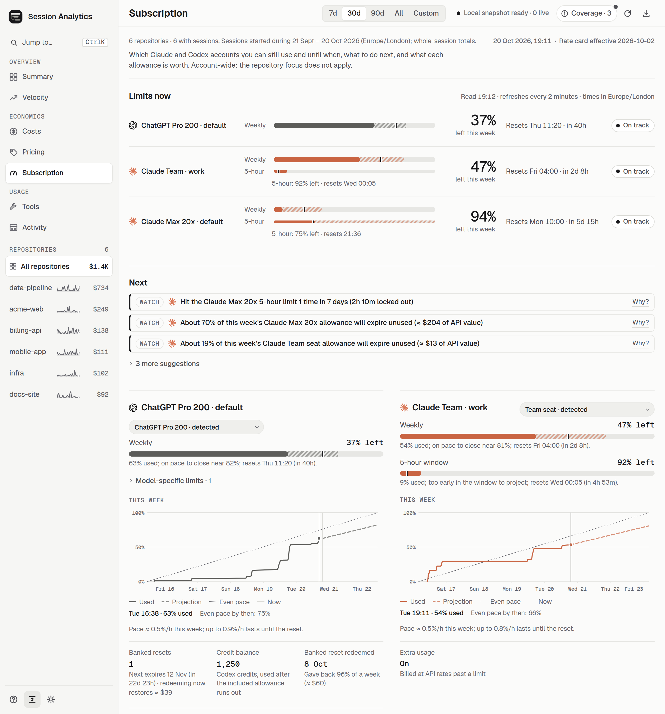
  </picture>
</p>

### Tools: what the agents reach for

Tools answers "how do the agents work?" using tool-call names only; arguments and results never reach any output. The table ranks tools by calls, share, sessions and repositories, with the change against the previous window, and provider chips narrow it to one or more agents. Selecting a tool opens its detail: calls by session-start day, the providers that made them, and the repositories they went into.

<p align="center">
  <picture>
    <source media="(prefers-color-scheme: dark)" srcset="../assets/screenshot-tools-dark.webp" />
    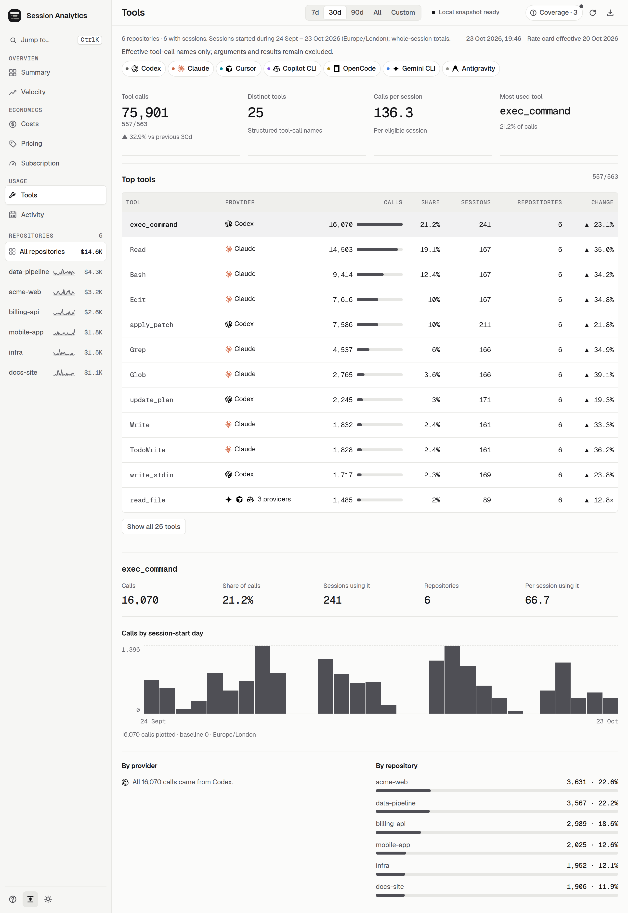
  </picture>
</p>

### Activity: when the work happens

Activity answers "when do sessions start?" A weekday-by-hour heatmap counts session starts in your local timezone for the selected providers, and a repository list shows where those sessions went. Sessions without a provider-recorded start time are excluded rather than guessed from file dates.

<p align="center">
  <picture>
    <source media="(prefers-color-scheme: dark)" srcset="../assets/screenshot-activity-dark.webp" />
    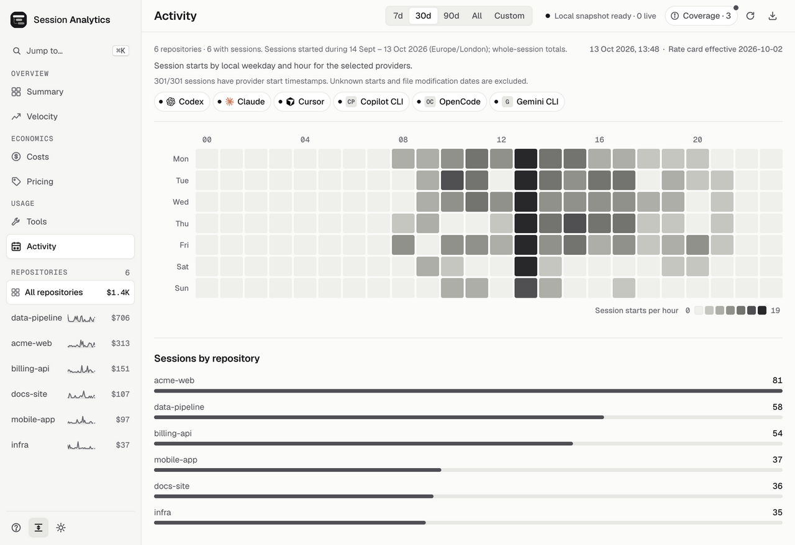
  </picture>
</p>

### Coverage, evidence and the command palette

Every number on the dashboard is a lower bound from local evidence. The **Coverage** button lists, for each source, how many selected sessions carry token evidence, tool evidence and timestamps, and explains how to read the figures on the current view. While the dashboard reads this machine alone, its notes end with how to add a server or VM where agents run (`session-analytics machines add HOST`). Unavailable is shown as a dash, never as zero activity, and counts never claim to measure quality or outcome.

<p align="center">
  <picture>
    <source media="(prefers-color-scheme: dark)" srcset="../assets/screenshot-coverage-dark.webp" />
    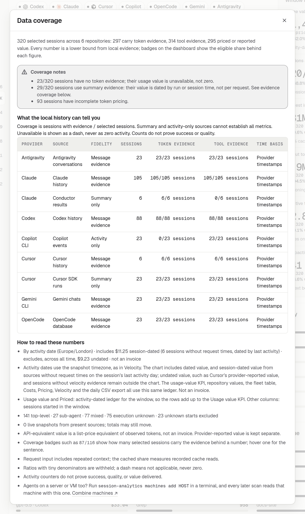
  </picture>
</p>

The address bar also records provider chips for the active view (`providers=codex,claude`, or `providers=none` when all are off). Reload and Back/Forward restore them; switching views keeps each view’s own selection.

Provider chips in Summary, Velocity, Tools and Activity use the same provider names, marks and order. Every supported provider has a brand mark (see `src/public/brands/NOTICE.md`); sessions from an unsupported provider get a neutral badge. Selected dots match the chart colours.

The command search has an accessible name and announces whether matching commands are expanded.

The command palette jumps to any view or repository, toggles provider chips and switches theme or density. The same actions have keyboard shortcuts: `g` then a letter for views, `[` and `]` for the previous and next view, `1` to `4` for the window presets, `e` for coverage and `t` for the theme.

<p align="center">
  <picture>
    <source media="(prefers-color-scheme: dark)" srcset="../assets/screenshot-palette-dark.webp" />
    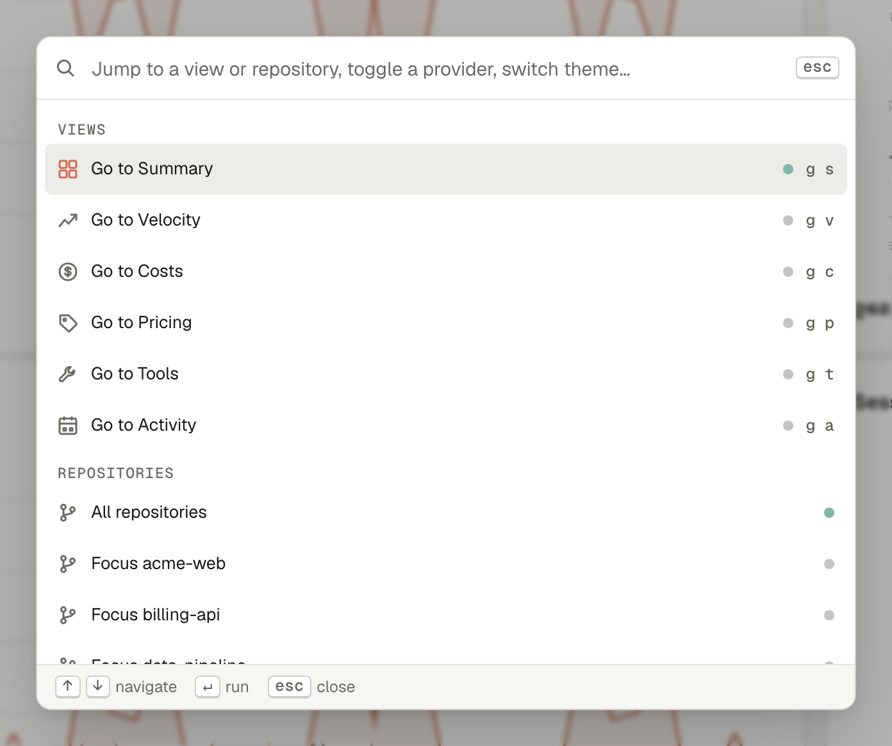
  </picture>
</p>

Repositories with the same display name keep that name for the first hashed repository ID and use ` · 2`, ` · 3`, and so on for later IDs. These dashboard-only labels stay stable across usage sorting and machine filters; their tooltips explain “another checkout with the same name”. No paths are shown. Links still accept a hashed ID or the original plain name (the first match wins); exports retain the original names.
