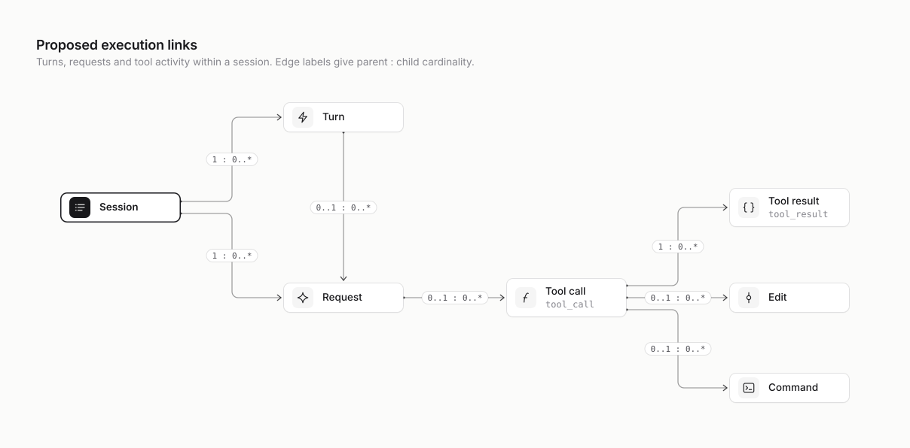
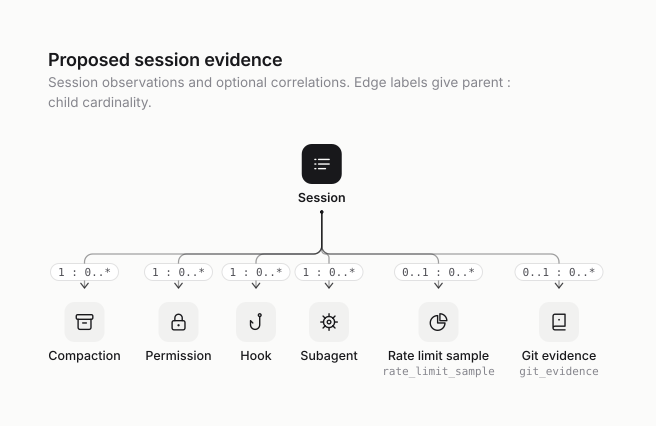

# Proposal: a content-free event model for cross-agent research

**Status: proposed, not implemented.** This document specifies a future adapter/index contract. It does not change `SessionAnalytics`, `/api/analytics`, `report --json`, the default privacy settings, or any provider parser. The accompanying [metrics research](metrics-research.md) prioritizes consumers of these events. The existing [public field manifest](../privacy.md#field-manifest) remains authoritative for shipped outputs.

The design has three goals: retain enough provenance to reconcile accounting, distinguish unavailable evidence from observed zero, and support cross-agent comparisons without storing source content. It deliberately has no `success`, `quality`, `developerProductivity`, or `humanTimeSaved` field. Task completion, a zero exit code, a merged change, and surviving lines are observations with different meanings.

## 1. Baseline, evidence labels, and proposed boundary

The baseline is the code in [`src/types.ts`](../../src/types.ts), [`src/analyzer.ts`](../../src/analyzer.ts), and the [architecture](../architecture.md), [providers](../providers.md), [metrics](../metrics.md), and [privacy](../privacy.md) documents. In particular:

- The current analyzer projects aggregate sessions, not normalized events; there is no durable event index or common tool-error taxonomy.
- Claude usage keeps the snapshot with greatest output per `message.id`; equal-output snapshots can add a thinking breakdown. Tool uses are deduplicated by tool-use ID. Main and subagent files feed one public session.
- Codex usage fingerprints the `(total_token_usage, last_token_usage)` tuple across files, chooses an owner by nearby activity, and excludes opening/reset baselines without per-request usage. This is an ownership heuristic, even when the token counters themselves are exact observations. Legacy lifecycle shapes currently use the largest per-shape count.
- Cursor merges composer/bubble records and deduplicates `toolFormerData.toolCallId`. Bubble tokens cannot safely be joined to per-model provider-reported cost; relative timing is not an absolute timestamp.
- Current session and repository keys are truncated **unkeyed** SHA-256 hashes. A per-machine HMAC identity layer below is a migration proposal, not a description of current security.
- Current code accepts structured model/tool/status/effort strings in several places without a central length or enum validator. The bounded names and closed enums below are a proposed hardening requirement, not a claim that v1 already implements it.

Source annotations in this proposal distinguish **C** (currently consumed in code), **B** (a source shape listed in the lane brief but not yet consumed), and **A** (measured in the local aggregate audit in the research document). A field listed as B is an adapter candidate; it is not evidence of local coverage. Synthetic fixtures establish parser behavior, not prevalence in real history. Actual observed tool names are listed separately from implementation-known and proposed mappings below.

The parser may inspect a source record transiently. Before an event leaves the parser, it must contain only typed, explicitly constructed fields. **No prompt, message, reasoning, command text, argument/result body, patch, raw error, path, repository name/root/remote, branch, title, nickname, raw provider/orchestrator/session/call/message ID, or credential is retained in this proposed event store or emitted through its surfaces.** Even an unknown enum or unrecognized field is never copied into a diagnostic. Existing v1 repository display names remain a separately documented legacy projection; they are not introduced into v2 event payloads.

P0 covers counters, times, documented model/tool identifiers, and fixed labels. P1 covers pseudonymous relationships and identifying metadata such as bounded MCP-server identifiers and keyed equality fingerprints. P2 covers opt-in local interpretation of command, error, or diff content; only a versioned rule ID and typed result survives. P3 content/LLM review is outside this schema and must have a separate, explicit per-run opt-in and storage boundary. P2 stays off by default.

## 2. Primitive types and observation semantics

These are specification types, not exported TypeScript declarations.

| Type | Definition and validation |
| --- | --- |
| `Count` | Integer in `[0, Number.MAX_SAFE_INTEGER]`; reject negative, fractional, non-finite, or overflowed input. |
| `Milliseconds` | Finite nonnegative number; a unit conversion must cite its source rule. Do not silently infer seconds versus milliseconds. |
| `Usd` | Finite nonnegative number in USD; retain the cost basis and rate-card version, if any. No invoice implication. |
| `Fraction` | Finite number in `[0, 1]`. Out-of-range provider percentages are invalid evidence, not clamped observations. |
| `Instant` | Valid normalized ISO-8601 UTC timestamp from an absolute source timestamp. A timezone-less, relative, or invalid value is unavailable. |
| `Key` | A type/domain prefix followed by 32 lowercase hexadecimal HMAC characters; no embedded source identifier. All key-bearing fields are P1. |
| `RegistryId` | A checked-in, closed adapter/field/rule identifier; never a provider-supplied string or dynamic JSON path. |
| `ModelName` | Structured model identifier, maximum 128 ASCII characters, matching `^[A-Za-z0-9][A-Za-z0-9._:/-]{0,127}$`; reject path-like absolute prefixes, traversal components, control characters, and credential/URL shapes. Otherwise `unknown`, with rejection counted. No truncation. |
| `ToolName`, `SkillName`, `ServerName` | Structured identifier, maximum 128 ASCII characters, matching `^[A-Za-z0-9][A-Za-z0-9._:-]{0,127}$`. `ServerName` is P1; model/tool/skill names retain the current P0 contract. Unknown/invalid values become the literal `unknown`, never a content-derived label. No truncation. |
| `Observed<T>` | `{ value: T \| null, state, method, sourceFields, ruleId }`, as defined below. Tier is the maximum of the underlying value and its derivation; wrappers do not lower it. |

Identifier syntax limits reduce accidental leakage; they do not prove that an otherwise syntactically valid name is harmless. Only documented structured name fields qualify. Never derive model/tool/server/skill names from arbitrary content, errors, URLs, titles, or paths. The current narrow code-mode tool-reference and canonical skill-reference extractors are documented legacy exceptions; retain their inferred status and do not expand them into general content classification. Rate-card identifiers are reviewed inputs. Dynamic MCP names remain identifying metadata even when bounded. Adapters cap distinct accepted names per scan (proposed 1,024 per name kind); overflow maps to `unknown` and increments a fixed coverage counter. This prevents unbounded cardinality without copying rejected values into logs.

Every optional semantic field below uses `Observed<T>`, including optional keys. `value` is non-null only for `state: observed`; a literal `unknown` enum means the source explicitly supplied an unrecognized enum. `state` is one of:

| State | Meaning | Example |
| --- | --- | --- |
| `observed` | Value is supported by the stated method. Zero/false is an observation, not a fallback. | An explicit `exit_code: 0`; a complete window with zero compactions. |
| `missing` | The source shape can carry it, but this record does not. | A tool result without duration. |
| `unsupported` | The adapter/version has no implemented mapping. | Cursor CLI request usage in a names-only source. |
| `invalid` | Present but fails type/range/identity validation. | NaN duration, negative counter, invalid timestamp. |
| `ambiguous` | Multiple incompatible candidates or unresolvable attribution. | Two commands could own an exit result. |
| `not_applicable` | The quantity has no meaning for this entity. | API price coverage for provider-reported-only Cursor cost. |
| `redacted` | The optional feature/tier is disabled. | P2 command purpose with P2 off. |

`method` is `structured`, `counter_delta`, `identity_join`, `temporal_join`, `lexical_rule`, `ast_rule`, or `derived`; `sourceFields` is a sorted, deduplicated array of closed `RegistryId` values (maximum 8); `ruleId` is a nullable checked-in rule/version identifier. Structured observations can still be wrong in the provider; “observed” does not mean independently verified. `counter_delta`, heuristic joins, and syntactic recognition must remain distinguishable from structured observations. A derived field lists the contributing registry fields and rule, with provenance retained in the index.

Use `null` with a reason instead of converting absent counters to zero. An adapter may declare zero only when the source explicitly reports it or when a complete, supported, fully parsed eligible window was examined and contained no event. An incomplete working transcript with no failures has “zero observed failures; final coverage incomplete,” not “no failures.”

### Coverage is an artifact, not an assumed provider capability

Each metric result has a companion coverage record. A provider/version support matrix is useful, but it cannot replace measured availability in the filtered data.

| Coverage field | Type | Source and meaning | Tier |
| --- | --- | --- | --- |
| `metricId`, `metricVersion` | `RegistryId`, positive integer | Checked-in formula registry. | P0 |
| `unit` | `session \| turn \| request \| tool_call \| result \| sample \| token \| interval` | Closed denominator unit. | P0 |
| `eligible`, `observed` | `Count` each | Distinct eligible entities and entities with usable evidence; `observed <= eligible`. | P0 |
| `excludedByReason` | Fixed object of `Count` | One mutually exclusive primary reason per excluded eligible entity: the six non-observed states above. Sum with `observed` equals `eligible`. | P0 |
| `numerator`, `denominator` | `Observed<Count>` or `Observed<number>` | Formula inputs after event dedupe; record units in the metric registry. | Inherit metric tier, P0/P1/P2 |
| `ratio`, `coverageRatio` | `Observed<Fraction>` | Denominator zero gives `not_applicable`, never 0%; `coverageRatio = observed / eligible`. Signed or unbounded derived ratios use finite `number` with an explicit domain instead. | Inherit metric tier, P0/P1/P2 |
| `workingEntities`, `malformedRecords`, `unlinkedEvents`, `conflictingEvents` | `Count` each | Overlapping quality flags, separate from exclusion partitions. | P0 |
| `minimumActivity`, `displayState` | `Count`; `ready \| low_activity \| unavailable` | Per-metric reviewed guard. Initial research policy: 20 usable denominator observations for a descriptive ratio; 50 usable observations across at least five sessions per compared stratum for comparison. Missing eligible entities do not satisfy this guard. Counts remain visible; these are display guards, not statistical guarantees. | P0 |
| `sourceMix` | Array of `{ adapterId: RegistryId, eligible: Count, observed: Count }` | Prevent broad cross-provider totals from hiding source skew. | P0 |

For example, an error proportion is errors divided by terminal results with known outcome; its coverage denominator is all eligible distinct calls, including unjoined and incomplete calls. Display both `3/60 known outcomes` and `60/100 calls covered`; never imply a 3% call error rate from those numbers. A duration percentile includes only source-compatible valid durations and shows its sample count. A pooled event-weighted ratio and the median per-session ratio are different metrics.

Coverage can be selection-biased: the local audit found explicit Claude `is_error` coverage differs greatly by tool, with many non-Bash records omitting the field. A conditional error proportion among known statuses is not representative merely because its count is large. Compare fully observed tool/format strata, show the explicit-error count over all calls as a labeled observed-error lower bound where appropriate, and never assume omitted `is_error` means false without a validated format rule. Unknown-result outcomes can change a mixed-tool ranking.

## 3. Identity, scopes, and relationships

Use Node's built-in `crypto` with a cryptographically random 256-bit per-machine secret, created only by a future index implementation, stored with owner-only permissions outside provider directories, and excluded from exports/backups intended for sharing. Do not derive the secret from a hostname, username, home path, or repository. This proposal introduces no secret or persisted identifiers today.

Conceptually, `key = prefix + truncate128(HMAC-SHA256(secret, canonicalEncode([keyVersion, domain, scope, rawIdentity])))`. `canonicalEncode` is length-delimited and unambiguous; string concatenation with `:` is insufficient when source IDs may contain delimiters. Distinct domains for profile, repository, session, actor, turn, request, call, artifact, file, argument, commit, and source prevent equality across unrelated namespaces. Keep 128 bits, detect collisions against full HMACs internally, and fail closed with fixed diagnostics on collision. Never retain the raw preimage. HMAC resists offline guessing without the machine secret; it does not anonymize behavior against an observer who already knows the activity.

- **Profile scope:** `profileKey` identifies a realpath-deduplicated provider installation/profile. A profile is not an account. Two profiles can share a subscription; one profile can change accounts. Do not add profile allowances together without explicit account linkage.
- **Repository scope:** use a canonical Git common directory identity for worktrees, with a separate domain for non-Git groups; `repositoryKey` is nullable when correlation fails. Do not emit a repository basename. Conductor aliases resolve to the canonical repository where validated; no opportunistic merge by name alone.
- **Session scope:** a provider thread/composer identity qualified by provider, profile, and validated origin; an archive copy is the same session only after identity and origin validation. A fork is a new session linked to its parent, not a duplicate. Main Claude history is a root session; subagent evidence receives an actor identity under that root, even if it has no independent provider session ID.
- **Actor scope:** identifies an execution participant inside a session. If Codex exposes a separate child thread, give it its own session and actor and link it to the parent with a `subagent` edge. A root actor and a subagent are never counted twice because one provider nests files while another separates them.
- **Workspace/resource scope:** the same relative command or path can mean different work in different directories. HMAC the validated workspace/CWD identity transiently and include it, the actor, and a conservative execution epoch in operation signatures. A missing scope makes signature-based recovery unavailable; do not substitute the repository root for an unknown CWD.
- **Turn scope:** one provider-defined interaction boundary where observable. Human, delegated, scheduled, system, resumed, and unknown initiators are different. A tool result is not a human turn. A task-start marker is not proof of a human prompt.
- **Request scope:** a model response/request or a clearly labeled usage observation. A request can initiate multiple calls. A request with zero tokens can still be a recorded request; v1 `modelCalls` counts positive usage and requires a compatibility projection.
- **Tool scope:** one logical invocation, with transport wrappers distinguished from effective calls. Multiple result updates can belong to one call; multiple actual retries are separate calls. Never join child result text to a request by tool name alone.
- **Allowance scope:** a provider/account/model budget bucket can span many sessions and repositories. A rate-limit sample is profile-scoped, with an optional sampled session link that means “observed here,” not “consumed by this session.”

<picture>
  <source media="(prefers-color-scheme: dark)" srcset="../diagrams/proposed-execution-links.dark.svg" />
  
</picture>

<picture>
  <source media="(prefers-color-scheme: dark)" srcset="../diagrams/proposed-session-evidence.dark.svg" />
  
</picture>

Foreign keys are typed pseudonyms with link states. Missing parents are allowed during ingest, then reconciled transactionally. Persist unresolved events and count their join failures; do not silently drop them or synthesize a parent with guessed fields. A time-window candidate is not an identity match: retain `method: temporal_join`, an explicit candidate count, and an `ambiguous` link until a declared deterministic rule can choose safely. Never turn proximity, a shared repository, or a branch into proven authorship.

## 4. Common event envelope

All 13 event kinds use this envelope. Every declared envelope key is required; `Observed` fields carry explicit null/state when unavailable instead of disappearing. Every kind's payload is a separate closed object. Unknown keys are rejected/dropped before persistence and export.

| Field | Type | Source | Tier |
| --- | --- | --- | --- |
| `schemaVersion` | Literal `2` | Schema implementation constant. | P0 |
| `normalizationVersion` | Positive integer | Adapter/rule contract revision; independent of app and schema version. | P0 |
| `kind` | `session \| turn \| request \| tool_call \| tool_result \| edit \| command \| compaction \| subagent \| permission \| hook \| rate_limit_sample \| git_evidence` | Closed adapter output kind. | P0 |
| `eventKey`, `keyVersion` | `Key`, positive integer | HMAC semantic identity and secret-generation version. | P1 |
| `revision` | Positive integer | Store-controlled monotonic upsert revision; replay without changes does not increment it. | P0 |
| `provider` | `claude \| codex \| cursor` | Source adapter. Orchestrators are evidence sources, not invented model providers. | P0 |
| `profileKey` | `Key` | Validated provider root identity; never account identity. | P1 |
| `sessionKey`, `repositoryKey`, `actorKey` | `Observed<Key>` each | Validated scoped joins; a profile-only sample can be `not_applicable` for session. | P1 |
| `workspaceKey`, `executionEpoch` | `Observed<Key>`, `Observed<Count>` | Validated working-directory scope and local epoch bounded by actor/context changes or evidence gaps; never a raw CWD. | P1 / P0 |
| `turnKey`, `requestKey`, `toolCallKey` | `Observed<Key>` each | Direct provider references or qualified join rules; payload kind can make a link inapplicable. | P1 |
| `occurredAt`, `endedAt` | `Observed<Instant>` each | Provider absolute timestamps; never ingest time as event time. | P0 |
| `ingestedAt` | `Instant` | Analysis clock, separate from event time. | P0 |
| `sourceKey`, `sourceGeneration`, `sourceOrdinal` | `Key`, `Count`, `Count` | HMAC of source identity, generation after replacement, logical record position. No path or DB row ID. | P1 / P0 / P0 |
| `adapterId`, `sourceShape` | `RegistryId` each | Versioned adapter and known format family (`claude.assistant.v1`, etc.); no raw enum passthrough. | P0 |
| `evidenceState` | `complete \| partial \| working \| conflicted` | Snapshot/parser completeness; absence of activity does not prove completeness. | P0 |
| `identityMethod` | `provider_id \| source_position \| validated_alias \| derived_child` | Event identity construction rule. | P0 |
| `warnings` | Array of `RegistryId`, maximum 16 | Fixed codes such as `join.missing_call`, `counter.baseline_excluded`; no provider/error text. Overflow increments a count. | P0 |

An event may have multiple origins when representations are deduplicated. Store a bounded `origins` relation containing only `sourceKey`, generation, ordinal, adapter ID, shape ID, and field provenance (the same tiers as above). An export can omit this relation but must not claim exact coverage without accounting for conflicting origins. The event's common source fields identify the selected canonical origin; selection is deterministic and documented.

`eventKey` is the canonical key for that kind's entity/observation. For a `session`, `turn`, `request`, or `tool_call` event, its corresponding envelope link is an observed self-reference equal to `eventKey`; descendants link to that same key. Actor/workspace/profile/repository identities are supporting scoped entities, not additional activity events. Different event kinds have different key domains even when they originate from one provider record. A terminal tool result and its command receipt can share an origin and call link without being counted as two tool executions.

## 5. Payload field manifest

All rows in this section are **proposed**. Every declared payload key is present; unless explicitly marked a plain required value, its type is wrapped in `Observed<T>` so unavailable values retain a reason. A grouped field list means each named field has the specified type and validation. Sources name provider field paths for implementation guidance; those strings are not dynamic output metadata. C/B/A have the meanings defined in section 1.

### `session`

| Field | Type | Concrete source/mapping | Tier |
| --- | --- | --- | --- |
| `executionKind` | `top_level \| subagent \| mixed \| unknown` | C: Claude main/subagent file relationship; Codex `session_meta.source.subagent`; Cursor composer/header flags. Mixed means observed multiple kinds, not uncertain. | P0 |
| `parentSessionKey`, `forkedFromSessionKey` | `Key` each | B: Codex `source.subagent.thread_spawn.parent_thread_id`, `forked_from_id`; validated provider correlation only. | P1 |
| `startedAt`, `lastActivityAt` | `Instant` each | C: source session time and valid event timestamps; do not replace with updated metadata time. | P0 |
| `status` | `active \| completed \| interrupted \| failed \| idle \| unknown` | C: Conductor/ Cursor structured status; B: provider terminal markers. An `idle` session has no implied outcome. | P0 |
| `entrypoint` | `cli \| editor \| sdk \| desktop_agent \| review \| unknown` | B: Claude `entrypoint`; Codex `source`/`originator`; adapter source family. Enumerate recognized inputs. | P0 |
| `clientVersion` | Bounded version tuple `{major: Count, minor: Count, patch: Count, channel: stable \| prerelease \| unknown}` | B: Claude `version`, Codex `cli_version`; parse numeric components; do not copy arbitrary suffix/build text. | P0 |
| `repositoryMatch` | `git_common_dir \| validated_workspace \| validated_root \| non_git \| unresolved` | C: repository assignment evidence; do not conflate name-based candidates with validated mappings. | P0 |
| `recordedUsageUsd`, `costBasis` | `Usd`; `provider_reported \| api_equivalent \| unavailable` | C: Cursor `usageData.*.costInCents`; B: Claude `cost-state.totalCostUSD`, Conductor SDK `total_cost_usd`. Reconciliation-only when request costs also exist. | P0 |
| `sourceFileCount` | `Count` | C: discovered distinct validated evidence files; supports completeness, not task size. | P0 |

### `turn`

| Field | Type | Concrete source/mapping | Tier |
| --- | --- | --- | --- |
| `initiator` | `human \| agent \| system \| resumed \| unknown` | C: human-message shapes; B: Claude `promptSource`, `origin.kind`; Codex lifecycle context. Closed source map, no message-based role guessing. | P0 |
| `boundaryMethod` | `explicit_id \| lifecycle_markers \| message_boundary \| unavailable` | B: stable provider turn IDs when present, `task_started`/terminal markers; C: user message boundary as lower-fidelity fallback. | P0 |
| `terminalState` | `completed \| failed \| interrupted \| replaced \| unknown` | B: Codex `task_complete`, `turn_aborted.reason`, thread DB turn `status`; Claude completion only where explicit. | P0 |
| `terminalInitiator` | `human \| agent \| system \| policy \| unknown` | Only explicit terminal-action provenance from a validated source. The actor who started a turn is not necessarily the actor who interrupted it; `turn_aborted.reason` alone does not establish this field. | P0 |
| `durationMs`, `timeToFirstTokenMs` | `Milliseconds` each | B: Codex `duration_ms`, `time_to_first_token_ms`; Conductor `duration_ms`, `ttft_ms`; derived timestamp span is a different method. | P0 |
| `collaborationMode` | `default \| plan \| unknown` | B: Codex `turn_context.collaboration_mode.mode`; Claude explicit permission/plan mode separately. | P0 |
| `effort` | `none \| minimal \| low \| medium \| high \| xhigh \| max \| ultra \| unknown` | C: Claude record `effort`, Codex `turn_context.effort`. Unknown source values counted, not returned. | P0 |
| `errorClasses` | Array of closed error-class IDs | B: structured terminal error codes; P2 only for any lexical fallback. No free-text error. | P0 or P2 |

Claude message boundaries do not prove that a model request was caused by a human action; tool results and subagent input are excluded from human-turn counts. Without explicit turn identity, keep `boundaryMethod: message_boundary` and do not label wall time as active time or waiting time.

### `request`

| Field | Type | Concrete source/mapping | Tier |
| --- | --- | --- | --- |
| `requestIdentityKind` | `response_id \| request_id \| counter_observation \| source_position` | C: Claude `message.id`; B: `requestId`; C: Codex last-usage observations. Counter observations do not invent a provider request ID. | P0 |
| `usageBasis` | `response_snapshot \| per_response \| last_usage \| cumulative_delta \| session_only` | C: Claude usage, Codex `last_token_usage` / valid delta; B: `token_usage_record`; C: Cursor bubble counters. | P0 |
| `model` | `ModelName` | C: Claude `message.model`, Codex `turn_context.model`; Cursor only where a safe request-to-model join exists. Never borrow a composer cost model for a bubble. | P0 |
| `effort` | Same enum as `turn.effort` | C: recorded value active at this request; avoid assigning final session effort to the entire trajectory. | P0 |
| `inputTokens`, `uncachedInputTokens`, `cacheReadTokens`, `cacheWriteTokens` | `Count` each | C: Claude `usage.input_tokens`, `cache_read_input_tokens`, `cache_creation_input_tokens`; Codex `input_tokens` inclusive of cached, `cached_input_tokens`. Claude processed input is the three-way sum. | P0 |
| `cacheWrite5mTokens`, `cacheWrite1hTokens` | `Count` each | C: Claude `usage.cache_creation.ephemeral_5m_input_tokens` / `ephemeral_1h_input_tokens`; missing split stays missing, not an observed 5-minute TTL. | P0 |
| `outputTokens`, `reasoningTokens`, `nonReasoningTokens` | `Count` each | C: output and separately exposed thinking/reasoning. Derive non-reasoning only with observed compatible components; reasoning is included in output. | P0 |
| `contextWindowTokens`, `requestInputTokens` | `Count` each | C: Codex `model_context_window`, `last_token_usage.input_tokens`; Claude processed input. No cross-request numerator/window pairing. | P0 |
| `stopReason` | `end_turn \| tool_call \| max_tokens \| stop_sequence \| refusal \| error \| unknown` | B: Claude `stop_reason`; provider-specific normalization map. Never copy `stop_details`. | P0 |
| `cacheMissReason` | `previous_message_not_found \| messages_changed \| tools_changed \| system_changed \| model_changed \| unknown` | A: Claude **`message.diagnostics.cache_miss_reason.type`**, verified locally; missing diagnostics is not “cache hit.” Do not read the brief's abbreviated path as a record-root field. | P0 |
| `httpStatus`, `retryAttempt`, `retryDelayMs` | integer 100–599; `Count`; `Milliseconds` | B: Claude `apiErrorStatus`, `system.api_error.retryAttempt/retryInMs`; validate independently. | P0 |
| `errorClasses` | Array of closed error-class IDs | B: Claude `isApiErrorMessage` plus structured `error`; Codex terminal error codes only where request linkage exists. | P0 or P2 |
| `reportedUsd`, `apiEquivalentUsd`, `upperEstimateUsd` | `Usd` each | Provider usage receipts versus versioned rate calculation; upper cache-write assumption separate. | P0 |
| `rateCardVersion`, `pricingRuleId` | `RegistryId` each | Reviewed rate-card artifact and rule, never transcript text. Unknown model remains unpriced. | P0 |
| `attributionMethod` | `direct_response \| activity_owner \| counter_delta \| unresolved` | C: direct Claude messages versus Codex ownership ledger; uncertain ownership visible. | P0 |

Usage invariants: components must be nonnegative, reasoning cannot exceed output, known cache-read cannot exceed inclusive input, and known TTL writes cannot exceed total writes. A violation makes the conflicting components invalid; do not repair the record by clamping and call it exact. Preserve total usage when independently valid. A cumulative baseline has no attributable usage and is excluded with a coverage warning, not priced as a zero-token request. Cursor session-level cost belongs on `session`; it must not be smeared across requests or days.

### `tool_call`

| Field | Type | Concrete source/mapping | Tier |
| --- | --- | --- | --- |
| `name` | `ToolName` | C: Claude `tool_use.name`; Codex response-item `name`; Cursor `toolFormerData.name` / legacy capability name. | P0 |
| `family` | Tool-family enum in section 6 | Checked-in provider-qualified exact-name mapping; unknown names keep family `unknown`. | P0 |
| `layer` | `transport \| effective` | C: Codex custom-tool code wrapper versus recognized inner invocation; Claude/Cursor ordinary calls effective. | P0 |
| `parentTransportCallKey` | `Key` | C: wrapper containing a derived effective invocation; absent for ordinary calls. | P1 |
| `recognition` | `structured \| lexical_reference \| ast_invocation` | C: current `nestedToolNames` is lexical; proposed AST confirmation remains optional P2. A lexical occurrence is not execution evidence. | P0 or P2 |
| `mcpServer`, `mcpTool` | `ServerName`, `ToolName` | B: structured MCP server/tool attribution or documented bounded name decomposition; no server URLs/config/credentials. | P1 / P0 |
| `skill` | `SkillName` | C: Claude explicit `Skill.input.skill`; existing Codex bounded skill-reference exception stays marked inferred, not an invocation receipt. | P0 |
| `argumentsKey` | `Key` | P1 keyed equality fingerprint of a canonical full argument structure; no retained argument bytes and no unkeyed hash. Disabled if canonicalization is unsupported or size exceeds the bound. | P1 |
| `operationKey` | `Key` | HMAC of tool identity, canonical argument fingerprint, workspace/resource scope, actor, and execution epoch. The same text in another directory/actor/epoch is a different operation. | P1 |
| `attemptOrdinal` | `Count` | Derive only within a validated logical retry chain; repeated equal arguments alone do not establish a retry. | P0 |
| `permissionMode` | `default \| auto \| bypass \| plan \| ask \| never \| unknown` | B: Claude `permissionMode`, Codex `approval_policy`; retain provider map/version rather than claiming policy equivalence. | P0 |

Fingerprints have a declared canonicalization version: preserve string bytes and array order; sort object keys; distinguish absent/null, string/number/boolean; reject non-JSON values; impose a byte bound. Do not strip paths, timestamps, or “irrelevant” arguments to improve loop matches in the default P1 fingerprint. Any semantic normalization is a distinct opt-in P2 rule. Identical argument fingerprints mean equality under that rule, not a useless loop.

Recovery/repetition detectors consume the ordered stream including unknown results, opaque operations, and evidence gaps. They must not filter those events away and then claim nothing changed. An opaque mutation or missing segment ends any claimed unchanged-state epoch. Keep at most one open recovery episode per operation signature: consecutive failures belong to that episode until a matched success or censoring boundary, so one success cannot close several overlapping episodes.

### `tool_result`

| Field | Type | Concrete source/mapping | Tier |
| --- | --- | --- | --- |
| `phase` | `progress \| terminal \| unknown` | B: structured result lifecycle, job/process handle continuation, tool completion status. A returned process handle alone is not terminal success. | P0 |
| `outcome` | `ok \| error \| interrupted \| cancelled \| denied \| unknown` | B: Claude `tool_result.is_error`; Codex item `status`, MCP `result.isError`; Cursor only supported structured outcome fields. | P0 |
| `errorClasses` | Array of closed error-class IDs, maximum 8 | Structured taxonomy below; multiple observations may coexist without guessing root cause. | P0 or P2 |
| `durationMs` | `Milliseconds` | B: Claude tool-specific duration fields; Codex item duration; SDK event timing. Exclude ongoing/poll update durations from terminal wall latency unless semantics are documented. | P0 |
| `exitCode` | Signed 32-bit integer | B: Codex `CommandExecution.exit_code` structured; text “Exit code N” extraction is opt-in P2. Nonzero does not imply tests failed. | P0 or P2 |
| `timedOut`, `interrupted` | Boolean each | B: Claude Bash `timedOutAfterMs`, `interrupted`; explicit Codex statuses. Missing flag is unknown unless format guarantees false by omission. | P0 |
| `httpStatus`, `bytes`, `linesRead`, `totalLines` | integer 100–599; `Count` each | B: Claude WebFetch `code/bytes`; Read `numLines/totalLines`; only exact unit-compatible counters. | P0 |
| `truncated` | Boolean | B: Claude Read `truncatedByTokenCap`; other adapters only documented structured flags. | P0 |
| `linkMethod` | `call_id \| item_id \| process_id \| temporal_candidate \| unlinked` | Typed provider references or declared join rule; raw values stay private. | P0 |

Distinct raw result updates remain origins of the canonical terminal result. If an earlier error is followed by a new invocation, both attempts survive. If the same result ID has contradictory terminal outcomes, mark it conflicted rather than selecting the most favorable state. A single wrapper result cannot establish outcomes for every nested tool reference.

### `edit`

| Field | Type | Concrete source/mapping | Tier |
| --- | --- | --- | --- |
| `fileKey` | `Key` | HMAC of repository-relative normalized path plus repository identity; canonicalize locally without exporting path, basename, extension, or URI. Cross-repository equality is impossible by design. | P1 |
| `operation` | `add \| update \| delete \| rename \| unknown` | B: Claude Edit/Write `type`; Codex `FileChange.changes[path].type`; structured semantics only. | P0 |
| `priorFileKey` | `Key` | Explicit structured rename relation only; never infer rename from similar content by default. | P1 |
| `applied` | Boolean | Structured successful mutation receipt; a requested patch alone is not an applied edit. | P0 |
| `linesAdded`, `linesRemoved` | `Count` each | B: structured counters in `toolStats` / cost-state (aggregate scope respected). Counting actual `structuredPatch`/`unified_diff` lines is local content interpretation and P2. | P0 or P2 |
| `userModified` | Boolean | B: Claude structured `userModified`; do not infer the modifier's identity. | P0 |
| `editScope` | `file \| call \| actor \| session` | Distinguishes file receipt from aggregate provider counters; do not distribute aggregate lines across files. | P0 |

Raw `structuredPatch` is still content. Its name does not make parsing patch lines a P0 operation. `FileChange` may record a proposed change or completed item; each adapter must validate which lifecycle represents an applied edit. A file fingerprint enables equality joins only, not a filename display.

### `command`

| Field | Type | Concrete source/mapping | Tier |
| --- | --- | --- | --- |
| `executionKey` | `Key` | Structured command/process identity scoped to provider session/call; no OS PID output. | P1 |
| `startedAt`, `sourceSnapshotKey` | `Instant`, `Key` | Actual execution-start time and an explicitly recorded/validated resource snapshot identity where available; queued-call or completion timestamps are not execution start. | P0 / P1 |
| `phase`, `exitCode`, `durationMs` | Same as tool result | B: Codex `CommandExecution.status/exit_code/duration`; Claude structured Bash flags/counters. | P0 or P2 for text-derived exit code |
| `declaredClass` | `read \| search \| list \| edit \| execute \| other \| unknown` | B: Codex `parsed_cmd[].type` through a closed map. This is the provider's declaration, not a command analysis claim. | P0 |
| `purpose` | `test \| build \| lint \| typecheck \| format \| package \| git \| other \| unknown` | Proposed opt-in regex/AST rule over command arguments. Shell pipelines and wrappers require a versioned parser rule. | P2 |
| `operation` | `commit \| push \| pr_create \| pr_merge \| unknown` | B: proposed mapping from Claude `toolUseResult.gitOperation`; the audit found the key but did not validate its inner enum/object shape. No supported mapping yet; a future validated receipt proves a reported operation only. | P0 |
| `pipelineStageCount` | `Count` | Opt-in command AST; never persist executable names, argv, environment assignments, or shell text. | P2 |

No default mapping turns `Bash`, `exec_command`, or a successful shell result into verification. “Tests passed” requires a P2 rule with an observed exit code, a documented command-purpose rule, and caveats for partial pipelines, swallowed exit codes, asynchronous jobs, skipped tests, and stale working trees. It remains evidence of one verification run, not code correctness.

A check counts as fresh after an edit only when it started against a compatible snapshot after that edit. If no snapshot identity is observable, require a known start after the last edit and label snapshot consistency unverified. A check begun before the final edit that finishes afterward is stale. Missing check evidence cannot be turned into a “verification skipped” verdict; show no observed verification with coverage/censoring instead.

### `compaction`

| Field | Type | Concrete source/mapping | Tier |
| --- | --- | --- | --- |
| `trigger` | `auto \| manual \| recovery \| unknown` | B: Claude `compactMetadata.trigger` through a closed map; Codex markers without trigger remain missing. | P0 |
| `preTokens`, `postTokens` | `Count` each | B: Claude `compactMetadata.preTokens/postTokens`; no substitution of unrelated request input. | P0 |
| `durationMs` | `Milliseconds` | B: Claude `compactMetadata.durationMs`; else explicit marker bounds only with derived method. | P0 |
| `completion` | `started \| completed \| failed \| unknown` | Provider lifecycle evidence; C: top-level Codex `compacted`, `ContextCompaction`, legacy marker map. | P0 |
| `boundaryMethod` | `explicit_id \| paired_marker \| conservative_shape_count` | C: legacy max-shape-count fallback labeled as a count bound, not a reconstructed exact timeline. | P0 |

Compaction counts are not counts of context loss, and no reduction ratio is available unless compatible pre/post counters are both observed and pre-tokens are positive. A post-count above the pre-count yields a signed negative reduction retained as an anomaly; it is not a `Fraction` or positive “saving” and must not be clamped to zero. Invalid or incompatible counters make the ratio unavailable.

### `subagent`

| Field | Type | Concrete source/mapping | Tier |
| --- | --- | --- | --- |
| `parentActorKey`, `childActorKey`, `childSessionKey` | `Key` each | C: Claude subagent file relationship; B: Codex spawn parent thread/structured call IDs; Cursor child composer relationship if explicit. | P1 |
| `action` | `spawn \| interact \| wait \| interrupt \| complete \| unknown` | B: Codex `SubAgentActivity.kind`; explicit tool lifecycle; main-file mention alone cannot prove spawn. | P0 |
| `depth` | `Count` | B: Codex `thread_spawn.depth`; derive from acyclic validated edges only. | P0 |
| `resolvedModel` | `ModelName` | B: Claude Agent `resolvedModel`; actual child request model outranks configured model for usage attribution. | P0 |
| `durationMs`, `reportedTokens` | `Milliseconds`, `Count` | B: Claude Agent `totalDurationMs`, `totalTokens`; reconciliation counters, never add to child request totals. | P0 |
| `terminalState` | `completed \| failed \| interrupted \| unknown` | B: Claude Agent `status`, Codex subagent lifecycle. Completion does not imply useful delegation. | P0 |

Reject cyclic/self parent edges with a fixed code. Session and actor rollups must declare **exclusive own usage** versus **inclusive descendant usage**; sum only exclusive values across a tree. A parent Agent result receipt and child transcript describe overlapping work. Retain both for reconciliation, never add both as consumption.

### `permission`

| Field | Type | Concrete source/mapping | Tier |
| --- | --- | --- | --- |
| `phase` | `requested \| decided \| mode_changed \| unknown` | B: explicit permission events, Claude `permission-mode`, Conductor denial records; a mode does not imply a prompt. | P0 |
| `decision` | `approved \| denied \| cancelled \| unknown` | Explicit decision/denial receipt. No decision inferred from a subsequently successful call. | P0 |
| `authority` | `human \| policy \| hook \| unknown` | B: Claude `toolDenialKind` via closed mappings; record uncertainty rather than assigning fault. | P0 |
| `mode` | Same as `tool_call.permissionMode` | B: Claude permission mode; Codex approval policy; preserve provider-qualified semantics. | P0 |
| `sandbox` | `read_only \| workspace_write \| unrestricted \| custom \| unknown` | B: Codex `sandbox_policy.type`; no filesystem rules or paths. | P0 |
| `networkAllowed` | Boolean | B: Codex `sandbox_policy.network_access`; no destination addresses. | P0 |
| `waitDurationMs` | `Milliseconds` | Only a paired permission request and decision using compatible clocks. | P0 |
| `targetKind` | `tool \| plan \| scope \| unknown` | Explicit source target; plan rejection is separate from denied tool execution. | P0 |

“Prompts per 100 calls” requires observed prompt events, not counts of permission modes. Approval rate needs approved and denied decisions from the same supported scope; denial-only logs cannot supply that denominator. Permission friction and interruptions are interaction signals, not quality scores.

### `hook`

| Field | Type | Concrete source/mapping | Tier |
| --- | --- | --- | --- |
| `scope` | `individual \| aggregate_summary` | B: Claude `hookInfos[]` versus `stop_hook_summary`. | P0 |
| `trigger` | `stop \| pre_tool \| post_tool \| session_start \| other \| unknown` | Explicit structured trigger through a closed map. Hook names/commands are not exported. | P0 |
| `runCount`, `errorCount` | `Count` each | B: Claude `hookCount`, typed `hookErrors` count; do not retain raw hook errors. | P0 |
| `durationMs` | `Milliseconds` | B: `hookInfos[].durationMs`; aggregate duration is not an individual latency sample. | P0 |
| `preventedContinuation` | Boolean | B: `preventedContinuation`; prevention may be intentional enforcement. | P0 |
| `outcome` | `ok \| error \| blocked \| unknown` | Explicit hook receipt or typed summary. | P0 |

Do not count individual hooks and their summary as separate runs. If only aggregate summaries exist, a p95 per-hook latency is unavailable. A configured hook is not a hook run.

### `rate_limit_sample`

| Field | Type | Concrete source/mapping | Tier |
| --- | --- | --- | --- |
| `bucketKey` | `Key` | HMAC of provider/profile plus documented limit scope/window/model discriminator; raw `limit_id` never exported. | P1 |
| `scope` | `profile_observation \| account_confirmed \| model_bucket \| unknown` | Source semantics. Account linkage needs explicit evidence; do not equate profile and account. | P0 |
| `windowMinutes` | Positive integer | B: Codex primary/secondary `window_minutes`; Claude known `five_hour`/`seven_day` mapped to 300/10080 with rule provenance. | P0 |
| `utilization`, `headroom` | `Fraction` each | B: Codex `used_percent / 100`, Claude `utilization / 100`; `headroom = 1 - utilization` only for valid values. | P0 |
| `resetsAt` | `Instant` | B: Codex `resets_at`, Claude `resetsAt`/`resets_at`; version-specific seconds/ISO conversion, no unit guessing. | P0 |
| `limitState` | `available \| near_limit \| exhausted \| unknown` | B: Claude quota `status`; exhausted from explicit usage-limit error is a separate observation. Threshold-derived “near limit” must carry a rule. | P0 |
| `overageState` | `enabled \| disabled \| active \| unknown` | B: `overageStatus`, `isUsingOverage`, bounded credits flags; no monetary balance unless a separate reviewed field is introduced. | P0 |
| `sampleOrigin` | `transcript \| provider_cache \| desktop_history \| quota_history` | B: token-count rate limits, Claude caches/history, CodexBar time series; source precedence is explicit. | P0 |
| `samplingSessionKey` | `Key` | Session that emitted sample, if any; observation linkage only, not resource ownership. | P1 |

Several budget windows in one source record produce separate bucket samples. Store measured utilization; do not reconstruct a missing history as 0% or interpolate through resets. A profile cache can be stale and repeated in many records. Deduplicate identical source receipt/time/bucket samples; equal utilization at a later independently observed time is a new sample. Prefer direct timestamped provider receipts over mirrored caches when both describe the same sample, preserving origins.

**Allowance projection:** a budget card returns the latest valid sample per bucket, its sample time/age, reset time, window, and observed headroom. It shows `stale` after a reviewed source-specific TTL and `unavailable` when no sample qualifies. A “time to limit” projection is a separate deferred metric: the research candidate requires at least five distinct samples in a 30-minute lookback spanning at least ten minutes, a fresh final sample, one reset window, positive observed consumption, and calibrated uncertainty. It stops at reset and is never presented as a guaranteed allowance. Concurrent sessions, account use outside local history, variable provider accounting, and polling gaps prevent attribution of headroom change to one session. Do not add percentages across 5-hour/7-day windows or across profiles.

### `git_evidence`

| Field | Type | Concrete source/mapping | Tier |
| --- | --- | --- | --- |
| `evidenceKind` | `commit_reported \| commit_present \| pr_reported \| merge_present \| revert_relation \| file_overlap \| time_overlap \| survival_sample` | B: Claude `gitOperation`/`pr-link`; future read-only Git evidence. Each kind has independent provenance. | P0 |
| `commitKey`, `pullRequestKey`, `relatedCommitKey` | `Key` each | HMAC of validated repository-scoped commit/PR identities; no commit SHA, PR number, URL, title, branch, or remote in this event contract. | P1 |
| `fileKey` | `Key` | Repository-scoped path HMAC; equality only. | P1 |
| `linkStrength` | `direct_reference \| validated_workspace \| file_overlap \| temporal_candidate \| unresolved` | Evidence class, not a calibrated probability or an authorship claim. | P0 |
| `candidateCount` | `Count` | Number of possible sessions/artifacts for the relation. | P0 |
| `ageDays`, `eligibleLines`, `survivingLines` | `Count` each | Future Git follow-up; cohort age and line denominator mandatory. Line/diff matching is opt-in P2. | P0 / P2 / P2 |
| `followupState` | `observed \| not_yet_due \| unavailable \| censored` | Distinguishes no follow-up from zero survival; repository unavailable/deleted is censored. | P0 |

A session's reported commit operation is not evidence that its changes were committed, merged, deployed, or correct. A local commit observation does not establish its author as this agent. Survival depends on follow-up availability, ref selection, rebases, renames, generated code, and attribution rules; retain those rule versions and denominators. This schema deliberately pseudonymizes even raw commit SHAs that the broader P1 roadmap might permit.

## 6. Cross-agent tool ontology

The ontology is a versioned mapping of **provider + structured name + source shape**, not a substring classifier. It has these required families: `file_read`, `file_search`, `file_write`, `command_execute`, `web_read`, `web_search`, `delegate`, `agent_control`, `plan`, `human_input`, `skill`, `mcp`, `transport`, `other`, `unknown`. A tool's family describes its operation surface, not intent or accomplishment. Generic shell tools remain `command_execute` even if their arguments run tests. MCP calls may have a separately reviewed semantic family but preserve `mcp` origin/server dimensions.

### Implementation-known mappings, not local prevalence claims

These names are present in current source or synthetic fixtures. The proposed semantic families are new; the current parser counts names without this shared taxonomy.

| Family | Claude Code | Codex | Cursor | Evidence / caveat |
| --- | --- | --- | --- | --- |
| `file_read` | `Read` | `read_file` | — | Claude/Codex names are recognized in source for skill-read eligibility. No claim that `read_file` occurred in the local audit. |
| `file_search` | — | — | `search_code` | Cursor fixture uses a modern `toolFormerData` record. |
| `file_write` | — | `apply_patch` | `edit_file` | Codex code-mode and Cursor legacy-capability fixtures. |
| `command_execute` | `Bash` | `exec_command` | — | Source/fixtures. Shell purpose requires P2. |
| `skill` | `Skill` | — | — | Explicit Claude invocation versus Codex reference inference. |
| `transport` | — | `exec` | — | Codex `custom_tool_call` fixture; map only the documented wrapper shape. |
| `unknown` | fallback `tool_use` | fallback `function_call` / `custom_tool_call` | missing/invalid name | Fallback record types are not meaningful tool names. |

### Candidate adapters pending fixture validation

| Family | Claude field/name candidates from the brief | Codex source candidates from the brief | Cursor source candidates from the brief |
| --- | --- | --- | --- |
| `file_search` | Structured `Grep`, `Glob` names when observed | Provider-qualified search tools; `parsed_cmd.type` is a command declaration, not a tool name | CLI `tool_use.name`; do not guess family from capabilities text |
| `file_write` | `Edit`, `Write` | `FileChange` is an edit event; do not count it again as a tool call when a matching `apply_patch` exists | Structured edit tool receipts only |
| `web_read`, `web_search` | `WebFetch`, `WebSearch` | `WebSearch` item is an operation receipt; link to call rather than double count | No validated mapping assumed |
| `delegate`, `agent_control` | `Agent` / `Task` with validated provider version | `SubAgentActivity` lifecycle plus structured spawn/wait/interrupt tool names | Header `isSubagent` establishes execution kind, not a delegation tool call |
| `mcp` | `attributionMcpServer/attributionMcpTool`, documented bounded MCP names | `McpToolCall.server/tool/status` | SDK structured tool names; mapping still required |
| `plan`, `human_input` | Explicit plan/ask tools once validated | `Plan` / `ExitedReviewMode` items are lifecycle/plan evidence; never output their content | No validated mapping assumed |

### Measured local names and proposed family mapping

The bounded read-only audit observed the following allowlisted structured names. Counts, sample construction, and denominators are in the [local audit](metrics-research.md#local-evidence-audit). This table establishes presence in that sample, not full provider coverage or execution-result support. MCP server/tool identities and unreviewed names were collapsed into redacted categories in the aggregate audit; the redaction label is not a real tool name.

| Proposed family | Claude Code names observed | Codex transport names observed | Cursor CLI names observed |
| --- | --- | --- | --- |
| `file_read` | `Read` | `view_image` (image read subtype) | `Read` |
| `file_search` | `Glob`, `Grep` | — | `Glob`, `Grep` |
| `file_write` | `Edit`, `Write` | `apply_patch` | `StrReplace`, `Write` |
| `command_execute` | `Bash` | `exec_command`, `write_stdin` (process interaction subtype) | `Shell` |
| `web_read` | `WebFetch` | — | `WebFetch` |
| `web_search` | `WebSearch` | — | `WebSearch` |
| `delegate` | `Agent` | `spawn_agent` | — |
| `agent_control` | `SendMessage`, `TaskOutput`, `TaskStop` | `close_agent`, `wait_agent` | — |
| `plan` | — | `create_goal`, `get_goal`, `update_goal`, `update_plan` | `TodoWrite` |
| `human_input` | — | `request_user_input` | — |
| `skill` | `Skill` | — | — |
| `transport` | — | `exec` | — |
| `other` | `CronCreate`, `CronDelete`, `ToolSearch` | — | — |
| `unknown` pending source-shape validation | — | `run`, `wait` | `Task` |

Codex static inner references additionally included `apply_patch`, `exec_command`, `update_plan`, and `write_stdin`; these are lexical references, not additional measured executed calls. `run`, `wait`, and Cursor `Task` are deliberately not assigned a semantic family from their short names: a namespace/source shape is required. `write_stdin` interacts with an existing process, so count the distinct command execution separately from input/poll calls. `TaskOutput`/`wait_agent` coordinate rather than spawn. `CronCreate` creates a schedule, not an observed later execution. Cursor CLI blocks in this sample lack timestamps and result records, and many lack call IDs; their inventory counts are block observations, with timing and result rates unavailable.

Observing a name verifies presence, not that arguments/results or semantic equivalence are understood. The mapping registry must have golden fixtures before an alias becomes a supported adapter rule. A family inferred from a reviewed exact name has normalization provenance; it does not establish that the requested action actually ran.

### Counting rules that prevent apparent activity inflation

1. One transport wrapper may contain zero, one, or many effective invocation **references**. Current `nestedToolNames` scans for `tools.<name>(`; it can match comments, strings, unreachable code, or repeated calls inside a loop. Preserve `recognition: lexical_reference`, do not claim execution count, and do not attach the wrapper's success to every reference. A P2 AST still cannot prove runtime execution.
2. Prefer structured executed inner calls/results when available; then suppress matching lexical references from executed-call denominators. Keep transport counts as a separate dimension. No `effective + transport` total.
3. Cursor legacy `capabilitiesRan` can overlap with modern tool records. Prefer stable IDs; without a join, expose separate representation counts/coverage rather than adding names and declaring exact invocation count.
4. `Agent` invocation, child actor, child tool calls, and child reported token total are distinct entities. A delegation share denominator must say whether it counts calls, requests, actors, tokens, or value.
5. Unknown structured names remain bounded names under `family: unknown`. Unknown enum *values* never become new categories. Invalid names and overflow share the fixed `unknown` label with rejection coverage.

## 7. Error taxonomy and responsibility boundary

The normalized outcome and error class are separate. `is_error: true` supports outcome `error` and class `tool_error_unknown`; it does not identify cause. A terminal `interrupted` state is an interaction outcome. One call may carry several error observations, but an error-rate numerator counts the call once. The initial registry is a closed list:

| Class | Claude structured mapping candidates | Codex structured mapping candidates | Cursor mapping candidates | Default tier and caveat |
| --- | --- | --- | --- | --- |
| `tool_error_unknown` | `tool_result.is_error == true` | `McpToolCall.result.isError`, explicit failed item status | Explicit SDK `tool_call.status` where validated | P0; bare error is not root cause. |
| `process_nonzero` | Only a structured numeric exit status, if present | `CommandExecution.exit_code != 0` | Validated structured process exit status only | P0; generic nonzero is not a test failure. |
| `timeout` | Bash `timedOutAfterMs > 0` | Explicit typed timeout status/code | Explicit typed timeout status/code | P0; latency alone is insufficient. |
| `interrupted` | Bash `interrupted == true` | `turn_aborted.reason == interrupted`, matched interrupted subagent/item | Explicit interruption status only | P0; may reflect steering or expertise. |
| `replaced` | No assumed mapping | `turn_aborted.reason == replaced` | No assumed mapping | P0; separate from cancellation/failure. |
| `permission_denied_human` | A validated `toolDenialKind` value explicitly denoting human denial | Explicit approval-decision reason, if available | Explicit approval decision, if available | P0; a denial flag without authority maps to unknown permission denial. |
| `permission_denied_policy` | Validated policy-specific denial kind | Explicit policy/sandbox denial code | Explicit policy denial code | P0; sandbox mode alone is not denial. |
| `permission_denied_unknown` | Structured denial without authority | Structured denial without authority | Structured denial without authority | P0. |
| `hook_blocked` | `preventedContinuation == true` with hook attribution | Only explicit hook-block status, if supported | No assumed mapping | P0; a block can be correct behavior. |
| `rate_limited` | `apiErrorStatus == 429` or `error == rate_limit` | Explicit typed rate-limit code | Explicit typed rate-limit code | P0; short-term rate limiting differs from exhausted allowance. |
| `usage_limit_exceeded` | Explicit exhausted-quota code, if available | `task_complete.error.codex_error_info == usage_limit_exceeded` | Explicit typed allowance-exhausted code | P0; budget sample alone does not prove this request failed. |
| `provider_server` | `apiErrorStatus` in 500–599 or `error == server_error` | Explicit server/HTTP status code | Explicit server/HTTP status code | P0; no inference from raw error prose. |
| `authentication` | `error == authentication_failed` | Explicit typed auth code | Explicit typed auth code | P0; never retain credentials or auth error text. |
| `connection` | `system.api_error.error.connection.code` through a closed map | Explicit typed connection code | Explicit typed connection code | P0; unknown connection codes collapse to `unknown`. |
| `mcp_error` | Explicit MCP failure/failed-server attachment | `McpToolCall.status/error` only if error is a documented typed enum; arbitrary string is discarded | Validated MCP status | P0; configured failed server and failed invocation have different units. |
| `file_not_found`, `edit_anchor_mismatch`, `command_not_found` | Local bounded lexical rules over content/error text | Same; numeric exit 127 alone needs shell semantics and is not universally equivalent | Only opt-in compatible rule | P2; keep rule ID/count only, with ambiguous bucket. |
| `verification_failed` | Opt-in command-purpose rule + terminal nonzero exit / structured verifier result | Same | Same | P2; no claim that all tests ran, nor that the agent caused the failure. |
| `unknown` | Unrecognized enum or explicit unsupported error kind | Same | Same | P0; source string never leaves parser. |

Current v1 does **not** parse this taxonomy; it mostly ignores tool results. The source mappings above are implementation targets grounded in brief-listed shapes, subject to the local audit and synthetic fixture validation. Missing Cursor evidence must stay unavailable rather than inheriting Claude semantics.

Do not assign an `agent_fault` or `environment_fault` label from this table. A process failure can result from invalid agent action, pre-existing test failure, flaky infrastructure, policy, a user's choice, or missing context. A future attribution rule would need independent evidence and validation. The taxonomy supports visible categories and triage, not blame.

## 8. Dedupe, updates, ordering, and source lifecycle

### Identity and dedupe precedence

| Entity / source | Canonical identity | Update/reconciliation behavior |
| --- | --- | --- |
| Session / copied archives | Validated provider session identity, profile/origin aliases | Merge only proven copies; retain fork edges. Conflicting cwd/identity means quarantine, not best-effort merge. |
| Claude request | Scoped response/message ID; request ID retained as optional correlation | Upsert stream snapshots by greatest output; equal-output update may fill a missing reasoning breakdown. Incompatible same-ID model/input fields become a conflict; no double pricing. |
| Claude tool call/result | Scoped tool-use ID / linked result identity | Deduplicate repeated streamed blocks. Preserve terminal-result conflicts and separate retries. |
| Codex explicit per-response usage | Scoped response/request ID when available | Prefer validated `token_usage_record` over aggregate observations representing the same response; do not sum both. Requires overlap fixtures before enabling. |
| Codex counter observation | HMAC of source cohort plus full total/last tuple and counter epoch | Keep a bounded cross-source ownership ledger. Start/reset counters are baselines; never charge them wholesale. Counter tuples alone can collide across independent processes; do not merge unrelated roots/process cohorts by value alone. |
| Codex ownership | Explicit identity if present; otherwise activity-owner heuristic | Record `attributionMethod: activity_owner`; deterministic ties by timestamp then pseudonymous source key, with ambiguity count. Publish token-observation confidence separately from session attribution. |
| Codex lifecycle shapes | Explicit ID or validated shared provider reference | If absent, retain representation-specific observations; legacy max-per-shape can supply a labeled conservative aggregate, not invented one-to-one events or timing. |
| Cursor bubble / call | Scoped bubble ID / `toolCallId` | Modern/inline aliases merge after identity validation. Legacy capability lists remain separate if unjoinable. |
| Conductor receipts | Provider session ID plus validated origin | Enrich missing fields or reconcile aggregate receipt; never add mirrored usage/tool counts to provider totals. |
| Hook summary / individual runs | Explicit shared run/group identity | Individual runs own latency distribution; summary checks count/aggregate totals. Never count both. |
| Rate sample | Bucket + source receipt/sample time identity | Mirrors merge; new independently timestamped samples remain even if utilization unchanged. |

An ID missing from a provider record uses a domain-scoped `sourceKey + generation + ordinal + record-kind + subrecord-position` fallback, with `identityMethod: source_position`. This guarantees repeat-scan stability only within the same source generation. It does not claim dedupe across copied/rotated files. Do not hash whole raw records to create public IDs or persist an unkeyed content digest; fallback content fingerprints, if essential internally, must be keyed and bounded.

### Event ordering

Source ordinals define order within one immutable source generation. Provider timestamps define a partial cross-source order when valid; file read order does not. Claude subagent files read after the parent are not chronologically later. Concurrent events retain overlap. A display sort can use `(occurredAt, sourceKey, sourceOrdinal, eventKey)` with missing times last, but must be labeled as a presentation order, not causality.

Duration derivation requires start/end from the same event scope, compatible clock semantics, and `end >= start`; negative deltas are invalid. Use explicit provider duration when defined; do not include idle gaps in active agent time. Reordered records can update bounds but cannot silently reassign a result to the nearest same-named call. Sampling time, event time, ingest time, reset time, and last-updated metadata time are different fields.

Parallelism uses homogeneous, nonnested execution intervals such as completed individual command runs. Divide the sum of those durations by the duration of their union; never sum inclusive parent turns together with child turns/tool intervals. A provider interruption marker does not identify a human initiator. `role: user` wrapping a tool result is not a human intervention. Plan mode or an exit-plan event does not establish acceptance/rejection; an explicit decision and its eligible denominator are required, with no quality interpretation.

### Upsert and incremental indexing

1. Read provider stores in streaming/read-only mode with existing process memory caps. Stage only projected events and private ephemeral join maps. Do not persist raw lines or source objects.
2. Maintain a local ingestion ledger of HMAC source identity, generation, byte/record watermark, observed size/mtime, and parser version. Paths remain transient discovery inputs; rediscover and match HMACs to resume. A rotated/replaced source creates a new generation; never append from a stale offset.
3. Handle a trailing incomplete JSONL record as a working boundary: retain the previous complete offset and retry next scan. Count malformed complete records using a fixed warning; never emit their bytes. A database scan uses a consistent read-only snapshot where available.
4. Upsert by semantic event key in one transaction with field provenance and origins. Repeated identical observations change neither revision nor aggregates. A later valid snapshot can fill missing values; source precedence is per field and documented. Conflicting observed values are retained as conflict metadata, never resolved by “largest wins” except the specific streamed-output rule.
5. Recompute affected materialized aggregates from canonical latest events, or apply old-to-new deltas atomically. Never add full cumulative usage or a full new streamed snapshot on each revision. Pricing upgrades are separately versioned derived recalculations.
6. Store the committed watermark only after successful event/aggregate commit. A crash before commit safely replays; a crash after commit replays idempotently. Record-lock/content growth mid-scan yields `working`, not an unexplained total change.
7. Absence of a source on a later scan means unavailable/deleted evidence, not proof that earlier observations were false. Keep accepted content-free history subject to an explicit future retention setting. A discovered rewrite invalidates affected generations and recalculates projections; an absent file alone does not erase history. Document this behavior before shipping an index.
8. Bound maps, pending joins, warning arrays, name cardinality, and snapshot size. On bounds exceeded, return fixed coverage counters/partial state. Spill only projected records to the future index; never spill raw source content to temporary files.

## 9. Projection, privacy, and compatibility

There are two allowlist boundaries: **provider record → normalized event**, and **normalized event → surface DTO**. The worker returns only surface DTOs; internal event metadata is not automatically a dashboard/API field. No `raw`, `extra`, `details`, arbitrary dictionaries, raw enum values, free-text explanations, or arbitrary provider attributes are allowed in either boundary. Closed maps use declared keys; dynamic name-count maps accept only the bounded name types above.

P2 runs only when enabled for that analysis and each metric says which rule/version produced it. Separate P0/P1 canonical rows from P2 derivation rows so a default query cannot accidentally include P2 results left from an earlier opt-in scan. Removing P2 consent clears/excludes P2 derivations; P3 remains separate entirely. Hashing an argument is P1 equality; parsing its command meaning is P2. Counting a structured provider counter is P0; interpreting a patch body is P2. A value's safe numeric shape does not erase the tier of its source derivation.

No current public-field manifest rows should be marked shipped for these proposed fields. An implementation PR must add the exact fields it actually exposes to [privacy.md](../privacy.md), [metrics.md](../metrics.md), public types, and sentinel tests in the same change. Event-index approval does not authorize a new export, remote transport, team sharing, MCP API, or P3 content path. The future index is local; analysis remains network-free.

### Staged migration

| Stage | Change | Gate before proceeding |
| --- | --- | --- |
| 0 — proposal | This research and field manifest; no parser/export changes. | Review provenance, privacy tiers, field scope, and candidate utility. |
| 1 — adapter contract | Add private normalized event types, registries, validators, synthetic golden fixtures, and transient adapters behind an internal comparison mode. | Sentinel/property tests, resource caps, and deterministic replay; v1 outputs unchanged. |
| 2 — compatibility projection | Project existing `SessionAnalytics` from new events in shadow runs; retain v1 behavior intentionally where semantics differ. | Reconcile current fixtures and one bounded real-data aggregate run; explain every changed total before adoption. |
| 3 — local index | Add dependency-free `node:sqlite` schema/migrations, HMAC secret lifecycle, transactional watermarks, retention/clear-index behavior. | Crash/replay/rotation tests, bounds tests, permission tests, migration recovery, and no raw fields in DB/WAL/temp artifacts. |
| 4 — opt-in v2 snapshot | Explicitly version the new snapshot/API rather than mutating v1 fields silently. Expose only approved DTO fields. | Public field manifest + metric formulas + output sentinels + backward-compatibility notes. |
| 5 — new metrics | Enable validated P0/P1 metrics incrementally; P2 remains an explicit opt-in. | Coverage/denominator UI, minimum-activity guards, research validation, and provider/version-specific golden data. |

HMAC secret rotation changes all keys. Treat it as a key-generation migration/reindex with an explicit epoch, not an invisible identity update. Do not publish a v1-to-v2 raw-ID bridge. Locally reconstruct both keys from transient source identity for compatibility checks only; external consumers must be told keys change. Lost secrets make old equality joins unavailable; never fall back to unkeyed hashes. Moving machines does not preserve identity unless the user explicitly migrates private state.

`schemaVersion` changes for incompatible structural/semantic changes; `normalizationVersion` changes for mapping/dedupe rules; source adapter and metric rule versions identify interpretation; rate-card version identifies pricing. SQLite `user_version` is only storage-migration bookkeeping. A rename of an error family is a normalization change with a migration or versioned historical grouping, not a silent rewrite of prior charts.

### Minimum acceptance matrix for a future implementation

| Risk | Required synthetic validation |
| --- | --- |
| Content leakage | Plant distinct sentinels in every forbidden source field, unknown enum, malformed record, rejected identifier, nested tool args/results, diffs, raw IDs, paths, and errors; inspect worker output, CLI/API/MCP/export DTOs, database/WAL, and fixed diagnostics. |
| False zero | Missing, null, false, explicit zero, malformed, unsupported, disabled P2, and incomplete-window cases produce different states and correct denominators. |
| Name abuse | Oversized names, controls, URL/path shapes, sentinel names outside allowed source fields, and name-cardinality overflow fail closed; unknown valid model stays unpriced. |
| Accounting duplication | Streamed Claude snapshots, equal-output reasoning enrichment, duplicate blocks, Codex broadcast mirrors, independent-process equal counters, opening/reset baselines, `token_usage_record` overlap, Cursor inline/modern/legacy overlaps. |
| Join errors | Orphan/out-of-order results, reused call IDs across actors/profiles, ambiguous temporal matches, fork/copy distinction, parent/child receipt overlap, cyclic delegation. |
| Time semantics | Missing/relative/timezone-less timestamps, clock skew, concurrent actors, duration units, out-of-order append, compaction representations without stable IDs. |
| Error interpretation | Nonzero grep result, successful process launch followed by failing terminal result, mixed pipeline status, policy/human/hook denial, MCP arbitrary error text, cancellation versus failure. |
| Limits | Repeated mirrored samples, two simultaneous windows, stale sample, reset crossing, >100% invalid value, account/profile ambiguity, unseen concurrent consumption. |
| Privacy tiers | P2 off never reads a persisted P2 derivation into default DTOs; P1 hashes deterministic only within domain/machine/version; no raw preimage persisted. |
| Index lifecycle | Double ingest idempotence, partial final line, crash before/after transaction, source replacement/truncation/rotation, adapter upgrade replay, secret loss/rotation, bounded-memory stress. |

## 10. Decisions and remaining limits

The normalized model keeps observations before interpretations, field-level absence before aggregate convenience, and provider scope before cross-provider comparisons. It rejects a free-form provider JSON column, global timestamp-only ordering, unkeyed argument/path hashes, success-by-completion labels, permissive unknown enums, and adding child receipts to parent usage. These shortcuts would make future metrics easier to prototype but difficult to trust or audit.

Open implementation questions are intentionally gated: explicit Codex response-ID support for `token_usage_record`; reliable process-cohort identity when counter snapshots are broadcast; provider-specific permission prompt coverage; Cursor tool-result and timing coverage; exact Claude hook/compaction duplicate relationships; and a durable retention/secret-migration UX. None blocks documenting candidate metrics, but each blocks presenting the affected metric as exact. The local audit measures availability in one retained machine corpus; it does not establish general provider guarantees, causal effects, or quality labels.
